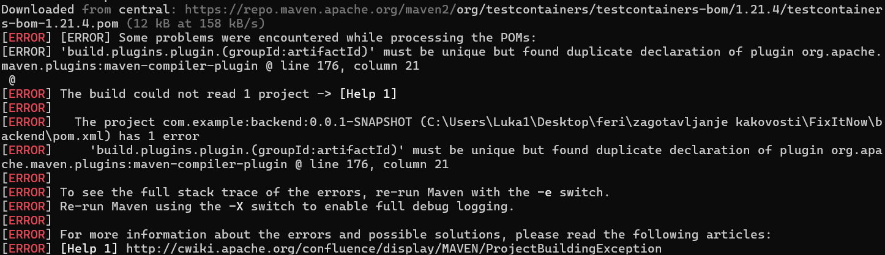
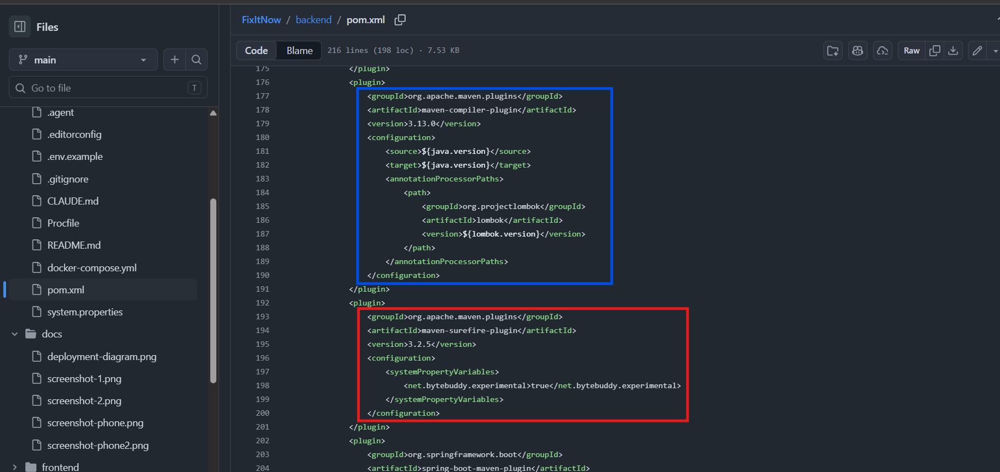
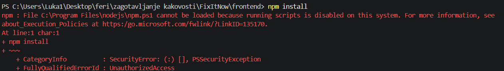
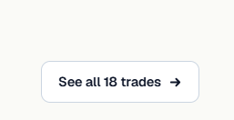
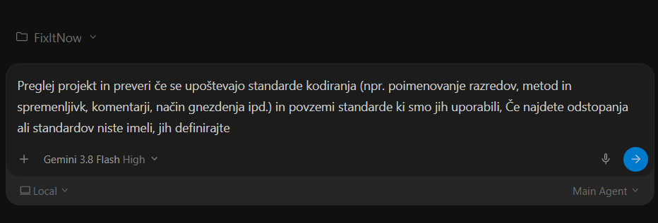

# Naloga 1

Ko smo pognali zaledje aplikacije s komando: `mvn spring-boot:run` smo dobili naslednji error:

To se je zgodilo, ker pom.xml datoteka vsebuje dvojno definicijo istega groupId-ja:

Ko smo to popravili se je zaledje uspešno zagnalo.

Ko smo pognali frontend `npm install` ukaz smo dobili naslednji error, vendar to ni napaka z aplikacijsko kodo vendar z windows sistemom, na katerem smo pognali ukaz, ko smo dodelili ustrezne pravice na windows sistemu, je ukaz deloval normalno:

Če poizkusimi zdaj uporabljati aplikacijo vidimo, da dobivamo CORS težave, saj je še en problem z default port od frontenda, v backendu je nastavljen na 3000, react pa začne na 5173. Ob popravkih tega zdaj spletna aplikacija deluje, le da je brez podatkov.

Ena težava kar smo jo opazili, zdaj ko nima baza nič podatkov je da smo pozabili en statičen tekst zamenjati za dinamičnega:

---

# Standardi kodiranja

## Pregled in poročilo o standardih kodiranja v projektu FixItNow

V sklopu analize projekta smo preverili obstoj dokumentacije standardov, definirali standarde kodiranja, analizirali njihovo doslednost v kodi ter identificirali odstopanja in dobre prakse.

---

### 1. Pregled obstoječih standardov v projektu

Pred analizo smo preučili, ali so v repozitoriju standardi kodiranja že kje formalno dokumentirani:
- **Formalni dokument standardov:** V projektu **ni bilo enotnega, samostojnega dokumenta** (npr. `CODING_STANDARDS.md`), ki bi ekipi predpisoval celovite standarde kodiranja za zagotavljanje kakovosti.
- **Interna navodila (`CLAUDE.md` datoteke):** V datotekah `CLAUDE.md`, `backend/CLAUDE.md` in `frontend/CLAUDE.md` so bila zapisana ključna arhitekturna pravila, konvencije poimenovanja plasti (DTO, storitve, krmilniki, domena) ter varnostne zahteve.
- **Konfiguracija stila (`.editorconfig`):** V obeh delih projekta (`backend/.editorconfig` in `frontend/.editorconfig`) so določena pravila formatiranja: nabor znakov UTF-8, zaključki vrstic LF, odstranjevanje odvečnih presledkov, zamiki (4 presledki za Javo, 2 za TypeScript/JSON) ter omejitev dolžine vrstice na 120 znakov v zaledju.
- **Statična analiza na odjemalcu (`eslint.config.js`):** Za spletni del je konfiguriran ESLint s pravili za TypeScript, React Hooks in Vite.
- **Zaledje (Maven):** V `backend/pom.xml` **ni bilo vključenega orodja za statično analizo kode** (kot sta Checkstyle ali Spotless), kar pomeni, da se standardi stila na zaledju niso avtomatsko preverjali med prevajanjem.

---

### 2. Definicija standardov kodiranja za projekt FixItNow

Ker projekt ni imel samostojne formalne specifikacije, smo na podlagi uveljavljenih dobrih praks za uporabljeni tehnološki sklad (Java 21 / Spring Boot 3 ter React 19 / TypeScript) definirali naslednje standarde:

#### 2.1 Konvencije poimenovanja (Naming Conventions)

| Element | Konvencija | Primer Backend | Primer Frontend |
| :--- | :--- | :--- | :--- |
| **Razredi / Komponente** | `PascalCase` samostalnik | `TicketController`, `ChatRateLimiter` | `TicketCard`, `LoginForm` |
| **Vmesniki (Interfaces)** | `PascalCase` brez predpone `I` | `TicketService`, `UserRepository` | `interface AuthState` |
| **Metode in funkcije** | `camelCase`, glagolski začetek | `createTicket()`, `findByEmail()` | `fetchTickets()`, `formatDate()` |
| **React Hooks** | `camelCase` s predpono `use` | / | `useTicketsQuery`, `useAuth` |
| **Spremenljivke in polja**| `camelCase` brez madžarske notacije | `customerEmail`, `ticketStatus` | `isPending`, `selectedDate` |
| **Konstante** | `SCREAMING_SNAKE_CASE` | `MAX_LENGTH`, `DEFAULT_PAGE_SIZE` | `API_BASE_URL` |
| **Enumi** | Tip `PascalCase`, vrednosti `SCREAMING_SNAKE_CASE` | `TicketStatus.IN_PROGRESS` | `UserRole.PROVIDER` |
| **Paketi in mape** | Male črke, brez podčrtajev | `com.example.backend.service` | `src/components/common` |
| **Datoteke** | Skladno z elementom, ki ga vsebujejo | `TicketServiceImpl.java` | Komponente: `PascalCase.tsx`, Pomožne: `camelCase.ts` |
| **REST poti** | `kebab-case` (pri večbesednih virih in akcijah), množinski samostalniki, verzije | `/api/v1/saved-providers`, `/api/v1/auth/confirm-email` | / |

#### 2.2 Oblikovanje kode (Code Formatting & Nesting)
- **Zamiki (Indentation):** 4 presledki za Java kodo, 2 presledka za TypeScript/JSX in konfiguracije. Tabulatorji niso dovoljeni.
- **Dolžina vrstic (Line Length):** Največ 120 znakov. Daljše stavke, veriženje metod ali dolge JSX lastnosti je potrebno prelomiti v več vrstic.
- **Oklepaji (Braces):** K&R stil – odprti zaviti oklepaj `{` stoji v isti vrstici kot deklaracija ali pogoj.
- **Gnezdenje (Nesting Depth):** Izogibanje gnezdenju globlje od 3–4 nivojev. Zahteva se uporaba vzorca zgodnjega izhoda (*guard clauses* / *early return*), namesto globoko gnezdenih `if-else` stavkov.

#### 2.3 Komentiranje in dokumentacija
- **Dokumentacijski komentarji:** Vsi javni API krmilniki, servisni vmesniki in kompleksnejša poslovna logika morajo imeti `JavaDoc` oziroma `TSDoc` komentarje z opisom namena, parametrov in izjem.
- **Namen komentarjev:** Komentarji morajo razlagati *razloge* in ozadje odločitev ("zakaj"), ne pa dobesednega prepisa delovanja kode ("kaj").
- **Čistoča repozitorija:** Zakomentirana "mrtva" koda ni dovoljena; za sledenje zgodovini se uporablja sistem Git.

#### 2.4 Arhitekturna in strukturna pravila
- **Krmilniki (Controllers):** Sprejmejo zahtevo, validirajo vnos z `@Valid`, delegirajo klic točno eni servisni metodi ter vrnejo `ResponseEntity`. Poslovna logika in neposredni klici repozitorijev v krmilnikih niso dovoljeni.
- **DTO vzorec:** JPA entitete nikoli ne prečkajo meje krmilnika; uporabljajo se namenski DTO objekti (`*Request`, `*Response`).
- **Injekcija odvisnosti:** Zahtevana je konstruktorska injekcija (preko Lombok `@RequiredArgsConstructor`). Uporaba `@Autowired` na poljih razreda je prepovedana.
- **Tipizacija:** V TypeScriptu je prepovedana raba tipa `any`; vsi tipi morajo biti eksplicitno določeni.

---

### 3. Analiza upoštevanja standardov in ugotovljena odstopanja

Opravili smo statično analizo celotne kode (167 Java datotek z 10.933 vrsticami in 217 TypeScript/TSX datotek s 25.468 vrsticami).

#### 3.1 Kje smo se standardov dosledno držali:
1. **Doslednost poimenovanja:**
   - Vsi Java razredi (100 %) dosledno sledijo `PascalCase`.
   - Vse Java metode (100 %) in funkcije na frontendu dosledno sledijo `camelCase`.
   - Vse React komponente (razen ene izjeme spodaj) sledijo `PascalCase`.
   - Vsi React hooki imajo predpono `use` (npr. `useTicketsQuery`).
2. **Konstruktorska injekcija (Dependency Injection):**
   - V celotnem zaledju je **0 primerov** nevarne injekcije polj (`@Autowired`). Povsod je uporabljena konstruktorska injekcija s pomočjo `@RequiredArgsConstructor`.
3. **Stroga tipizacija v TypeScriptu:**
   - Vseh 25.468 vrstic TypeScript kode ima **0 primerov uporabe `any`**, kar dokazuje izredno visoko raven tipske varnosti in discipline pri razvoju odjemalca.
4. **Enosmerna večnivojska arhitektura:**
   - Krmilniki ne komunicirajo neposredno z bazo, entitete se ne izpostavljajo v REST odgovorih, temveč se preslikujejo preko namenskih DTO razredov.

#### 3.2 Ugotovljena odstopanja:
1. **Izjema pri poimenovanju datotek v frontendu:**
   - Komponenta `frontend/src/components/confirm-email-card.tsx` je poimenovana v `kebab-case`, medtem ko vse ostale komponente uporabljajo `PascalCase` (`ConfirmEmailCard.tsx`).
2. **Preseganje dolžine vrstice (več kot 120 znakov):**
   - V zaledju je **84 vrstic**, ki presegajo 120 znakov (predvsem kompleksnejše JPQL poizvedbe in dolge anotacije).
   - Na frontendu je **764 vrstic** daljših od 120 znakov – gre predvsem za dolge sezname Tailwind CSS razredov v JSX elementih, ki niso bili prelomljeni v več vrstic.
3. **Globoko gnezdenje stavkov:**
   - V zaledju je bilo identificiranih **362 blokov kode** z gnezdenjem na 5 ali več nivojih (zlasti pri kompleksnih preverjanjih urnikov v koledarju in lambdah).
4. **Nizka gostota dokumentacijskih komentarjev:**
   - Delež komentarjev v zaledju znaša **6,9 %** (179 JavaDoc blokov na 167 datotek), na frontendu pa zgolj **2,8 %**. Javni DTO-ji in številne servisne metode nimajo formalnih opisov parametrov.
5. **Paketno poimenovanje zaledja:**
   - Uporablja se privzeto ogrodno poimenovanje `com.example.backend` namesto domensko specifičnega paketa (npr. `si.um.feri.fixitnow`).
6. **Podvojene konfiguracijske datoteke:**
   - Na frontendu sočasno obstajata `eslint.config.js` in `eslint.config.ts`.
   - V `backend/pom.xml` je bil vtičnik `maven-compiler-plugin` deklariran dvakrat (kar je povzročilo začetno napako pri zagonu).
7. **Pomanjkljivosti v CI/CD cevovodu:**
   - V GitHub Actions delotokih (`backend.yml` in `frontend.yml`) se testi izvajajo z nastavitvijo `continue-on-error: true`, prav tako pa cevovoda ne vsebujeta koraka za avtomatizirano preverjanje stila kode (linter).
8. **Odstopanja pri REST končnih točkah (Path variables in verzije):**
   - Pri večbesednih segmentih se sicer uporablja `kebab-case` (npr. `/saved-providers`, `/confirm-email`), vendar pa spremenljivke poti (Path variables) uporabljajo `camelCase` znotraj parametrov: `{ticketId}`, `{chatRoomId}`, `{providerId}`, `{blockId}` namesto enotnega `{id}`.
   - Nekonsistentnost pri verziranju: krmilniki `AdminController`, `AuthController` in `UserController` uporabljajo predpono `/api/v1/...`, medtem ko `TicketController` (`/api/tickets`), `ChatController` (`/api/chat`) in `NotificationController` (`/api/notifications`) tečejo pod `/api/...` brez verzije.

---

### 4. Pregled dobrih inženirskih praks v projektu

Poleg upoštevanja standardov projekt izkazuje številne napredne inženirske prakse:

1. **Centralizirano obravnavanje napak (Global Exception Handling):**
   - Vpeljan je `GlobalExceptionHandler` (`@RestControllerAdvice`), ki prestreže napake in jih enotno strukturira v format `ErrorResponse` z ločenim zemljevidom napak po posameznih poljih (`fieldErrors`).
2. **Validacija podatkov na vstopu:**
   - Uporaba Jakarta Validation anotacij (`@NotNull`, `@NotBlank`, `@Size`, `@Email`) na vhodnih DTO-jih v kombinaciji z `@Valid` v krmilnikih. Na frontendu se za validacijo uporablja knjižnica Zod.
3. **Nadzorovano upravljanje baze podatkov z migracijami (Flyway):**
   - Vse spremembe baze tečejo preko verzijskih skript (`V1__...`). Hibernate ima nastavljeno `ddl-auto: validate`, kar preprečuje samodejno spreminjanje strukture podatkovne baze brez revizije.
4. **Varnostni mehanizmi:**
   - Varno zgoščevanje gesel z algoritmom BCrypt.
   - Brezstanjna avtentikacija z JWT in varnim mehanizmom rotacije osvežitvenih žetonov (Refresh Tokens).
   - Integrirana dvofaktorska avtentikacija (TOTP).
   - Skrivnosti (JWT ključi, gesla baze, API ključi) se prebirajo izključno iz okoljskih spremenljivk (`.env`) in niso del izvorne kode.
5. **Ločitev stanja in preslikava podatkov na odjemalcu:**
   - Uporaba TanStack Query za upravljanje strežniškega predpomnilnika.
   - Vzpostavljena jasna plast preslikovalnikov (`mappers/`), ki pretvarja omrežne DTO oblike v domenske modele aplikacije, s čimer je uporabniški vmesnik zaščiten pred neposrednimi spremembami API-ja.

---

### 5. Predlogi ukrepov za izboljšanje kakovosti (QA)

Za nadaljnje zagotavljanje kakovosti projekta predlagamo naslednje ukrepe:
1. **Avtomatizacija preverjanja stila v zaledju:** V `backend/pom.xml` vključiti `maven-checkstyle-plugin` ali `spotless-maven-plugin` z vnaprej definiranim pravilnikom Google Java Style.
2. **Vključitev statične analize v CI/CD:** V GitHub Actions dodati koraka `mvn checkstyle:check` in `npm run lint` ter odstraniti `continue-on-error: true` pri izvajanju testov.
3. **Čiščenje podvojitev:** Odstraniti odvečni `eslint.config.ts` (obdržati `eslint.config.js`) ter preimenovati `confirm-email-card.tsx` v `ConfirmEmailCard.tsx`.
4. **Povečanje testne pokritosti:** Glede na obseg 167 razredov v zaledju razširiti zbirko 22 obstoječih testnih razredov s testi enot in integracijskimi testi za ključne poslovne servise.

