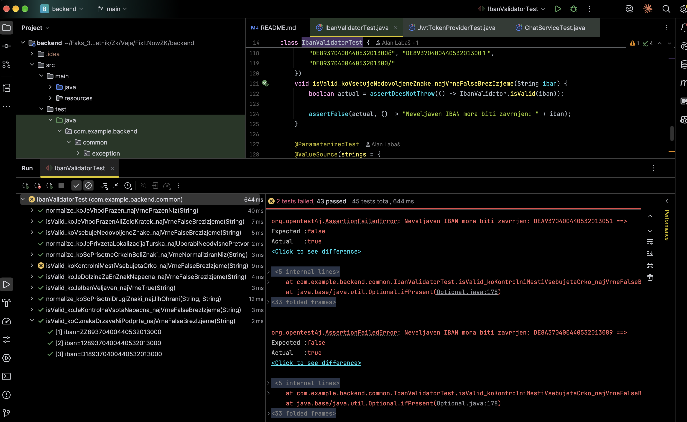
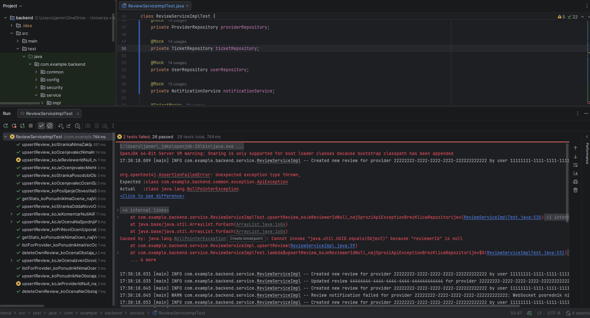

# Poročilo – Naloga 2: Testiranje enot

## Enota 1: `NotificationController`

### 1. Utemeljitev izbire in specifikacija delovanja

**Utemeljitev izbire in izvor obvestil v arhitekturi:**
Razred `NotificationController` predstavlja REST API vstopno točko (`/api/notifications`) za branje in upravljanje uporabniških obvestil v aplikaciji. Sama obvestila (`Notification`) se ne ustvarjajo preko javne REST končne točke, temveč interno v storitvenem sloju v razredu `NotificationServiceImpl` (v metodah `createTicketScoped` in `notifyNewMessage`), kjer se preverijo uporabniške nastavitve (`isEnabled`), 2-minutno okno za preprečevanje podvajanja (`isRecentDuplicate`), agregacija sporočil klepeta (`aggregateCount`) ter pošiljanje preko WebSocketa (`broadcast`). Ustvarjanje obvestil sprožajo ostale storitve ob domenskih dogodkih:
- `TicketService` (`notifyInboundRequest`, `notifyPaymentReceived`, `notifyTicketStatusChange`),
- `ChatServiceImpl` (`notifyNewMessage`),
- `ReviewServiceImpl` (`notifyReviewReceived`),
- `TrackingService` (`notifyProviderNearby`).

**Specifikacija delovanja:**
Vse končne točke v `NotificationController` zahtevajo avtenticiranega uporabnika (`@PreAuthorize("isAuthenticated()")`). Krmilnik mora pri vsakem klicu **preveriti identiteto in `userId` (`UUID`) prijavljenega uporabnika** iz objekta `UserPrincipal` (`userDetails.getUser().getId()`) – preveriti mora, da prijavljeni uporabnik in njegov `userId` obstajata (nista `null`), ter zagotoviti, da se v storitveni sloj vedno posreduje točno ta `userId`, s čimer se prepreči dostop do obvestil drugih uporabnikov:

1. **`GET /api/notifications` (`list`):**
   - **Namen:** Vrne seznam obvestil prijavljenega uporabnika.
   - **Pričakovano delovanje:** Preveri `userId` prijavljenega uporabnika, pokliče `notificationService.getNotifications(userId)` s točno tem `UUID` in vrne status `200 OK` ter JSON seznam objektov `NotificationResponse` z vsemi pripadajočimi polji (`id`, `type`, `title`, `body`, `titleKey`, `bodyKey`, `params`, `ticketId`, `chatRoomId`, `aggregateCount`, `read`, `createdAt`).
   - **Robni primeri:** Če uporabnik nima obvestil, vrne `200 OK` in prazen JSON seznam `[]`.

2. **`GET /api/notifications/unread-count` (`unreadCount`):**
   - **Namen:** Vrne število neprebranih obvestil prijavljenega uporabnika.
   - **Pričakovano delovanje:** Preveri `userId` prijavljenega uporabnika, pokliče `notificationService.getUnreadCount(userId)` za ta `userId` in vrne status `200 OK` ter JSON objekt `{"count": <število>}`.
   - **Robni primeri:** Ob 0 neprebranih obvestilih vrne `{"count": 0}`; pravilno obravnava tudi velike vrednosti tipa `Long`.

3. **`PUT /api/notifications/{id}/read` (`markRead`):**
   - **Namen:** Označi posamezno obvestilo z danim `id` kot prebrano za prijavljenega uporabnika.
   - **Pričakovano delovanje:** Preveri `userId` prijavljenega uporabnika ter pokliče `notificationService.markAsRead(id, userId)` z natančno podanim `id` iz poti in preverjenim `userId` prijavljenega uporabnika, nato vrne `200 OK` z JSON odgovorom `{"success": true}`.
   - **Neveljavni vhodi in izjeme:**
     - Če `{id}` v poti ni veljavno celo število (npr. `/api/notifications/abc/read`), mora krmilnik zavrniti zahtevo s statusom `400 Bad Request` brez klica storitve.
     - Če `userId` prijavljenega uporabnika ne ustreza lastniku obvestila in storitev proži `AccessDeniedException` (ali drugo izjemo), zahteva ne sme vrniti `200 OK`.

4. **`PUT /api/notifications/read-all` (`markAllRead`):**
   - **Namen:** Označi vsa obvestila prijavljenega uporabnika kot prebrana.
   - **Pričakovano delovanje:** Preveri `userId` prijavljenega uporabnika, točno enkrat pokliče `notificationService.markAllAsRead(userId)` s tem `userId` in vrne status `200 OK` z JSON odgovorom `{"success": true}`.

5. **`DELETE /api/notifications` (`deleteAll`):**
   - **Namen:** Trajno izbriše vsa obvestila prijavljenega uporabnika.
   - **Pričakovano delovanje:** Preveri `userId` prijavljenega uporabnika, točno enkrat pokliče `notificationService.deleteAll(userId)` s tem `userId` in vrne status `200 OK` z JSON odgovorom `{"success": true}`.
   - **Izjeme ob neveljavnem uporabniku / `userId`:** Če `UserPrincipal`, `User` ali uporabnikov `userId` manjka (`null`) oziroma storitev vrže izjemo, klic ne sme uspeti s `200 OK`.

---

### 2. Analiza obstoječih testov (`NotificationControllerTest`) – zakaj so pomanjkljivi

Obstoječi testi v razredu `NotificationControllerTest` so pomanjkljivi, saj **so bili izpeljani neposredno iz obstoječe implementacije kode in ne iz specifikacije zahtev**:

- **Testiranje zgolj trenutne implementacije ("happy path"):** Vseh 5 testov preverja le osnovni scenarij uspešnega klica (HTTP 200 OK) z vnaprej pripravljenim lažnim odgovorom, ki zgolj zrcali trenutno napisano kodo krmilnika.
- **Odsotnost preverjanja dejanskih klicev storitve (`verify`):** Pri metodah `markRead`, `markAllRead` in `deleteAll` testi nastavijo `doNothing().when(notificationService)...` in preverijo le statični odgovor `{"success": true}`, ki ga krmilnik vrne v vsakem primeru. Če v krmilniku izbrišemo klic metode `notificationService`, obstoječi testi še vedno uspejo (lažno pozitivni testi).
- **Nepopolno preverjanje izhodnih podatkov:** Test `listNotificationsShouldReturn200` preveri le eno polje (`$[0].title`), ostalih polj objekta `NotificationResponse` (npr. `id`, `type`, `body`, `read`, `aggregateCount`) ter primera praznega seznama obvestil pa sploh ne preveri.
- **Brez robnih primerov, neveljavnih vhodov in izjem:** Testi ne preverjajo obnašanja ob neveljavnem parametru poti (npr. nečrkovni ali negativni `{id}`), ob neprijavljenem uporabniku (`null` principal), niti ob izjemah iz storitvenega sloja (npr. `AccessDeniedException`, ko uporabnik poskuša označiti tuje obvestilo kot prebrano, ali `ResourceNotFoundException`).

---

### 3. Generiranje novih testov na podlagi specifikacije in rezultati zagona

Na podlagi zgornje specifikacije smo z uporabo ogrodja **JUnit 5**, **Spring MockMvc** in **Mockito** (`@Mock`, `@InjectMocks`, `ArgumentCaptor`, `verify`, `verifyNoInteractions`, `verifyNoMoreInteractions`) na novo ustvarili **36 testov enot**, ki so poimenovani po konvenciji `metoda_koJePogoj_najPričakovanRezultat` in razdeljeni v 5 ločenih pod-datotek (po ena za vsako končno točko) v paketu `com.example.backend.web.controller.notification`:
- `NotificationControllerListTest.java` (8 testov)
- `NotificationControllerUnreadCountTest.java` (8 testov)
- `NotificationControllerMarkReadTest.java` (8 testov)
- `NotificationControllerMarkAllReadTest.java` (6 testov)
- `NotificationControllerDeleteAllTest.java` (6 testov)

Ob prvem zagonu novih testov je **31 testov uspelo, 5 testov pa je bilo neuspešnih** (po en test `*_whenPrincipalUserIdIsNull_shouldRejectAndNeverCallService` v vsaki izmed petih datotek). Testi so odkrili, da obstoječa koda v `NotificationController` ne preverja robnega primera, ko je `userDetails.getUser().getId()` enak `null`, temveč posreduje `null` v `NotificationService` in vrne status `200 OK` namesto zavrnitve zahtevka:

---

### 4. Posodobitev CI/CD cevovoda (`.github/workflows/backend.yml`)

V datoteki `.github/workflows/backend.yml` smo:
- Odstranili zastavico `continue-on-error: true` pri koraku `Run tests` (`mvn test`), tako da vsak neuspešen test enot takoj ustavi in označi izvajanje cevovoda kot neuspešno.
- Dodali generiranje in shranjevanje **JaCoCo poročila o pokritosti** (`jacoco-maven-plugin` v `backend/pom.xml` ter koraka `Generate JaCoCo coverage report` in `Upload coverage report artifact` z `actions/upload-artifact@v4` v `.github/workflows/backend.yml`), tako da je poročilo o pokritosti (`target/site/jacoco/`) del rezultatov vsakega zagona cevovoda.
- Zakomentirali korake gradnje produkcijskega paketa in objave na Heroku (`Build JAR`, `Install Heroku CLI`, `Deploy to Heroku`), tako da cevovod izvaja izključno preverjanje s testi enot in pripravo poročila o pokritosti.

---

### 5. Uporaba orodij umetne inteligence (del za `NotificationController`)

- **Uporabljeni model:** Gemini 4 Argon (Medium)
- **Namen uporabe:** Pomoč pri pregledu in posodobitvi CI/CD cevovoda (`.github/workflows/backend.yml`), da se ob neuspešnih testih izvajanje ustavi in se preskoči objava, ter pomoč pri analizi pomanjkljivosti obstoječih testov v `NotificationControllerTest` in zapisu tega dela poročila. Specifikacija delovanja krmilnika je bila napisana ročno, na njeni podlagi pa so bili nato z agentom ponovno generirani izboljšani testi enot.

---

## Enota 2: `IbanValidator`

### 1. Utemeljitev izbire in specifikacija delovanja

**Utemeljitev izbire:**

Razred `IbanValidator` je namenjen normalizaciji in preverjanju veljavnosti
številk IBAN. Izbran je zaradi netrivialne logike, ki vključuje obdelavo
vhodnega niza, preverjanje dovoljenih znakov, preverjanje dolžine glede
na državo in izračun kontrolne vsote MOD-97.

Napačno delovanje lahko povzroči sprejetje neveljavnega ali zavrnitev
veljavnega IBAN-a. Razred nima zunanjih odvisnosti, zato ga lahko
testiramo izolirano, brez baze podatkov in zagona aplikacije.

**Specifikacija delovanja:**

1. **Normalizacija (`normalize`):**
   - Za vhod `null` vrne prazen niz.
   - Odstrani presledke, tabulatorje in prelome vrstic.
   - Male črke pretvori v velike neodvisno od privzete lokalizacije.
   - Drugih znakov ne odstranjuje.
   - Za prazen niz ali niz samih belih znakov vrne prazen niz.
   - Primer: `" gb29 nwbk 6016 1331 9268 19 "` pretvori v
     `"GB29NWBK60161331926819"`.

2. **Preverjanje vhodov in oblike (`isValid`):**
   - Za `null`, prazen niz ali niz samih belih znakov vrne `false`.
   - Vhod pred preverjanjem normalizira, zato sprejme tudi veljavne
     IBAN-e z malimi črkami in presledki.
   - IBAN se mora začeti z dvema črkama podprte države, ki jima
     sledita dve kontrolni števki.
   - Po normalizaciji sme vsebovati samo znake A–Z in 0–9.
   - Nepodprte oznake držav zavrne.
   - Dolžina mora natančno ustrezati državi; za Slovenijo je 19,
     Nemčijo 22 in Veliko Britanijo 22 znakov.
   - Prekratek ali predolg IBAN zavrne.
   - Neveljavni vhodi morajo vrniti `false`, ne sprožiti izjeme.

3. **Preverjanje kontrolne vsote (`isValid`):**
   - Prve štiri znake normaliziranega IBAN-a prestavi na konec.
   - Črke pretvori v številčne vrednosti A = 10, B = 11, …, Z = 35.
   - IBAN sprejme le, če je ostanek dobljenega števila pri deljenju
     z 97 enak 1 in so izpolnjene tudi zahteve glede oblike in dolžine.
   - `DE89370400440532013000` in `GB29NWBK60161331926819` sta
     primera veljavnih vhodov.
   - `DE89370400440532013001` mora zavrniti zaradi napačne
     kontrolne vsote.

### 2. Generiranje testov, vnos napak in analiza pomanjkljivih testov

**Izhodišče in pravila načrtovanja:**

Testiranje smo zasnovali na specifikaciji zahtev (črna škatla), ne na prilagajanju pričakovanj trenutni implementaciji. Upoštevali smo napotke s prosojnic *10_ZK_Testiranje Objava 1*, predvsem strani 21–22 (vnaprej določeni pravilni rezultati, napačni vhodi in zapisnik), 25 (dopustni, nedopustni in mejni vhodi) ter 32 (lastnosti dobrega testa enote). Odkrita odstopanja dokumentiramo; izvorne kode zaradi uspeha testov ne popravljamo.

**Ukaz agentu UI:**

> Na podlagi specifikacije dopolni `IbanValidatorTest` z JUnit 5. Za sorodne primere uporabi parametrizirane teste. Pokrij običajne primere, robne dolžine, neveljavne vhode in zahtevo, da neveljavni vhodi ne sprožijo izjem. Uporabi poimenovanje `metoda_koJePogoj_najPricakovanRezultat`. Vsak test naj preverja eno jasno vedenje in ima razvidno pripravo vhoda, izvedbo ter preverjanje rezultata. Pričakovane rezultate določi vnaprej iz SZ; ne izračunavaj jih s testirano metodo in ne podvajaj algoritma MOD-97. Ne uporabljaj mockov, ker razred nima zunanjih odvisnosti. Testi naj bodo izolirani, deterministični in samodejni. Preglej obstoječe teste ter poročaj o rezultatih. Nato ločeno začasno vnesi dve napaki, po vsaki poženi teste in zapiši rezultate. Obe napaki odstrani in ponovi teste.

**Analiza pomanjkljivih testov in popravki:**

Obstoječih **15 testnih primerov** je ob začetnem zagonu uspelo. Vsebovali so konkretna preverjanja, vendar niso pokrivali celotne SZ:

- **Normalizacija:** Manjkali so tabulatorji, prelomi vrstic, sami beli znaki in ohranjanje drugih znakov. Dodali smo primere z vnaprej določenimi pričakovanimi nizi.
- **Lokalizacija:** Dodali smo primer s turško privzeto lokalizacijo. Prvotna nastavitev se obnovi v bloku `finally`, test pa uporablja `@ResourceLock` za usklajevanje dostopa do nastavitve.
- **Mejne dolžine:** Dodali smo za en znak prekratke in predolge IBAN-e za SI, DE in GB ter veljavne primere pravilnih dolžin.
- **Neveljavni vhodi:** Razširili smo preverjanje oznak držav, nedovoljenih znakov in napačnih kontrolnih vsot.
- **Kontrolni števki:** Dodali smo dva fiksna vhoda s črko na tretjem oziroma četrtem mestu, ki sicer prestaneta MOD-97. Tako zavrnitve ne povzroči že napačna kontrolna vsota.
- **Preglednost:** Sorodne scenarije smo združili v parametrizirane teste. Pri klicih so rezultat in preverjanja zapisani izrecno z lokalno spremenljivko `actual`; pri primerjavah nizov je pričakovana vrednost podana vnaprej. Odstranili smo pomožno metodo, ki je skrivala klic in preverjanje neveljavnih vhodov.

Testi ne dostopajo do zasebnih članov, ne zaganjajo Spring konteksta in ne uporabljajo baze, omrežja ali datotek. Mocki niso potrebni. Vsak parametriziran primer preverja konkretni rezultat. Pri neveljavnih vhodih `assertDoesNotThrow` in `assertFalse` skupaj preverjata pogodbo zavrnitve brez izjeme. Anotacij `@BeforeEach` in `@AfterEach` ne dodajamo brez potrebe, ker validator nima stanja za inicializacijo oziroma čiščenje.

**Rezultati na nespremenjeni izvorni kodi:**

Izvedenih je bilo **45 testnih primerov: 43 uspešnih in 2 neuspešna**, brez napak izvajanja in preskočenih primerov. Oba neuspešna primera pripadata testu `isValid_koKontrolniMestiVsebujetaCrko_najVrneFalseBrezIzjeme`:

| Vhod | Vnaprej pričakovani rezultat po SZ | Dejanski rezultat |
|---|---|---|
| `DEA9370400440532013051` | `false` | `true` |
| `DE8A370400440532013089` | `false` | `true` |

Vhoda imata ustrezno dolžino in prestaneta MOD-97, vendar vsebujeta črko na kontrolnem mestu. Implementacija ne preverja izrecno, ali sta tretji in četrti znak števki. Testa ostajata neuspešna, saj pravilno zaznata odstopanje od SZ. Pričakovanj ne prilagajamo implementaciji in izvorne kode ne popravljamo zaradi uspeha testov.

Agent je v predhodnem koraku neupravičeno dodal preverjanje kontrolnih števk v produkcijsko kodo. Ta popravek je bil odstranjen in `IbanValidator.java` je obnovljen v prvotno stanje. Predhodni uspešni zagon 45/45 zato ni rezultat testiranja končne, nespremenjene implementacije.

**Stanje namernega vnosa napak:**

V predhodnem poskusu sta bili ločeno preizkušeni odstranitev `.toUpperCase(Locale.ROOT)` in sprememba pogoja MOD-97 iz `== 1` v `== 0`. Vsaka je povzročila 7 neuspešnih primerov, vendar sta bila poskusa opravljena na začasno popravljeni osnovi. Dnevnika `iban-napaka-1.log` in `iban-napaka-2.log` sta zgodovinska izpisa tega poskusa in ne predstavljata rezultatov na prvotni osnovi. Za dokazovanje dveh namernih napak na prvotni osnovi je treba ta korak ponoviti kot ločen eksperiment. V trenutni izvorni kodi ni nobene od teh sprememb.

**Zapisnik testiranja:**

Kontekst: lokalni zagon na macOS, Java 25.0.2, Maven 3.9.14 in JUnit 5. Ukaz iz korena projekta: `mvn -f backend/pom.xml -Dtest=IbanValidatorTest test`. Število 45 pomeni izvedene primere, vključno s posameznimi vhodi parametriziranih testov.

| Stanje enote | Pričakovano po SZ | Dobljeni rezultat | Sklep |
|---|---|---|---|
| Prvotna implementacija, dopolnjeni testi | Oba vhoda s črko na kontrolnem mestu sta zavrnjena | 43 uspešnih, 2 neuspešna | Odkrito odstopanje od SZ |
| Končno stanje po obnovitvi izvorne kode | Oba vhoda s črko na kontrolnem mestu sta zavrnjena | 43 uspešnih, 2 neuspešna | Odstopanje ostaja dokumentirano |

**Omejitev preverjanja celotnega projekta:**

Poskus zagona vseh testov z `mvn -f backend/pom.xml test` je izvedel 251 primerov z 0 neuspešnimi preverjanji in 147 napakami izvajanja. Testi drugih enot se niso mogli pravilno izvesti zaradi napake inicializacije Mockito `MockMaker` pri pripenjanju agenta v lokalnem okolju. Zato uspeha 45 primerov validatorja ne enačimo z uspehom celotnega projekta.

**CI in pokritost:**

Obstoječi korak `Run tests` v `.github/workflows/backend.yml` izvaja `mvn test` brez `continue-on-error`, zato se vanj samodejno vključuje tudi `IbanValidatorTest`, neuspešen test pa povzroči neuspeh koraka. Poročilo o pokritosti se generira z vtičnikom `jacoco-maven-plugin` in se v cevovodu naloži kot artefakt `jacoco-coverage-report`.

---

### 3. Uporaba orodij umetne inteligence (del za 2. enoto)

- **Uporabljeno orodje:** OpenAI Codex.
- **Namen uporabe:** Pomoč pri pripravi SZ, analizi obstoječih testov, generiranju in dopolnitvi testov z JUnit 5, prilagoditvi priporočilom profesorjevih prosojnic, analizi odkrite napake, poskusnem namernem vnosu dveh napak, izvedbi testov in pripravi zapisnika ter poročila.
- **Preverjanje kakovosti:** Pričakovanja so bila določena iz SZ pred zagonom. Pregledali smo konkretna preverjanja, robne in neveljavne vhode, neodvisnost testov ter odsotnost podvajanja algoritma v testih. Zaznavanje napak smo preverili z dvema dejanskima začasnima spremembama implementacije. Vse spremembe produkcijske kode so odstranjene. Končni zagon na prvotni implementaciji vsebuje dva neuspešna primera, ki dokumentirata odstopanje od SZ.

---

## Enota 3: `ReviewServiceImpl`

### 1. Utemeljitev izbire in specifikacija delovanja

**Utemeljitev izbire:**
Razred `ReviewServiceImpl` predstavlja storitveno enoto za oddajo, urejanje, branje, izračun statistike in brisanje ocen izvajalcev storitev (`Provider`). Za testiranje enot smo ga izbrali, ker združuje več vrst netrivialne poslovne logike in sodeluje s petimi zunanjimi odvisnostmi (`ReviewRepository`, `ProviderRepository`, `TicketRepository`, `UserRepository`, `NotificationService`), kar zahteva dosledno uporabo nadomestnih objektov (Mockito mockov):
- **Večstopenjske validacije:** Preverjanje veljavnosti identifikatorjev (`reviewerId`, `providerId`), preprečevanje samoocenjevanja (`reviewerId.equals(providerId)`), preverjanje mejnih vrednosti ocene (`1 <= rating <= 5`), preverjanje obstoja izvajalca ter poslovnega pogoja, da ima stranka pri izbranem izvajalcu vsaj en zaključen zahtevek (`TicketStatus.COMPLETED`).
- **Pogojna logika ("upsert" in varno obveščanje):** Metoda `upsertReview` razveji izvajanje glede na to, ali ocena za par `(reviewerId, providerId)` že obstaja (posodobitev obstoječega zapisa brez ponovnega iskanja uporabnika in brez pošiljanja obvestila) ali gre za novo oceno (ustvarjanje novega zapisa in klic `notificationService.notifyReviewReceived`). Pri pošiljanju obvestila in preslikavi v `ReviewResponse` se upošteva prikazno ime uporabnika (`displayName()` – vključno z maskiranjem mehko izbrisanih uporabnikov v `"Former Customer"` in nadomestnim e-poštnim naslovom, ko ime/priimek manjkata), morebitna izjema `RuntimeException` pri obveščanju pa se ujame, da ne prekine oddaje ocene.
- **Izračun in pogojna agregacija (`getStats`):** Metoda preveri število ocen izvajalca (`countByProviderId`) in samo v primeru `count > 0` izračuna povprečno oceno (`averageRatingByProviderId`), medtem ko ob `count == 0` vrne `averageRating = null` brez nepotrebnega klica poizvedbe za povprečje.

**Specifikacija delovanja:**

1. **Oddaja ali posodobitev ocene (`upsertReview(UUID reviewerId, UUID providerId, CreateReviewRequest request)`):**
   - **Preverjanje vhodov:**
     - Če je `reviewerId == null`, `providerId == null` ali `request == null`, mora metoda zavrniti klic z `ApiException` brez klicev v repozitorije ali storitev obveščanja.
     - Če je `reviewerId.equals(providerId)`, sproži `ApiException("You cannot review yourself.")` brez klicev v repozitorije.
     - Če je `request.getRating() < 1` ali `request.getRating() > 5`, sproži `ApiException("Rating must be between 1 and 5.")` brez klicev v repozitorije. Mejni vrednosti `1` in `5` sta veljavni.
   - **Preverjanje obstoja izvajalca in upravičenosti:**
     - Če izvajalec z danim `providerId` ne obstaja (`providerRepository.findById` vrne `Optional.empty()`), sproži `ResourceNotFoundException("Provider not found.")` in ne kliče ostalih repozitorijev.
     - Preveri, ali ima stranka (`reviewerId`) pri izvajalcu (`providerId`) vsaj en zahtevek v stanju `TicketStatus.COMPLETED`. Če ga nima, sproži `ApiException("You can leave a review only after a completed ticket with this provider.")` in ne shranjuje ocene.
   - **Ustvarjanje nove ocene (ko zapis v `reviewRepository` še ne obstaja):**
     - Poišče ocenjevalca (`userRepository.findById(reviewerId)`). Če ne obstaja, sproži `ResourceNotFoundException("User not found.")`.
     - Ustvari in shrani nov objekt `Review` s podanim `reviewer`, `provider`, `rating` in `comment`.
     - Pošlje obvestilo izvajalcu s klicem `notificationService.notifyReviewReceived(providerId, "New review", "<displayName> left you a <rating>★ review.", "notifications.review.title", "notifications.review.body", Map.of("reviewerName", "<displayName>", "rating", "<rating>"))`.
     - Če `notificationService.notifyReviewReceived` vrže `RuntimeException`, mora storitev izjemo ujeti in kljub temu vrniti veljaven `ReviewResponse`.
   - **Posodobitev obstoječe ocene (ko zapis že obstaja):**
     - Posodobi `rating` in `comment` na obstoječem objektu `Review` ter ga shrani.
     - Ne kliče `userRepository.findById` in **ne pošlje** ponovnega obvestila (`notificationService.notifyReviewReceived` se ne sme poklicati).
   - **Izhod (`ReviewResponse`):**
     - Vrne polno izpolnjen `ReviewResponse` (`id`, `providerId`, `reviewerId`, `reviewerName`, `reviewerProfilePictureUrl`, `rating`, `comment`, `createdAt`, `updatedAt`). Če je ocenjevalec mehko izbrisan (`deleted = true`), mora biti `reviewerName` enak `"Former Customer"` in `reviewerProfilePictureUrl` enak `null`. Če sta ime in priimek prazna, se kot `reviewerName` uporabi `email`.

2. **Seznam ocen izvajalca (`listForProvider(UUID providerId)`):**
   - Pokliče `reviewRepository.findAllByProviderIdOrderByCreatedAtDesc(providerId)` in vrne seznam preslikanih objektov `ReviewResponse` v istem vrstnem redu. Če ocen ni, vrne prazen seznam `[]`.

3. **Statistika ocen izvajalca (`getStats(UUID providerId)`):**
   - Če je `countByProviderId(providerId) > 0`, pokliče `averageRatingByProviderId(providerId)` in vrne `ProviderRatingStats` z `providerId`, `reviewCount` in `averageRating`.
   - Če je `countByProviderId(providerId) == 0`, vrne `reviewCount = 0` in `averageRating = null`, pri čemer **ne sme poklicati** `averageRatingByProviderId`.

4. **Brisanje lastne ocene (`deleteOwnReview(UUID reviewerId, UUID providerId)`):**
   - Poišče oceno prek `findByReviewerIdAndProviderId(reviewerId, providerId)`. Če obstaja, pokliče `reviewRepository.delete(review)`. Če ne obstaja, ne sproži izjeme in ne pokliče `delete`.

---

### 2. Analiza pomanjkljivih testov, generiranje novih testov in namerni vnos napak

**Analiza obstoječih testov (`ReviewServiceImplTest`) – zakaj so bili pomanjkljivi:**

Prvotni razred `ReviewServiceImplTest` je vseboval 12 testov, ki so vsi uspeli, vendar so imeli več kritičnih pomanjkljivosti:
- **Prepisovanje pričakovane vrednosti iz lažnega odgovora namesto preverjanja dejansko shranjenega objekta:** V testu `upsertReviewShouldCreateNewReview` je bil nastavljen `when(reviewRepository.save(any())).thenReturn(savedReview)`, kjer je bil `savedReview` ročno sestavljen v testu z oceno `5`, nato pa je test preveril le `assertEquals(5, resp.getRating())`. Test sploh ni preveril (npr. z `ArgumentCaptor<Review>`), kaj je metoda `upsertReview` dejansko posredovala v `reviewRepository.save(...)`. Če bi produkcijska koda v bazo shranila `rating = 1` ali `comment = null`, bi test še vedno uspel.
- **Ohlapno preverjanje klicev nadomestnih objektov (`any()`):** Klic `verify(notificationService).notifyReviewReceived(any(), any(), any(), any(), any(), any())` je uporabil šest splošnih ujemalnikov `any()`, zato ni preveril, ali se obvestilo pošlje pravemu izvajalcu (`providerId`), s pravilnim imenom ocenjevalca in pravilno oceno.
- **Ignoriranje vrnjenih vrednosti in stranskih učinkov:**
  - `upsertReviewShouldUpdateExistingReview` je ignoriral vrnjeni `ReviewResponse`, ni preveril posodobitve komentarja (`existing.getComment()`), niti ni preveril, da je bil klican `reviewRepository.save(existing)`.
  - `listForProviderShouldReturnMappedList` je preveril zgolj `assertEquals(1, result.size())`, nobenega polja objekta `ReviewResponse` pa ni preveril.
  - `getStatsShouldReturnNullAverageWhenNoReviews` ni preveril `providerId` niti tega, da se ob 0 ocenah ne kliče `averageRatingByProviderId`.
- **Manjkajoči robni primeri, neveljavni vhodi in izjeme:** Manjkali so testi za mejni oceni `1` in `5`, prazen/`null` komentar, maskiranje mehko izbrisanega ocenjevalca (`deleted = true`), ocenjevalca brez imena/priimka, neobstoječega uporabnika (`ResourceNotFoundException("User not found.")`), odpornost na izjemo `RuntimeException` iz `NotificationService` ter preverjanje `null` vhodnih identifikatorjev (`reviewerId`, `providerId`).

**Ukaz agentu UI:**

> Z ogrodjem JUnit 5 in knjižnico Mockito (`@ExtendWith(MockitoExtension.class)`, `@Mock`, `@InjectMocks`, `ArgumentCaptor`, `verify`, `verifyNoInteractions`, `never()`) na podlagi specifikacije dopolni in prenovi enotne teste v `ReviewServiceImplTest`. Uporabi način poimenovanja `metoda_koJePogoj_najPricakovanRezultat`. Pokrij:
> 1. običajne primere (ustvarjanje nove ocene s preverjanjem vseh polj shranjenega `Review` prek `ArgumentCaptor` in vseh argumentov `notifyReviewReceived`, posodobitev obstoječe ocene brez ponovnega obveščanja, izpis seznama ocen, izračun statistike, brisanje ocene),
> 2. robne vrednosti (parametriziran test za mejni oceni 1 in 5, `null` in prazen komentar, mehko izbrisan ocenjevalec, ocenjevalec s praznim imenom/priimkom, prazen seznam ocen, statistika ob 0 ocenah brez klica `averageRatingByProviderId`, brisanje neobstoječe ocene),
> 3. neveljavne vhode in izjeme (samoocenjevanje, parametriziran test za ocene izven obsega `{Integer.MIN_VALUE, -5, -1, 0, 6, 10, Integer.MAX_VALUE}`, neobstoječ izvajalec, odsotnost zaključenega zahtevka, neobstoječ uporabnik, ujetje `RuntimeException` pri odpovedi `NotificationService` ter `null` vrednosti za `reviewerId` in `providerId`).
> Nato poženi teste, v `ReviewServiceImpl` začasno in ločeno vnesi dve napaki, preveri, ali ju testi zaznajo, zapiši rezultate ter povrni izvorno kodo v prvotno stanje.

**Rezultati zagona na nespremenjeni izvorni kodi:**

Prenovljeni testni razred `ReviewServiceImplTest` obsega **28 izvedenih testnih primerov** (18 testnih metod, od tega 3 parametrizirane). Ob zagonu na nespremenjeni izvorni kodi z ukazom `mvn -f backend/pom.xml -Dtest=ReviewServiceImplTest test` je **26 testnih primerov uspelo, 2 pa sta bila neuspešna**:

| Testni primer | Pričakovano po specifikaciji | Dejanski rezultat na nespremenjeni kodi |
|---|---|---|
| `upsertReview_koJeReviewerIdNull_najSproziApiExceptionBrezKlicaRepozitorijev` | Sproži `ApiException` brez klicev v repozitorije | Sproži neobravnavan `NullPointerException` v vrstici `if (reviewerId.equals(providerId))` |
| `upsertReview_koJeProviderIdNull_najSproziApiExceptionBrezKlicaRepozitorijev` | Sproži `ApiException` brez klicev v repozitorije | Pokliče `providerRepository.findById(null)` in sproži `ResourceNotFoundException` |

Testa razkrijeta, da `ReviewServiceImpl.upsertReview` ne validira vhodnih parametrov `reviewerId` in `providerId` na `null` pred izvajanjem poslovne logike in poizvedb v bazo.

**Preizkus zaznavanja napak – namerni vnos dveh napak v `ReviewServiceImpl`:**

Da smo preverili občutljivost testov na napake v poslovni logiki, smo v `ReviewServiceImpl.java` ločeno vnesli dve namerni napaki in po vsaki pognali testni nabor:

1. **Namerna napaka 1 (Napaka mejnih vrednosti pri validaciji ocene – "off-by-one"):**
   - **Sprememba v kodi:** V metodi `upsertReview` smo pogoj `if (request.getRating() < 1 || request.getRating() > 5)` spremenili v `if (request.getRating() <= 1 || request.getRating() >= 5)`, tako da storitev napačno zavrne tudi veljavni mejni oceni `1` in `5`.
   - **Rezultat zagona testov:** Od 28 testnih primerov je bilo **11 neuspešnih** (`Tests run: 28, Failures: 4, Errors: 7`). Padla sta oba primera parametriziranega mejnega testa `upsertReview_koJeOcenaNaSpodnjiAliZgornjiMeji_najUspesnoShraniOceno` (za vhoda `1` in `5`) ter vsi testi, ki uporabljajo oceno `5`.

2. **Namerna napaka 2 (Napačna pogojna logika obveščanja ob oddaji/posodobitvi ocene):**
   - **Sprememba v kodi:** V metodi `upsertReview` smo pogoj `if (isNew)` pred klicem `notifyProviderOfReview(...)` obrnili v `if (!isNew)`, tako da se obvestilo izvajalcu ne pošlje ob novi oceni, temveč ob posodobitvi obstoječe ocene.
   - **Rezultat zagona testov:** Od 28 testnih primerov je bilo **8 neuspešnih** (`Tests run: 28, Failures: 8, Errors: 0`). Padli so vsi testi ustvarjanja nove ocene, ki z `verify(notificationService).notifyReviewReceived(...)` preverjajo pošiljanje obvestila, ter test posodobitve `upsertReview_koStrankaPosodobiObstojecoOceno_najPosodobiOcenoInKomentarBrezNovegaObvestila`, ki z `verifyNoInteractions(notificationService)` zahteva, da se ob urejanju ocene obvestilo ne pošlje.

Po preizkusu smo obe namerni napaki odstranili in `ReviewServiceImpl.java` povrnili v prvotno stanje.

**Pokritost kode (JaCoCo):**
Po zagonu `ReviewServiceImplTest` vtičnik `jacoco-maven-plugin` (`0.8.14`) v `backend/target/site/jacoco/` izpiše naslednjo pokritost za razred `ReviewServiceImpl`:
- **Vrstična pokritost (Lines):** `59 / 59` (**100,0 %**)
- **Pokritost metod (Methods):** `8 / 8` (**100,0 %**)
- **Pokritost ukazov (Instructions):** `213 / 214` (**99,5 %**)
- **Pokritost vej (Branches):** `15 / 16` (**93,8 %**)

---

### 3. Uporaba orodij umetne inteligence (del za `ReviewServiceImpl`)

- **Uporabljeni model:** Gemini 4 Argon (Medium) (v okolju Antigravity IDE).
- **Namen uporabe:** Analiza pomanjkljivosti obstoječih testov v `ReviewServiceImplTest`, generiranje razširjenega nabora 28 testnih primerov z JUnit 5 in Mockito na podlagi specifikacije delovanja, izvedba eksperimenta z namernim vnosom dveh napak v `ReviewServiceImpl`, konfiguracija vtičnika `jacoco-maven-plugin` v `backend/pom.xml` in artefakta poročila o pokritosti v `.github/workflows/backend.yml` ter priprava dokumentacije za 3. enoto v poročilu.
