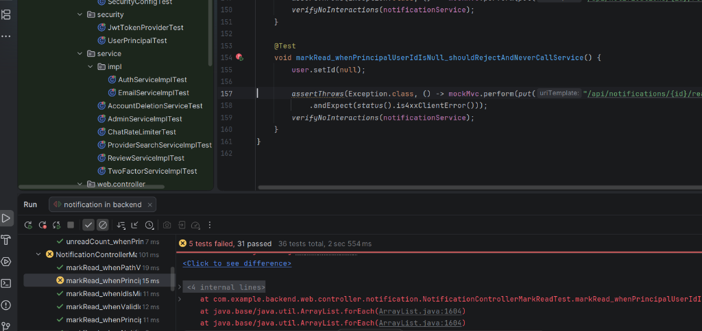

# Poročilo – Naloga 2: Testiranje enot

## Enota 1: `NotificationController`

### 1. Utemeljitev izbire in specifikacija delovanja

**Utemeljitev izbire in izvor obvestil v arhitekturi:**
Razred `NotificationController` predstavlja REST API vstopno točko (`/api/notifications`) za branje in upravljanje uporabniških obvestil v aplikaciji. Sama obvestila (`Notification`) se ne ustvarjajo preko javne REST končne točke, temveč interno v storitvenem sloju v razredu `NotificationServiceImpl` (v metodah `createTicketScoped` in `notifyNewMessage`), kjer se preverijo uporabniške nastavitve (`isEnabled`), 2-minutno okno za preprečevanje podvajanja (`isRecentDuplicate`), agregacija sporočil klepeta (`aggregateCount`) ter pošiljanje preko WebSocketa (`broadcast`). Ustvarjanje obvestil sprožajo ostale storitve ob domenskih dogodkih:
- `TicketService` (`notifyInboundRequest`, `notifyPaymentReceived`, `notifyTicketStatusChange`),
- `ChatServiceImpl` (`notifyNewMessage`),
- `ReviewServiceImpl` (`notifyReviewReceived`),
- `TrackingService` (`notifyProviderNearby`).

**Specifikacija delovanja:**
Vse končne točke v `NotificationController` zahtevajo avtenticiranega uporabnika (`@PreAuthorize("isAuthenticated()")`). Krmilnik mora pri vsakem klicu **preveriti identiteto in `userId` (`UUID`) prijavljenega uporabnika** iz objekta `UserPrincipal` (`userDetails.getUser().getId()`) – preveriti mora, da prijavljeni uporabnik in njegov `userId` obstajata (nista `null`), ter zagotoviti, da se v storitveni sloj vedno posreduje točno ta `userId`, s čimer se prepreči dostop do obvestil drugih uporabnikov:

1. **`GET /api/notifications` (`list`):**
   - **Namen:** Vrne seznam obvestil prijavljenega uporabnika.
   - **Pričakovano delovanje:** Preveri `userId` prijavljenega uporabnika, pokliče `notificationService.getNotifications(userId)` s točno tem `UUID` in vrne status `200 OK` ter JSON seznam objektov `NotificationResponse` z vsemi pripadajočimi polji (`id`, `type`, `title`, `body`, `titleKey`, `bodyKey`, `params`, `ticketId`, `chatRoomId`, `aggregateCount`, `read`, `createdAt`).
   - **Robni primeri:** Če uporabnik nima obvestil, vrne `200 OK` in prazen JSON seznam `[]`.

2. **`GET /api/notifications/unread-count` (`unreadCount`):**
   - **Namen:** Vrne število neprebranih obvestil prijavljenega uporabnika.
   - **Pričakovano delovanje:** Preveri `userId` prijavljenega uporabnika, pokliče `notificationService.getUnreadCount(userId)` za ta `userId` in vrne status `200 OK` ter JSON objekt `{"count": <število>}`.
   - **Robni primeri:** Ob 0 neprebranih obvestilih vrne `{"count": 0}`; pravilno obravnava tudi velike vrednosti tipa `Long`.

3. **`PUT /api/notifications/{id}/read` (`markRead`):**
   - **Namen:** Označi posamezno obvestilo z danim `id` kot prebrano za prijavljenega uporabnika.
   - **Pričakovano delovanje:** Preveri `userId` prijavljenega uporabnika ter pokliče `notificationService.markAsRead(id, userId)` z natančno podanim `id` iz poti in preverjenim `userId` prijavljenega uporabnika, nato vrne `200 OK` z JSON odgovorom `{"success": true}`.
   - **Neveljavni vhodi in izjeme:**
     - Če `{id}` v poti ni veljavno celo število (npr. `/api/notifications/abc/read`), mora krmilnik zavrniti zahtevo s statusom `400 Bad Request` brez klica storitve.
     - Če `userId` prijavljenega uporabnika ne ustreza lastniku obvestila in storitev proži `AccessDeniedException` (ali drugo izjemo), zahteva ne sme vrniti `200 OK`.

4. **`PUT /api/notifications/read-all` (`markAllRead`):**
   - **Namen:** Označi vsa obvestila prijavljenega uporabnika kot prebrana.
   - **Pričakovano delovanje:** Preveri `userId` prijavljenega uporabnika, točno enkrat pokliče `notificationService.markAllAsRead(userId)` s tem `userId` in vrne status `200 OK` z JSON odgovorom `{"success": true}`.

5. **`DELETE /api/notifications` (`deleteAll`):**
   - **Namen:** Trajno izbriše vsa obvestila prijavljenega uporabnika.
   - **Pričakovano delovanje:** Preveri `userId` prijavljenega uporabnika, točno enkrat pokliče `notificationService.deleteAll(userId)` s tem `userId` in vrne status `200 OK` z JSON odgovorom `{"success": true}`.
   - **Izjeme ob neveljavnem uporabniku / `userId`:** Če `UserPrincipal`, `User` ali uporabnikov `userId` manjka (`null`) oziroma storitev vrže izjemo, klic ne sme uspeti s `200 OK`.

---

### 2. Analiza obstoječih testov (`NotificationControllerTest`) – zakaj so pomanjkljivi

Obstoječi testi v razredu `NotificationControllerTest` so pomanjkljivi, saj **so bili izpeljani neposredno iz obstoječe implementacije kode in ne iz specifikacije zahtev**:

- **Testiranje zgolj trenutne implementacije ("happy path"):** Vseh 5 testov preverja le osnovni scenarij uspešnega klica (HTTP 200 OK) z vnaprej pripravljenim lažnim odgovorom, ki zgolj zrcali trenutno napisano kodo krmilnika.
- **Odsotnost preverjanja dejanskih klicev storitve (`verify`):** Pri metodah `markRead`, `markAllRead` in `deleteAll` testi nastavijo `doNothing().when(notificationService)...` in preverijo le statični odgovor `{"success": true}`, ki ga krmilnik vrne v vsakem primeru. Če v krmilniku izbrišemo klic metode `notificationService`, obstoječi testi še vedno uspejo (lažno pozitivni testi).
- **Nepopolno preverjanje izhodnih podatkov:** Test `listNotificationsShouldReturn200` preveri le eno polje (`$[0].title`), ostalih polj objekta `NotificationResponse` (npr. `id`, `type`, `body`, `read`, `aggregateCount`) ter primera praznega seznama obvestil pa sploh ne preveri.
- **Brez robnih primerov, neveljavnih vhodov in izjem:** Testi ne preverjajo obnašanja ob neveljavnem parametru poti (npr. nečrkovni ali negativni `{id}`), ob neprijavljenem uporabniku (`null` principal), niti ob izjemah iz storitvenega sloja (npr. `AccessDeniedException`, ko uporabnik poskuša označiti tuje obvestilo kot prebrano, ali `ResourceNotFoundException`).

---

### 3. Generiranje novih testov na podlagi specifikacije in rezultati zagona

Na podlagi zgornje specifikacije smo z uporabo ogrodja **JUnit 5**, **Spring MockMvc** in **Mockito** (`@Mock`, `@InjectMocks`, `ArgumentCaptor`, `verify`, `verifyNoInteractions`, `verifyNoMoreInteractions`) na novo ustvarili **36 testov enot**, ki so poimenovani po konvenciji `metoda_koJePogoj_najPričakovanRezultat` in razdeljeni v 5 ločenih pod-datotek (po ena za vsako končno točko) v paketu `com.example.backend.web.controller.notification`:
- `NotificationControllerListTest.java` (8 testov)
- `NotificationControllerUnreadCountTest.java` (8 testov)
- `NotificationControllerMarkReadTest.java` (8 testov)
- `NotificationControllerMarkAllReadTest.java` (6 testov)
- `NotificationControllerDeleteAllTest.java` (6 testov)

Ob prvem zagonu novih testov je **31 testov uspelo, 5 testov pa je bilo neuspešnih** (po en test `*_whenPrincipalUserIdIsNull_shouldRejectAndNeverCallService` v vsaki izmed petih datotek). Testi so odkrili, da obstoječa koda v `NotificationController` ne preverja robnega primera, ko je `userDetails.getUser().getId()` enak `null`, temveč posreduje `null` v `NotificationService` in vrne status `200 OK` namesto zavrnitve zahtevka:

---

### 4. Posodobitev CI/CD cevovoda (`.github/workflows/backend.yml`)

V datoteki `.github/workflows/backend.yml` smo:
- Odstranili zastavico `continue-on-error: true` pri koraku `Run tests` (`mvn test`), tako da vsak neuspešen test enot takoj ustavi in označi izvajanje cevovoda kot neuspešno.
- Zakomentirali korake gradnje produkcijskega paketa in objave na Heroku (`Build JAR`, `Install Heroku CLI`, `Deploy to Heroku`), tako da cevovod izvaja izključno preverjanje s testi enot.

---

### 5. Uporaba orodij umetne inteligence (del za `NotificationController`)

- **Uporabljeni model:** Gemini 4 Argon (Medium)
- **Namen uporabe:** Pomoč pri pregledu in posodobitvi CI/CD cevovoda (`.github/workflows/backend.yml`), da se ob neuspešnih testih izvajanje ustavi in se preskoči objava, ter pomoč pri analizi pomanjkljivosti obstoječih testov v `NotificationControllerTest` in zapisu tega dela poročila. Specifikacija delovanja krmilnika je bila napisana ročno, na njeni podlagi pa so bili nato z agentom ponovno generirani izboljšani testi enot.

---

## Enota 2: `IbanValidator`

### 1. Utemeljitev izbire in specifikacija delovanja

**Utemeljitev izbire:**

Razred `IbanValidator` je namenjen normalizaciji in preverjanju veljavnosti
številk IBAN. Izbran je zaradi netrivialne logike, ki vključuje obdelavo
vhodnega niza, preverjanje dovoljenih znakov, preverjanje dolžine glede
na državo in izračun kontrolne vsote MOD-97.

Napačno delovanje lahko povzroči sprejetje neveljavnega ali zavrnitev
veljavnega IBAN-a. Razred nima zunanjih odvisnosti, zato ga lahko
testiramo izolirano, brez baze podatkov in zagona aplikacije.

**Specifikacija delovanja:**

1. **Normalizacija (`normalize`):**
   - Za vhod `null` vrne prazen niz.
   - Odstrani presledke, tabulatorje in prelome vrstic.
   - Male črke pretvori v velike neodvisno od privzete lokalizacije.
   - Drugih znakov ne odstranjuje.
   - Za prazen niz ali niz samih belih znakov vrne prazen niz.
   - Primer: `" gb29 nwbk 6016 1331 9268 19 "` pretvori v
     `"GB29NWBK60161331926819"`.

2. **Preverjanje vhodov in oblike (`isValid`):**
   - Za `null`, prazen niz ali niz samih belih znakov vrne `false`.
   - Vhod pred preverjanjem normalizira, zato sprejme tudi veljavne
     IBAN-e z malimi črkami in presledki.
   - IBAN se mora začeti z dvema črkama podprte države, ki jima
     sledita dve kontrolni števki.
   - Po normalizaciji sme vsebovati samo znake A–Z in 0–9.
   - Nepodprte oznake držav zavrne.
   - Dolžina mora natančno ustrezati državi; za Slovenijo je 19,
     Nemčijo 22 in Veliko Britanijo 22 znakov.
   - Prekratek ali predolg IBAN zavrne.
   - Neveljavni vhodi morajo vrniti `false`, ne sprožiti izjeme.

3. **Preverjanje kontrolne vsote (`isValid`):**
   - Prve štiri znake normaliziranega IBAN-a prestavi na konec.
   - Črke pretvori v številčne vrednosti A = 10, B = 11, …, Z = 35.
   - IBAN sprejme le, če je ostanek dobljenega števila pri deljenju
     z 97 enak 1 in so izpolnjene tudi zahteve glede oblike in dolžine.
   - `DE89370400440532013000` in `GB29NWBK60161331926819` sta
     primera veljavnih vhodov.
   - `DE89370400440532013001` mora zavrniti zaradi napačne
     kontrolne vsote.

### 2. Generiranje testov, vnos napak in analiza pomanjkljivih testov

**Ukaz agentu UI:**

> Na podlagi zgornje specifikacije preglej in dopolni `IbanValidatorTest`. Uporabi JUnit 5 in parametrizirane teste za sorodne primere. Pokrij običajne primere, robne vrednosti, neveljavne vhode in preveri, da neveljavni vhodi ne sprožijo izjem. Teste poimenuj po konvenciji `metoda_koJePogoj_najPricakovanRezultat`. Mockov ne uporabljaj, saj razred nima zunanjih odvisnosti. Vsak test mora vsebovati smiselno preverjanje; pričakovanih vrednosti ne pridobivaj iz implementacije in v testih ne podvajaj algoritma MOD-97. Odstrani podvojene teste in preveri pravilnost obstoječih testnih podatkov. Poženi teste ter poročaj o rezultatih in morebitnih odstopanjih implementacije od SZ.

**Analiza obstoječih testov – zakaj so pomanjkljivi:**

Obstoječi razred `IbanValidatorTest` je vseboval **15 testnih primerov**, ki so ob začetnem zagonu vsi uspeli. Preverjali so osnovne veljavne in neveljavne vhode, vendar niso pokrivali vseh zahtev specifikacije:

- **Nepopolno preverjanje normalizacije:** Manjkali so primeri s tabulatorji, prelomi vrstic in samimi belimi znaki ter preverjanje, da normalizacija ohrani druge znake.
- **Nepreverjena neodvisnost od lokalizacije:** Testi niso preverjali pretvorbe malih črk v velike pri turški privzeti lokalizaciji.
- **Nepopolne robne vrednosti:** Preverjen je bil prekratek nemški IBAN, manjkali pa so primeri za en znak prekratkih in predolgih IBAN-ov za Slovenijo, Nemčijo in Veliko Britanijo.
- **Manjkajoče preverjanje kontrolnih števk:** Testi niso preverjali, ali sta tretji in četrti znak res števki, tudi kadar vhod sicer prestane preverjanje MOD-97.
- **Ponavljanje sorodnih scenarijev:** Podobni primeri so bili zapisani v ločenih testnih metodah, zato so bili združeni v parametrizirane teste.

**Dopolnitve in popravki testov:**

Na podlagi specifikacije smo z uporabo ogrodja **JUnit 5** dopolnili razred `IbanValidatorTest`. Sorodni primeri uporabljajo `@ParameterizedTest`, `@ValueSource`, `@CsvSource` in `@NullAndEmptySource`. Testi so poimenovani po konvenciji `metoda_koJePogoj_najPricakovanRezultat`.

Dopolnjeni testi preverjajo:

- normalizacijo vhodov, vključno z belimi znaki in ohranjanjem drugih znakov;
- neodvisnost pretvorbe črk od privzete lokalizacije;
- veljavne slovenske, nemške in britanske IBAN-e;
- prazne vhode, `null` in zelo kratke nize;
- dolžine za en znak pod in nad zahtevano dolžino;
- nepodprte oziroma napačno oblikovane oznake držav;
- nedovoljene znake;
- napačno kontrolno vsoto;
- črke na mestih, kjer morata biti kontrolni števki.

Pri neveljavnih vhodih kombinacija `assertDoesNotThrow` in `assertFalse` preverja, da metoda vrne `false` brez izjeme. Test lokalizacije po izvedbi obnovi prvotno nastavitev.

**Mocki niso uporabljeni**, ker razred nima zunanjih odvisnosti. Pričakovani rezultati so določeni vnaprej, testi pa ne podvajajo algoritma MOD-97. Obstoječi slovenski primer `SI56191000000123438` je bil preverjen in ohranjen kot veljaven testni podatek.

**Rezultati zagona:**

Teste smo pognali z ukazom `mvn -Dtest=IbanValidatorTest test` v imeniku `backend`.

Izvedenih je bilo **45 testnih primerov: 43 uspešnih in 2 neuspešna**, brez napak izvajanja in preskočenih testov.

Oba neuspešna primera pripadata testu `isValid_koKontrolniMestiVsebujetaCrko_najVrneFalseBrezIzjeme`:

| Vhod | Pričakovani rezultat | Dejanski rezultat |
|---|---|---|
| `DEA9370400440532013051` | `false` | `true` |
| `DE8A370400440532013089` | `false` | `true` |

Oba vhoda imata pravilno dolžino za Nemčijo in prestaneta preverjanje MOD-97, vendar vsebujeta črko na mestu kontrolne števke. Testi so odkrili, da obstoječa implementacija metode `isValid` **ne preverja izrecno, ali sta tretji in četrti znak števki**.

Pričakovanja testov so ostala skladna s specifikacijo. Produkcijska koda v tem koraku ni bila spremenjena, zato neuspešna testa ostajata dokaz odkrite napake.

**Stanje namernega vnosa napak:**

Namerni vnos najmanj dveh napak v izbrano enoto še ni bil izveden. Dva neuspešna testna primera razkrivata isto obstoječo pomanjkljivost in ne predstavljata dveh namerno vnesenih napak. Ta del naloge je treba še izvesti in dopolniti z rezultati zagona.

---

### 3. Uporaba orodij umetne inteligence (del za 2. enoto)

- **Uporabljeno orodje in model:** OpenAI Codex.
- **Namen uporabe:** Pomoč pri pripravi specifikacije delovanja razreda `IbanValidator`, analizi pomanjkljivosti obstoječih testov, generiranju in dopolnitvi testov enot z ogrodjem JUnit 5, zagonu testov ter razlagi rezultatov in pripravi tega dela poročila.
- **Preverjanje kakovosti ustvarjenih testov:** Testi so bili pregledani glede skladnosti s specifikacijo, smiselnosti preverjanj, podvajanja in pravilnosti testnih podatkov. Pričakovani rezultati niso bili prilagojeni trenutnemu obnašanju implementacije. Neuspešna testa sta razkrila manjkajoče preverjanje kontrolnih števk.

---

---

## Enota 3: `[Ime 3. enote]` 

### 1. Utemeljitev izbire in specifikacija delovanja
*(Tukaj vpišite utemeljitev izbire in specifikacijo delovanja 3. enote)*

### 2. Generiranje testov, vnos napak in analiza pomanjkljivih testov
*(Tukaj opišite ukaz agentu, vnesene napake, analizo pomanjkljivih testov ter njihove popravke)*

### 3. Uporaba orodij umetne inteligence (del za 3. enoto)
*(Tukaj navedite uporabljeni model UI in namen uporabe)*

