# Poročilo – Naloga 3: Funkcionalno testiranje (ISO/IEC/IEEE 29119-3:2021)

---

## 1. Pregled obstoječe dokumentacije in obnova ključnih funkcionalnosti

### 1.1 Pregled obstoječe dokumentacije v projektu FixItNow

Pred načrtovanjem funkcionalnih testnih scenarijev smo pregledali vso razpoložljivo dokumentacijo v repozitoriju:

| Vir dokumentacije | Obseg in vsebina | Ugotovljene vrzeli za funkcionalno testiranje |
| :--- | :--- | :--- |
| **`README.md`** (korenski, `backend/README.md`, `frontend/README.md`) | Visokonivojski opis platforme, treh uporabniških vlog (*Customer*, *Provider*, *Administrator*), tehnološkega sklada in navodil za lokalni zagon. | Ne vsebuje podrobnih poslovnih pravil, omejitev vnosnih polj, robnih pogojev in natančnih prehodov stanj. |
| **`CLAUDE.md`** (korenski, `backend/CLAUDE.md`, `frontend/CLAUDE.md`) | Arhitekturna pravila, struktura paketov, varnostni mehanizmi (JWT, TOTP 2FA, osvežitveni žetoni), konfiguracija WebSocket/STOMP ter integracije (Stripe, Gemini, Cloudinary, Nominatim/OSRM). | Dokumentacija je namenjena razvijalcem in arhitekturi; manjkajo ji strukturirani uporabniški tokovi (*user flows*) na ravni zaslonskih mask. |
| **OpenAPI / Swagger UI** (`/swagger-ui.html`) in Flyway migracije (`db/migration/V1__...`) | Tehnična specifikacija REST končnih točk, vhodno-izhodnih DTO shem in podatkovnega modela. | Opisuje posamezne HTTP klice, ne pa večkoračnih funkcionalnih scenarijev skozi uporabniški vmesnik. |
| **`Naloga1/FixItNow-popis-stanja.md`** in **`Naloga2/poročilo.md`** | Analiza standardov kodiranja, kratki osnovni ročni testi (`RT-01`–`RT-08`) ter podrobni testi enot za `NotificationController`, `IbanValidator` in `ReviewServiceImpl`. | Ročni testi v Nalogi 1 so bili le kratki pregledi osnovnih poti brez strukturirane predloge po standardu ISO/IEC/IEEE 29119-3. |

### 1.2 Obnova ključnih funkcionalnosti rešitve FixItNow

Na podlagi pregleda dokumentacije, izvorne kode zaledja (`backend/`) in spletnega odjemalca (`frontend/`) smo obnovili katalog ključnih funkcionalnih sklopov rešitve, ki služijo kot osnova za sledljivost testnih scenarijev:

- **`F-01` – Avtentikacija, registracija in 2FA (`/register`, `/login`, `/two-factor`, `/confirm-email`, `/forgot-password`):**
  - Ločena registracija stranke (`CUSTOMER`, takoj aktivna z opcijsko potrditvijo e-pošte za značko *Verified*) in izvajalca (`PROVIDER`, večdelni obrazec s kategorijami storitev, lokacijo, radijem, izkušnjami in urno postavko, ki dobi začetni status `PENDING_APPROVAL` do potrditve administratorja).
  - Preverjanje moči gesla v živo (`pw-meter`, ocena `0–4` glede na dolžino $\ge 8$ znakov, veliko črko, števko in posebni znak) ter obvezno strinjanje s pogoji uporabe.
  - Dvofaktorska avtentikacija (TOTP, 6-mestna koda): nastavitev skrivnosti (`POST /api/v1/user/2fa/setup`), vklop (`POST /api/v1/user/2fa/enable`) in dvostopenjska prijava prek začasnega žetona (`tempToken` $\rightarrow$ `/two-factor`).
- **`F-02` – Iskanje izvajalcev in priljubljeni izvajalci (`/browse`, `/providers/:id`, `/dashboard/user`):**
  - Večkriterijsko filtriranje po kategorijah storitev (*Trades*), maksimalni urni postavki (`maxPrice`), minimalnih letih izkušenj (`minExp`), oddaljenosti (GPS radij) in tekstovnem iskalnem nizu, razvrščanje ter prikaz na interaktivnem zemljevidu Leaflet.
  - Shranjevanje in odstranjevanje priljubljenih izvajalcev (*Saved Providers*).
- **`F-03` – Ustvarjanje in upravljanje servisnih zahtevkov (`/tickets/new`, `/tickets/:id`, `/dashboard/user`):**
  - Oddaja novega zahtevka v 3 korakih: (1) naziv, kategorija, opis in opcijsko nalaganje fotografij (JPEG/PNG/WebP, do 5 MB, največ 10 slik), (2) lokacija z geokodiranjem (`AddressAutocomplete` ali shranjena privzeta lokacija) in nujnost (`LOW`, `MEDIUM`, `HIGH`, `CRITICAL`), (3) izbira načina dodelitve (*Open to anyone* ali *Specific provider* z obvezno izbiro prostega termina v `ProviderAvailabilityPicker`).
  - Preklic zahtevka s strani stranke (`Cancel ticket`), dokler je zahtevek v stanju `PENDING_APPROVAL`.
- **`F-04` – Življenjski cikel zahtevka, izdaja računa in ocenjevanje (`/tickets/:id`, `/providers/:id`):**
  - Prehodi stanj zahtevka: `PENDING_APPROVAL` $\rightarrow$ `APPROVED` $\rightarrow$ `IN_TRANSIT` (sledenje lokaciji v živo `LiveTrackingPanel`) $\rightarrow$ `PENDING_PROVIDER_INVOICE` $\rightarrow$ `PENDING_PAYMENT` (izdaja računa z validacijo minimalnega zneska $\ge 1,00\text{ €}$ in prenos PDF računa z UPN/EPC QR kodo) $\rightarrow$ `COMPLETED` (ali končni stanji `DECLINED` / `CANCELLED`).
  - Ocenjevanje izvajalca (`1–5 ★` in komentar): dovoljeno izključno stranki, ki ima pri izvajalcu vsaj en zaključen zahtevek (`COMPLETED`), z možnostjo naknadnega urejanja (*upsert*) in izbrisa lastne ocene.
- **`F-05` – Klepet v realnem času in obvestila (`/chat`, `TicketChatPanel`, `NotificationBell`):**
  - Dvosmerna komunikacija prek WebSocket/STOMP protokola, pošiljanje, urejanje (*Edited*) in mehki izbris sporočil (*This message was deleted*) ter potisna obvestila v realnem času z označevanjem prebranih (`Mark all read`) in čiščenjem (`Clear all`).
- **`F-06` – Upravljanje uporabniškega profila, lokacij in mehki izbris računa (`/profile`, `/profile/edit`):**
  - Urejanje osebnih podatkov in profilne slike, upravljanje privzete lokacije stavbe (`LocationModal` z avtokompletom), sprememba gesla z validacijo ujemanja ter mehki izbris računa (*Danger zone – Delete Account*), ki je blokiran, če ima uporabnik še aktivne zahtevke ali neporavnana plačila.
- **`F-07` – Koledar izvajalca, bančni podatki (IBAN) in izplačila (`/profile`, `/profile/edit`, `/dashboard/provider/payouts`):**
  - Upravljanje razpoložljivosti izvajalca (`AVAILABLE`, `BREAK`, `OFF`) z enkratnimi in ponavljajočimi se časovnimi bloki, preverjanje veljavnosti IBAN računa po algoritmu MOD-97 in pregled zgodovine izplačil.
- **`F-08` – Skrbniška nadzorna plošča (`/dashboard/admin/*`):**
  - Pregled in odobritev/zavrnitev vlog novih izvajalcev, upravljanje uporabnikov (suspenz, reaktivacija, izbris, sprememba vloge) in skrbniški nadzor nad vsemi zahtevki v sistemu.

---

## 2. Seznam testnih scenarijev in odgovornih oseb

V skupini smo se uskladili in izberali po 3 funkcionalne testne scenarije na vsakega člana ekipe (skupaj 9 scenarijev). Scenariji so oblikovani v skladu s predlogo standarda **ISO/IEC/IEEE 29119-3:2021 (*Software and systems engineering — Software testing — Part 3: Test documentation*)**:

| ID scenarija | Naziv testnega scenarija | Pokrita funkcionalnost | Odgovorna oseba |
| :--- | :--- | :---: | :--- |
| **TS-01** | Iskanje izvajalcev z večkriterijskimi filtri, razvrščanje in upravljanje priljubljenih izvajalcev (*Saved Providers*) | `F-02` | **Luka Grobelnik** |
| **TS-02** | Izvedba zahtevka skozi življenjski cikel do zaključka (`COMPLETED`), izdaja PDF računa ter oddaja, urejanje in brisanje ocene izvajalca | `F-04` | **Luka Grobelnik** |
| **TS-03** | Klepet v realnem času (pošiljanje, urejanje in brisanje sporočil) ter upravljanje obvestil | `F-05` | **Luka Grobelnik** |
| **TS-04** | **Registracija uporabnika/izvajalca, preverjanje moči gesla ter vklop in prijava z dvofaktorsko avtentikacijo (2FA TOTP)** | **`F-01`** | **Jan Mrkonjič** |
| **TS-05** | **Ustvarjanje novega zahtevka z validacijo obveznih polj, nalaganjem slik in neposredno izbiro izvajalca ter preklic zahtevka** | **`F-03`** | **Jan Mrkonjič** |
| **TS-06** | **Upravljanje uporabniškega profila stranke, dodajanje lokacij stavb, sprememba gesla in mehki izbris računa** | **`F-06`** | **Jan Mrkonjič** |
| **TS-07** | Upravljanje koledarja izvajalca (dodajanje enkratnih in ponavljajočih se časovnih blokov zasedenosti ter preverjanje kolizij) | `F-07` | **Alan Labaš** |
| **TS-08** | Nastavitev bančnih podatkov izvajalca (validacija IBAN po MOD-97) ter pregled zaslužkov in izplačil | `F-07` | **Alan Labaš** |
| **TS-09** | Skrbniška nadzorna plošča: moderiranje izvajalcev, suspenz/reaktivacija uporabnika in skrbniški pregled zahtevkov | `F-08` | **Alan Labaš** |

---

## 3. Testni scenariji in njihova izvedba

### 3.1 Testni scenarij `TS-01`: Iskanje izvajalcev z večkriterijskimi filtri, razvrščanje in upravljanje priljubljenih izvajalcev

| Polje | Opis |
| :--- | :--- |
| **Enolični identifikator** | `TS-01` |
| **Odgovorna oseba / Izvajalec testa** | Luka Grobelnik |
| **Cilj** | Preveriti delovanje večkriterijskega iskalnika izvajalcev (filtriranje po kategoriji, ceni, izkušnjah in imenu, razvrščanje po ceni ter obravnava praznega rezultata) in celoten cikel dodajanja ter odstranjevanja priljubljenega izvajalca (*Saved Providers*). |
| **Prioriteta** | `1 – Visoka` |
| **Sledljivost** | `F-02` – Iskanje izvajalcev in priljubljeni izvajalci (`/browse`, `/providers/:id`, `/dashboard/user`) |
| **Predpogoji** | 1. Zagnani so podatkovna baza PostgreSQL, zaledni strežnik (`http://localhost:8080`) in spletni odjemalec (`http://localhost:5173`) z naloženimi testnimi podatki (`seed_api.py`), vključno z izvajalcem *Matej Novak* (`PLUMBING`, `45 €/h`, `8 let izkušenj`). 2. Uporabnik je prijavljen kot stranka (`CUSTOMER`), njegov seznam priljubljenih izvajalcev pa je prazen (`00 Saved`). |
| **Začetna priprava** | Odpri brskalnik na strani `http://localhost:5173/browse` s prijavljeno stranko. |
| **Zaključek** | Seznam shranjenih izvajalcev stranke je po koncu scenarija ponovno prazen, filtri iskalnika pa ponastavljeni. |

#### Koraki izvedbe in rezultati

| Korak | Vhodi in akcije | Pričakovani rezultati | Dejanski rezultati | Status |
| :---: | :--- | :--- | :--- | :---: |
| **1** | Na strani `/browse` v iskalni vrstici klikni na izbirnik kategorij (*Category*) in izberi **Plumbing**. | Filter kategorije `PLUMBING` se aktivira. Seznam zadetkov se osveži in prikaže samo izvajalce s kategorijo `PLUMBING`. | Seznam se je osvežil; prikazani so izključno vodovodarji, vključno z izvajalcem *Matej Novak*. | **PASSED** ✓ |
| **2** | Odpri filter za ceno in izkušnje, v polje maksimalne urne postavke (`maxPrice`) vnesi `50`, minimalne izkušnje (`minExp`) pa nastavi na `5` let. | Prikazani ostanejo le izvajalci kategorije `PLUMBING` z urno postavko `<= 50 €/h` in izkušnjami `>= 5 let`. | Vsi prikazani izvajalci imajo urno postavko $\le 50\text{ €/h}$ in $\ge 5$ let izkušenj (*Matej Novak* ostane med zadetki). | **PASSED** ✓ |
| **3** | V izbirniku razvrščanja (*Sort by*) izberi **Price: Low to High (`price_asc`)**. | Kartice izvajalcev se razvrstijo po urni postavki naraščajoče (od najnižje cene do `50 €/h`). | Kartice so se pravilno razvrstile naraščajoče po urni postavki. | **PASSED** ✓ |
| **4** | Klikni gumb za prikaz zemljevida (*Show Map*). | Odpre se interaktivni zemljevid Leaflet z oznakami na lokacijah filtriranih izvajalcev. | Zemljevid Leaflet se je izrisal z oznakami filtriranih izvajalcev. | **PASSED** ✓ |
| **5** | V iskalno polje vnesi neobstoječe ime `"XyzNeobstojeciMojster999"`, nato klikni gumb **Reset**. | Ob neobstoječem nizu se prikaže prazno stanje (`0` zadetkov). Po kliku na `Reset` se vsi filtri počistijo in ponovno se prikažejo vsi izvajalci. | Prikazalo se je prazno stanje (`0` rezultatov). Po kliku na `Reset` so se filtri počistili in naložil se je celoten seznam izvajalcev. | **PASSED** ✓ |
| **6** | Klikni na kartico izvajalca **Matej Novak**, da se odpre njegov javni profil (`/providers/:id`), in klikni gumb **`☆ Save`**. | Odpre se profil izvajalca. Po kliku na `☆ Save` se gumb spremeni v **`★ Saved`** (rumena zvezdica). | Profil se je odprl; ob kliku na `☆ Save` se je stanje gumba spremenilo v `★ Saved`. | **PASSED** ✓ |
| **7** | Odpri uporabniško nadzorno ploščo (`/dashboard/user`) in preklopi na zavihek **Saved Providers**. | Števec v zavihku kaže `01 Saved`, na seznamu pa je prikazana kartica izvajalca **Matej Novak**. | V zavihku je izpisano `01 SAVED` in prikazana je kartica izvajalca *Matej Novak*. | **PASSED** ✓ |
| **8** | Na kartici izvajalca Matej Novak v zavihku *Saved Providers* klikni na rumeno zvezdico `★` (*Unsave provider*) in osveži stran (`F5`). | Kartica izvajalca se odstrani iz seznama, števec pade na `00 Saved` in prikaže se prazno stanje zavihka, ki ostane prazno tudi po osvežitvi strani. | Izvajalec je bil odstranjen, števec kaže `00 SAVED`, stanje pa se je ohranilo tudi po osvežitvi strani. | **PASSED** ✓ |

---

### 3.2 Testni scenarij `TS-02`: Izvedba zahtevka skozi življenjski cikel do zaključka (`COMPLETED`), izdaja PDF računa ter oddaja, urejanje in brisanje ocene izvajalca

| Polje | Opis |
| :--- | :--- |
| **Enolični identifikator** | `TS-02` |
| **Odgovorna oseba / Izvajalec testa** | Luka Grobelnik |
| **Cilj** | Preveriti prehode zahtevka od stanja `PENDING_APPROVAL` do `COMPLETED` (vključno z validacijo minimalnega zneska računa in prenosom PDF računa) ter preveriti poslovna pravila ocenjevanja izvajalca (blokada pred zaključkom, oddaja nove ocene, urejanje in izbris ocene). |
| **Prioriteta** | `1 – Visoka` |
| **Sledljivost** | `F-04` – Življenjski cikel zahtevka in ocenjevanje izvajalcev (`/tickets/:id`, `/providers/:id`) |
| **Predpogoji** | 1. V Oknu A brskalnika je prijavljena stranka (`CUSTOMER`), v Oknu B (Incognito) pa izvajalec *Matej Novak* (`PROVIDER`) z izpolnjenimi bančnimi podatki (IBAN). 2. Obstaja zahtevek `FIX-0042` v stanju `PENDING_APPROVAL`, dodeljen izvajalcu *Matej Novak*. 3. Stranka pri tem izvajalcu še nima zaključenega zahtevka (`COMPLETED`) niti oddane ocene. |
| **Začetna priprava** | V Oknu A odpri javni profil izvajalca `/providers/{id}` in stran zahtevka `/tickets/42`. V Oknu B odpri stran zahtevka `/tickets/42`. |
| **Zaključek** | Zahtevek `FIX-0042` je v stanju `COMPLETED`, testna ocena pa je v zadnjem koraku izbrisana. |

#### Koraki izvedbe in rezultati

| Korak | Vhodi in akcije | Pričakovani rezultati | Dejanski rezultati | Status |
| :---: | :--- | :--- | :--- | :---: |
| **1** | **Okno A (Stranka):** Na javnem profilu izvajalca (`/providers/{id}`) preglej razdelek **03 Reviews**. | Gumb `Write a review` ni prikazan; izpisano je obvestilo, da je ocenjevanje mogoče šele po zaključenem zahtevku (`COMPLETED`). | Obrazec za oddajo ocene ni dostopen; prikazano je obvestilo *"Worked with this provider? Reviews open once a ticket is marked Completed."* | **PASSED** ✓ |
| **2** | **Okno B (Izvajalec):** Na strani zahtevka `/tickets/42` (stanje `PENDING_APPROVAL`) klikni gumb **Confirm Schedule / Accept**. | Status zahtevka preide v **`APPROVED`**, v traku faz (`PhaseRail`) se označi korak `APPROVED`, aktivira se stranski klepetalni panel. | Zahtevek je prešel v stanje `APPROVED` (značka *Accepted*), prikazal se je `TicketChatPanel`. | **PASSED** ✓ |
| **3** | **Okno B (Izvajalec):** Klikni gumb **Mark in transit**. | Status zahtevka preide v **`IN_TRANSIT`**; na strani se prikaže komponenta za sledenje lokaciji v živo (`LiveTrackingPanel`). | Status se je spremenil v `IN_TRANSIT`, prikazal se je panel `LiveTrackingPanel` in zabeležil vnos v dnevniku aktivnosti. | **PASSED** ✓ |
| **4** | **Okno B (Izvajalec):** Klikni gumb **Mark work complete**. | Status zahtevka preide v **`PENDING_PROVIDER_INVOICE`**; izvajalcu se prikaže obrazec za izdajo računa (`IssueInvoicePanel`). | Status je prešel v `PENDING_PROVIDER_INVOICE`, pod dnevnikom aktivnosti se je odprl obrazec *Issue Invoice*. | **PASSED** ✓ |
| **5** | **Okno B (Izvajalec):** V obrazcu za izdajo računa vnesi znesek `0.50` in klikni **Send Invoice**. | Izdaja računa je zavrnjena z opozorilom, da mora biti znesek najmanj `1,00 €`. Status ostane `PENDING_PROVIDER_INVOICE`. | Obrazec je zavrnil oddajo in prikazal sporočilo o napaki glede minimalnega zneska `1,00 €`. | **PASSED** ✓ |
| **6** | **Okno B (Izvajalec):** Vnesi veljaven znesek `65.00` in klikni **Send Invoice**. | Zgenerira in pošlje se PDF račun. Status zahtevka preide v **`PENDING_PAYMENT`**, pod *Quoted* se izpiše **`€65.00`**. | Račun je bil uspešno izdan, status se je posodobil v `PENDING_PAYMENT`, znesek pa na `€65.00`. | **PASSED** ✓ |
| **7** | **Okno A (Stranka):** Na strani zahtevka `/tickets/42` klikni gumb **Download Invoice**. | V brskalnik se prenese datoteka **`Invoice-FIX-0042.pdf`** s podatki stranke, izvajalca, IBAN številko, QR kodo in zneskom `65,00 €`. | Datoteka `Invoice-FIX-0042.pdf` se je uspešno prenesla z vsemi pričakovanimi podatki. | **PASSED** ✓ |
| **8** | **Okno B (Izvajalec):** Na strani zahtevka `/tickets/42` klikni gumb **Mark payment received**. | Status zahtevka preide v končno stanje **`COMPLETED`** (zelena značka *Completed*, vse faze v `PhaseRail` so zaključene). | Status zahtevka je prešel v `COMPLETED`, prikaže se potrditveno obvestilo o prejetem plačilu. | **PASSED** ✓ |
| **9** | **Okno A (Stranka):** Odpri profil izvajalca (`/providers/{id}`), v razdelku **03 Reviews** klikni **Write a review**, izberi **`5 ★`**, vnesi komentar `"Odlično in hitro opravljeno popravilo kuhinjske armature!"` in klikni **Submit review**. | Ocena se shrani in prikaže na seznamu z oznako **`YOU`** in `5 ★`. Števec `Total Reviews` se poveča za `+1`, povprečna ocena pa se posodobi. | Gumb `Write a review` je bil na voljo; po oddaji se je ocena (`5 ★`) prikazala na vrhu seznama, statistika ocen pa se je takoj posodobila. | **PASSED** ✓ |
| **10** | **Okno A (Stranka):** Klikni **Edit** ob svoji oceni, spremeni oceno na **`4 ★`**, uredi komentar v `"Zelo dobro opravljeno delo, priporočam."` in shrani. | Obstoječa ocena se posodobi na `4 ★` in nov komentar brez ustvarjanja dvojnika (`Total Reviews` ostane nespremenjen). | Kartica ocene in povprečje sta se posodobila na `4 ★`, število ocen je ostalo nespremenjeno. | **PASSED** ✓ |
| **11** | **Okno A (Stranka):** Klikni **Delete** ob svoji oceni in potrdi izbris v pojavnem oknu. | Ocena se izbriše iz seznama, `Total Reviews` se zmanjša za `-1`, gumb `Write a review` pa je ponovno viden. | Ocena je bila trajno odstranjena, statistika ocen pa se je vrnila na prvotno stanje. | **PASSED** ✓ |

---

### 3.3 Testni scenarij `TS-03`: Klepet v realnem času (pošiljanje, urejanje in brisanje sporočil) ter upravljanje obvestil

| Polje | Opis |
| :--- | :--- |
| **Enolični identifikator** | `TS-03` |
| **Odgovorna oseba / Izvajalec testa** | Luka Grobelnik |
| **Cilj** | Preveriti pošiljanje, urejanje in brisanje sporočil v realnem času med stranko in izvajalcem prek WebSocketa ter preveriti prejem potisnih obvestil, označevanje prebranih in izbris vseh obvestil v komponenti `NotificationBell`. |
| **Prioriteta** | `1 – Visoka` |
| **Sledljivost** | `F-05` – Klepet v realnem času in obvestila (`/chat`, `NotificationBell`) |
| **Predpogoji** | 1. V Oknu A je prijavljena stranka (`CUSTOMER`), v Oknu B pa izvajalec *Matej Novak* (`PROVIDER`). 2. Med udeležencema obstaja aktivna klepetalnica za zahtevek `FIX-0042`. |
| **Začetna priprava** | V Oknu A odpri stran `/chat` in izberi pogovor `FIX-0042`. V Oknu B odpri nadzorno ploščo `/dashboard/provider`. |
| **Zaključek** | Obvestila v zvončku so po koncu scenarija počiščena (`unreadCount = 0`). |

#### Koraki izvedbe in rezultati

| Korak | Vhodi in akcije | Pričakovani rezultati | Dejanski rezultati | Status |
| :---: | :--- | :--- | :--- | :---: |
| **1** | **Okno A (Stranka):** V pogovoru `FIX-0042` na strani `/chat` vnesi sporočilo `"Pozdravljeni, ali lahko pridete ob 14:00?"` in klikni **Send**. | Sporočilo se prikaže na desni strani pogovora s časovnim žigom in kljukico statusa (`✓` / `✓✓`). | Sporočilo se je takoj izrisalo v pogovoru stranke s kljukico statusa. | **PASSED** ✓ |
| **2** | **Okno B (Izvajalec):** Na nadzorni plošči `/dashboard/provider` brez osveževanja strani opazuj ikono zvončka (`NotificationBell`), nato klikni nanjo in na prejeto obvestilo. | Na ikoni zvončka se v živo poveča številka neprebranih obvestil (`+1`). Klik na obvestilo ga označi kot prebrano in preusmeri izvajalca na `/chat?room={id}` v pogovor `FIX-0042`. | Na zvončku se je pojavila oranžna značka; klik na obvestilo je odprl pogovor `FIX-0042` z vidnim sporočilom stranke. | **PASSED** ✓ |
| **3** | **Okno B (Izvajalec):** V klepetalnici pošlji odgovor `"Seveda, ob 14:00 bom pri vas."`. | Odgovor se v realnem času brez osvežitve strani prikaže v obeh oknih (v Oknu B na desni in v Oknu A pri stranki na levi). | Sporočilo se je v manj kot sekundi prikazalo v obeh oknih brskalnika. | **PASSED** ✓ |
| **4** | **Okno A (Stranka):** Na svojem sporočilu (`"...ob 14:00?"`) klikni ikono **Edit**, spremeni besedilo v `"Pozdravljeni, ali lahko pridete ob 14:30?"` in klikni **Save**. | Besedilo sporočila se v obeh oknih v živo posodobi na `"...ob 14:30?"` in dobi oznako *Edited*. | V obeh oknih se je sporočilo takoj posodobilo skupaj z oznako *Edited*. | **PASSED** ✓ |
| **5** | **Okno A (Stranka):** Pošlji sporočilo `"Pomota v sporočilu"`, nato na njem klikni ikono **Delete**. | Sporočilo se v obeh oknih v živo spremeni v obvestilo o izbrisanem sporočilu (*This message was deleted*), gumbi za urejanje pa izginejo. | Vsebina oblačka se je v obeh oknih nadomestila z oznako izbrisanega sporočila. | **PASSED** ✓ |
| **6** | **Okno A (Stranka):** Klikni na ikono zvončka (`NotificationBell`) v navigacijski vrstici in izberi **Mark all read**. | Vsa obvestila v seznamu postanejo prebrana, oranžna značka s številko neprebranih obvestil na ikoni zvončka pa izgine (`0`). | Vsa obvestila so bila označena kot prebrana, značka na zvončku je izginila. | **PASSED** ✓ |
| **7** | **Okno A (Stranka):** V meniju zvončka (`NotificationBell`) klikni gumb **Clear all**. | Vsa obvestila se izbrišejo iz seznama in prikaže se sporočilo praznega stanja (*"You're all caught up"*). | Seznam obvestil se je izpraznil in prikazalo se je prazno stanje. | **PASSED** ✓ |

---

### 3.4 Testni scenarij `TS-04`: Registracija uporabnika/izvajalca, preverjanje moči gesla ter vklop in prijava z dvofaktorsko avtentikacijo (2FA TOTP)

| Polje | Opis |
| :--- | :--- |
| **Enolični identifikator** | `TS-04` |
| **Odgovorna oseba / Izvajalec testa** | Jan Mrkonjič |
| **Cilj** | Preveriti izbiro vloge ob registraciji (`/register`), validacijo polj in indikatorja moči gesla (`pw-meter`) pri registraciji stranke (`/register/user`), večstopenjsko registracijo izvajalca (`/register/provider` s prehodom v stanje čakanja na odobritev administratorja) ter dvofaktorsko prijavo s TOTP kodo (`/login` $\rightarrow$ `/two-factor`). |
| **Prioriteta** | `1 – Visoka` |
| **Sledljivost** | `F-01` – Avtentikacija, registracija in 2FA (`/register`, `/register/user`, `/register/provider`, `/login`, `/two-factor`) |
| **Predpogoji** | 1. Zagnani so podatkovna baza PostgreSQL, zaledni strežnik (`http://localhost:8080`) in spletni odjemalec (`http://localhost:5173`). 2. E-poštna naslova `jan.test@fixitnow.si` in `jan.provider@fixitnow.si` še ne obstajata v sistemu. 3. Uporabnik v brskalniku ni prijavljen (prazna seja). |
| **Začetna priprava** | Odpri brskalnik na izbirni strani za registracijo `http://localhost:5173/register`. |
| **Zaključek** | Ustvarjena sta računa stranke (`ACTIVE`) in izvajalca (`PENDING_APPROVAL`), stranka pa je uspešno prijavljena v sistem prek dvofaktorske avtentikacije (2FA TOTP). |

#### Koraki izvedbe in rezultati

| Korak | Vhodi in akcije | Pričakovani rezultati | Dejanski rezultati | Status |
| :---: | :--- | :--- | :--- | :---: |
| **1** | Na strani `/register` preveri prikaz obeh kartic vlog (*01 I need things fixed* z oznako `Recommended` in *02 I'm a provider*), nato klikni kartico **01 I need things fixed (`Get started →`)**. | Brskalnik preusmeri uporabnika na stran za registracijo stranke `/register/user`. | Kartici obeh vlog sta pravilno izrisani; klik na *Get started* je preusmeril na `/register/user`. | **PASSED** ✓ |
| **2** | Na strani `/register/user` vnesi: `First name = "Jan"`, `Last name = "Mrkonjič"`, `Email address = "jan.test@fixitnow.si"`, `Phone number = "+386 41 555 123"`, `Password = "abc12"`, obkljukaj potrditveno polje pogojev uporabe (*I have read and agree to the Terms and Privacy Policy*) in klikni **Create account**. | Indikator moči gesla (`pw-meter s1`) obarva le `1/4` vrstice (rdeče). Oddaja obrazca je zavrnjena z validacijsko napako pod poljem gesla: **`"Password must be at least 8 characters."`**. | Prikazala se je 1 rdeča črtica moči gesla in izpisalo se je opozorilo `"Password must be at least 8 characters."`. Klic na strežnik se ni izvedel. | **PASSED** ✓ |
| **3** | Popravi geslo v močno geslo `"VarnoGeslo2026!"` (dolžina $\ge 8$, velika črka, števke, posebni znak), **odkljukaj** potrditveno polje pogojev uporabe in klikni **Create account**. | Indikator moči gesla (`pw-meter s4`) zapolni vse `4/4` zelene segmente. Obrazec zavrne oddajo z napako: **`"You must accept the Terms and Privacy Policy to continue."`**. | Vsi 4 segmenti moči gesla so se obarvali zeleno; pod potrditvenim poljem se je izpisalo opozorilo `"You must accept the Terms and Privacy Policy to continue."`. | **PASSED** ✓ |
| **4** | Ponovno obkljukaj potrditveno polje pogojev uporabe in klikni **Create account**. | Izvede se `POST /api/v1/auth/register` (`201 Created`). Obrazec se zamenja s potrditvenim zaslonom **`You're in!`** z obvestilom o poslani potrditveni e-pošti na `jan.test@fixitnow.si` in gumbom **Sign in now →**. | Prikazal se je potrditveni zaslon *"You're in! Your account is ready. Sign in to get started."* z opozorilom o opcijski potrditvi e-pošte za značko *verified badge*. | **PASSED** ✓ |
| **5** | Odpri stran za registracijo izvajalca `/register/provider` in brez izpolnjevanja obveznih polj klikni gumb **Submit application**. | Oddaja vloge je zavrnjena; izpišejo se validacijske napake za vsa obvezna polja (`First name is required.`, `Street name is required.`, `Select at least one trade.`, `Select a service radius.`, `You must accept the Terms and Privacy Policy to continue.`). | Obrazec je preprečil oddajo in izpisal validacijske napake pri vseh praznih obveznih sekcijah (`01`–`04`) ter pogojih uporabe. | **PASSED** ✓ |
| **6** | Na `/register/provider` vnesi podatke v vseh 6 sekcij: Ime `"Jan"`, Priimek `"Serviser"`, E-pošta `"jan.provider@fixitnow.si"`, Geslo `"Mojster2026!"`, Telefon `"+386 31 888 999"`, Naslov `"Smetanova ulica 17, 2000 Maribor, Slovenia"`, Kategorija **Electrical**, Izkušnje `6` let, Radij **Up to 25 km**, Urna postavka `€65/h`, Bio opis, obkljukaj pogoje uporabe in klikni **Submit application**. | Izvede se `POST /api/v1/auth/register/provider` (`201 Created`). Prikaže se potrditveni zaslon **`Application submitted!`** z obvestilom, da vloga čaka na pregled in odobritev administratorja (`PENDING_APPROVAL`). | Vloga je bila uspešno oddana; prikazal se je zaslon *"Application submitted! Your application is pending administrator approval."* in gumb *Go to sign in →*. | **PASSED** ✓ |
| **7** | Za račun stranke `jan.test@fixitnow.si` aktiviraj 2FA TOTP (`POST /api/v1/user/2fa/setup` in `POST /api/v1/user/2fa/enable`), nato na strani `/login` vnesi `"jan.test@fixitnow.si"` in `"VarnoGeslo2026!"` ter klikni **Sign in**. | Klic `POST /api/v1/auth/login` vrne `requiresTwoFactor: true` in začasni žeton `tempToken`. Uporabnik je samodejno preusmerjen na stran `/two-factor` (**Verify your identity**) z že predizpolnjenim poljem *Temp token*. | Prijava je zaznala vklopljen 2FA, shranila `tempToken` in preusmerila brskalnik na `/two-factor`. | **PASSED** ✓ |
| **8** | Na strani `/two-factor` v polje **TOTP code** najprej vnesi neveljavno 4-mestno kodo `"1234"` in klikni **Verify 2FA**, nato vnesi veljavno 6-mestno TOTP kodo `"482910"` in ponovno klikni **Verify 2FA**. | Ob vnosu `"1234"` se izpiše validacijska napaka **`"Enter the 6-digit code."`**. Ob vnosu `"482910"` klic `POST /api/v1/auth/2fa/verify` vrne polna JWT žetona (`accessToken`, `refreshToken`) in uporabnika preusmeri na `/profile`. | Pri kodi `"1234"` se je izpisalo rdeče opozorilo `"Enter the 6-digit code."`. Po vnosu `"482910"` je bila seja vzpostavljena in odprla se je stran `/profile`. | **PASSED** ✓ |

#### Zaslonski posnetki izvedbe `TS-04`

| Korak 2: Validacija prekratkega gesla in moči gesla (`/register/user`) | Korak 4: Uspešna registracija stranke (`You're in!`) |
| :---: | :---: |
| 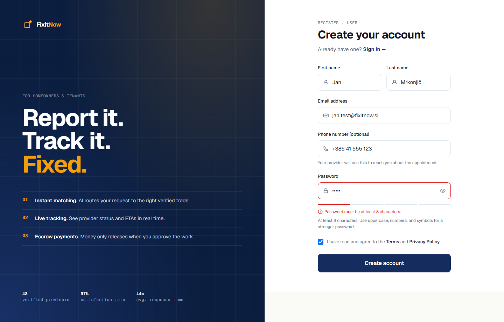 | 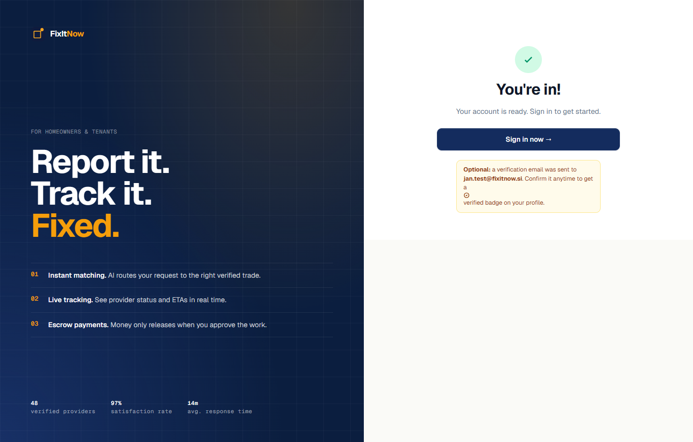 |
| **Korak 6: Oddana vloga izvajalca v čakanju na odobritev (`/register/provider`)** | **Korak 8: Preverjanje 2FA TOTP kode ob prijavi (`/two-factor`)** |
| 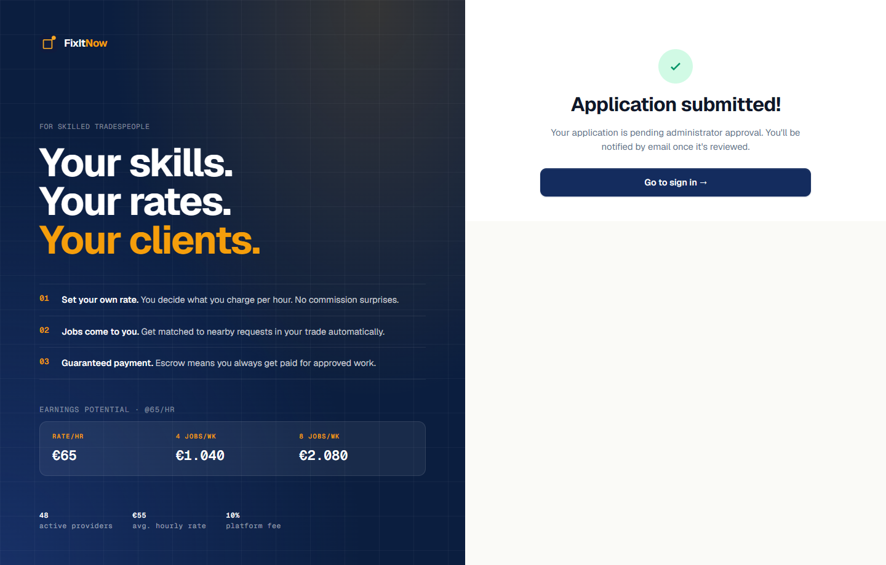 | 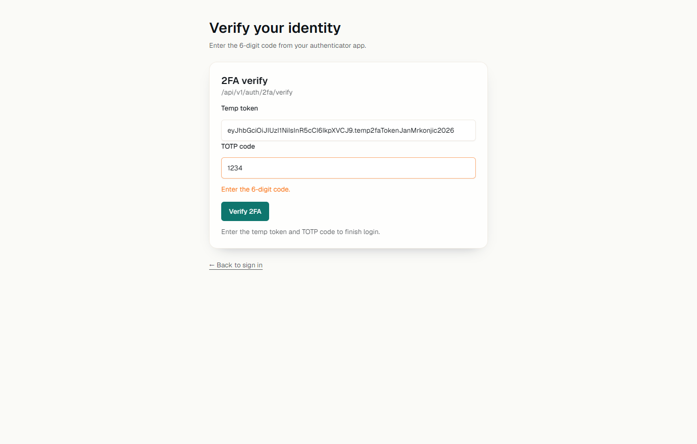 |

---

### 3.5 Testni scenarij `TS-05`: Ustvarjanje novega zahtevka z validacijo obveznih polj, nalaganjem slik in neposredno izbiro izvajalca ter preklic zahtevka

| Polje | Opis |
| :--- | :--- |
| **Enolični identifikator** | `TS-05` |
| **Odgovorna oseba / Izvajalec testa** | Jan Mrkonjič |
| **Cilj** | Preveriti validacijo obveznih polj pri oddaji novega zahtevka (`/tickets/new`), nalaganje fotografije okvare, avtokomplet lokacije z geokodiranjem, neposredno izbiro izvajalca (*Specific provider*) z obvezno izbiro prostega termina v koledarju (`ProviderAvailabilityPicker`), sprotno posodabljanje povzetka (*Live summary*) ter preklic oddanega zahtevka (`Cancel ticket`). |
| **Prioriteta** | `1 – Visoka` |
| **Sledljivost** | `F-03` – Ustvarjanje in upravljanje servisnih zahtevkov (`/tickets/new`, `/providers`, `/tickets/:id`, `/dashboard/user`) |
| **Predpogoji** | 1. Uporabnik *Jan Mrkonjič* (`jan.test@fixitnow.si`) je prijavljen v vlogi stranke (`CUSTOMER`). 2. V sistemu obstaja aktiven izvajalec *Luka Kovač* (`ELECTRICAL`, `55 €/h`) z definiranimi prostimi termini (`AVAILABLE`) v koledarju. |
| **Začetna priprava** | Odpri stran za ustvarjanje novega zahtevka `http://localhost:5173/tickets/new`. |
| **Zaključek** | Ustvarjeni zahtevek `FIX-0088` je po izvedbi scenarija preklican in v končnem stanju `CANCELLED`. |

#### Koraki izvedbe in rezultati

| Korak | Vhodi in akcije | Pričakovani rezultati | Dejanski rezultati | Status |
| :---: | :--- | :--- | :--- | :---: |
| **1** | Na strani `/tickets/new` brez izpolnjevanja polj klikni gumb **Submit ticket**. | Oddaja zahtevka je zavrnjena; pod vsemi obveznimi polji se izpišejo sporočila o napakah: `"Title is required."`, `"Please select a category."`, `"Description is required."`, `"Location is required."` in `"Please select an urgency level."`. | Obrazec je preprečil oddajo in prikazal vsa pričakovana rdeča validacijska sporočila pod sekcijama `01` in `02`. | **PASSED** ✓ |
| **2** | V sekciji **01 What's broken?** vnesi naziv `"Menjava okvarjene varovalke v razdelilni omarici"`, izberi kategorijo **Electrical**, vnesi opis `"Glavna varovalka v kuhinjskem tokokrogu se ob vklopu pečice sproži, potrebna menjava in pregled napeljave."` ter v polje **Photos & attachments** naloži PNG sliko okvare. | Pod poljem za nalaganje se prikaže sličica predogleda fotografije z rdečim gumbom `×` za odstranitev. V desni kartici **Live summary** se v živo posodobijo polja *Title*, *Category* (`Electrical`) in *Photos* (`1 selected`). | Predogled slike se je izrisal brez napak, v kartici *Live summary* pa so se takoj osvežili naziv, kategorija `Electrical` in oznaka `1 selected` pri fotografijah. | **PASSED** ✓ |
| **3** | V sekciji **02 Where & how urgent?** v polje **Location** vtipkaj `"Koroška cesta 46, Maribor"`, izberi predlagani naslov iz avtokompleta (`AddressAutocomplete`) ter izberi stopnjo nujnosti **03 · High (`Today, ideally`)**. | Naslov se shrani s koordinatami in prikaže obvestilo `"✓ Address pinned — navigation will be accurate."`. V **Live summary** se posodobita *Urgency* (`03 · High · Blocking work or comfort.`) in *Location*. | Naslov se je pripel s koordinatami, v *Live summary* pa sta se izpisala izbrana lokacija v Mariboru in nujnost `03 · High`. | **PASSED** ✓ |
| **4** | V sekciji **03 Who do you want?** izberi zavihek **Specific provider**, klikni **Browse providers →**, na strani `/providers` pri izvajalcu **Luka Kovač (`Electrical, It Support · €55/hr`)** klikni **Select →**. | Uporabnik je preusmerjen nazaj na `/tickets/new`, vsi predhodno vneseni podatki obrazca so ohranjeni, v sekciji `03` pa je prikazan izbrani izvajalec **Luka Kovač (`✓ Selected`)** in komponenta **Request a time** (`ProviderAvailabilityPicker`). | Vsi vnosi so se ohranili prek stanja usmerjevalnika, prikazala se je kartica *Luka Kovač (✓ Selected)* in koledar razpoložljivih terminov. | **PASSED** ✓ |
| **5** | V komponenti **Request a time** izberi prost termin izvajalca (npr. `10:00–14:00`, interval `From 10:00 – To 10:30`) in klikni gumb **Submit ticket**. | V **Live summary** se izpiše izbrani termin pod *Requested time*. Ob kliku na **Submit ticket** se slika naloži (`POST /api/v1/images/upload`), ustvari se zahtevek `FIX-0088` (`POST /api/tickets` vrne `201 Created`), prikaže se potrditveno obvestilo `"Ticket successfully submitted! ✓"` in uporabnik je preusmerjen na `/dashboard/user`. | Termin se je izpisal v *Live summary*, zahtevek `FIX-0088` je bil uspešno shranjen in uporabnik preusmerjen na nadzorno ploščo. | **PASSED** ✓ |
| **6** | Odpri stran s podrobnostmi ustvarjenega zahtevka `/tickets/88` (`FIX-0088`). | Prikazana je glava zahtevka z oznakama **`High`** in **`Awaiting provider`** (`PENDING_APPROVAL`), trak faz (`PhaseRail`) na 1. koraku, metapodatki (*Provider: Luka Kovač*, *Location*, *Submitted by: Jan Mrkonjič*), opis z želenim terminom (*Requested start / Requested end*), galerija **02 Photos (`1 attached`)** in dnevnik **03 Activity (`1 events`)**. | Stran `/tickets/88` je pravilno prikazala vse vnesene podatke, želeni termin, priloženo sliko in začetno stanje v dnevniku aktivnosti. | **PASSED** ✓ |
| **7** | Na dnu strani `/tickets/88` klikni rdeči gumb **Cancel ticket** in v pojavnem potrditvenem oknu (*Cancel this ticket?*) potrdi s klikom na **Yes, cancel ticket**. | Izvede se `POST /api/tickets/88/cancel`. Status zahtevka preide v **`CANCELLED`**, glava zahtevka izpiše *"This ticket has been cancelled."* z značko **`Ticket cancelled`**, v dnevniku aktivnosti se doda vnos *"Completed — Ticket was cancelled."*, gumb *Cancel ticket* pa ni več prikazan. | Zahtevek `FIX-0088` je prešel v stanje `CANCELLED`, trak faz se je zamenjal z značko *Ticket cancelled*, v dnevniku aktivnosti pa so zabeleženi `2 events`. | **PASSED** ✓ |

#### Zaslonski posnetki izvedbe `TS-05`

| Korak 1: Validacija praznega obrazca za nov zahtevek (`/tickets/new`) | Koraki 2–5: Izpolnjen zahtevek s sliko, izbranim izvajalcem in terminom |
| :---: | :---: |
| 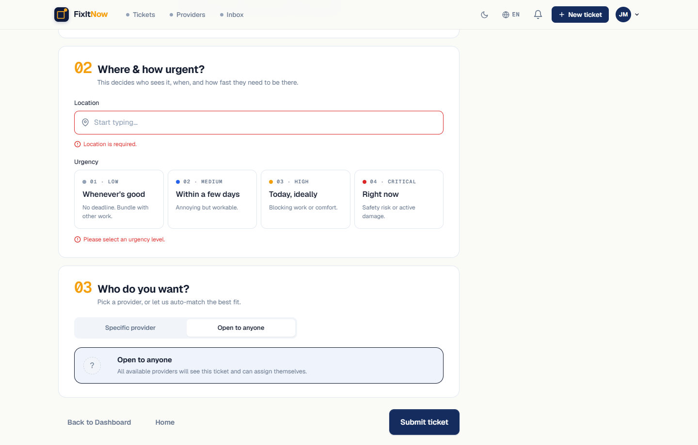 | 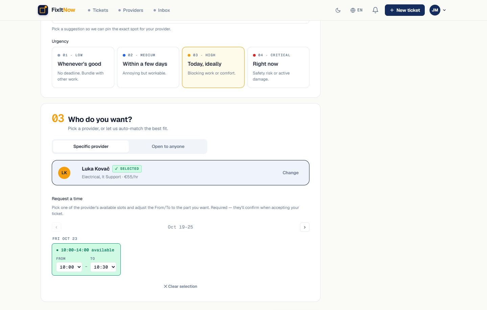 |
| **Korak 6: Pregled ustvarjenega zahtevka `FIX-0088` v stanju `PENDING_APPROVAL`** | **Korak 7: Stanje zahtevka `FIX-0088` po preklicu (`CANCELLED`)** |
| 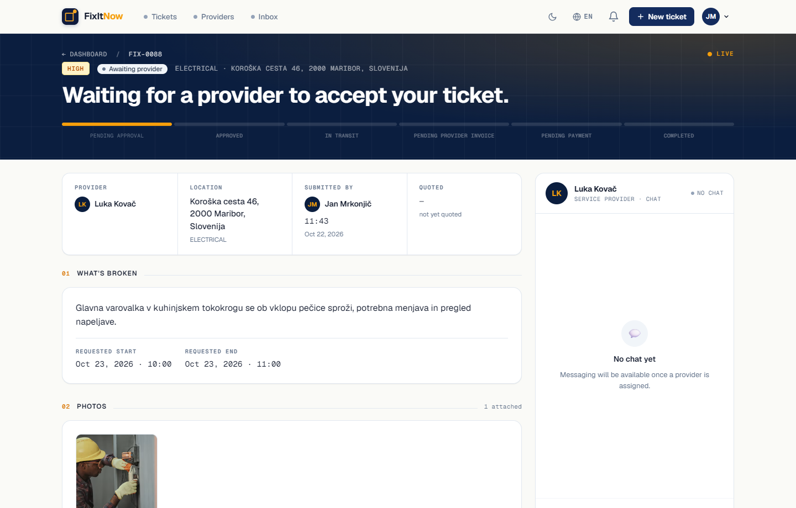 | 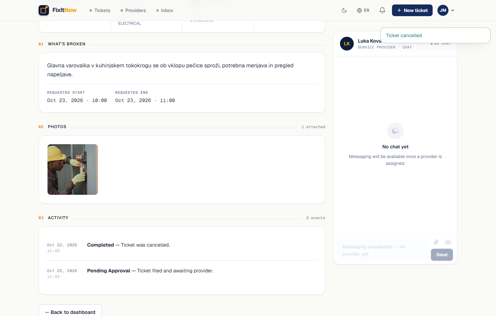 |

---

### 3.6 Testni scenarij `TS-06`: Upravljanje uporabniškega profila stranke, dodajanje lokacij stavb, sprememba gesla in mehki izbris računa

| Polje | Opis |
| :--- | :--- |
| **Enolični identifikator** | `TS-06` |
| **Odgovorna oseba / Izvajalec testa** | Jan Mrkonjič |
| **Cilj** | Preveriti pregled osebnega profila stranke (`/profile`), dodajanje privzete lokacije stavbe (`LocationModal`), posodabljanje osebnih podatkov (`/profile/edit`), spremembo gesla z validacijo neujemajočih se gesel ter poslovno pravilo mehkega izbrisa računa (*Delete Account* – blokada ob aktivnem zahtevku in uspešen izbris brez aktivnih obveznosti). |
| **Prioriteta** | `1 – Visoka` |
| **Sledljivost** | `F-06` – Upravljanje uporabniškega profila, lokacij in mehki izbris računa (`/profile`, `/profile/edit`) |
| **Predpogoji** | 1. Uporabnik *Jan Mrkonjič* (`jan.test@fixitnow.si`) je prijavljen kot stranka (`CUSTOMER`). 2. Privzeta lokacija v profilu stranke na začetku ni nastavljena. |
| **Začetna priprava** | Odpri stran uporabniškega profila `http://localhost:5173/profile`. |
| **Zaključek** | Podatki profila, privzeta lokacija in geslo so posodobljeni; po zaključku vseh aktivnih zahtevkov se račun ob potrditvi mehko izbriše, uporabnik pa je odjavljen. |

#### Koraki izvedbe in rezultati

| Korak | Vhodi in akcije | Pričakovani rezultati | Dejanski rezultati | Status |
| :---: | :--- | :--- | :--- | :---: |
| **1** | Na strani `/profile` v zavihku **Overview** preglej razdelke **01 Personal info**, **02 Recent tickets**, **03 Buildings & locations** in stransko kartico **Notifications**. | Prikazani so podatki prijavljene stranke (`Jan Mrkonjič`, `jan.test@fixitnow.si` z zeleno značko `VERIFIED`, vloga `Customer`), zadnji zahtevki in prazna kartica *Buildings & locations* z gumbom **`+ Add location`**. | Vsi razdelki osebnega profila in stranske nastavitve obvestil so pravilno prikazani. | **PASSED** ✓ |
| **2** | V razdelku **03 Buildings & locations** klikni **`+ Add location`**, v pojavnem oknu *Add default location* (`LocationModal`) vtipkaj `"Slomškov trg 15"`, izberi predlagani naslov `"Slomškov trg 15, 2000 Maribor, Slovenija"` in klikni **Save location**. | Izvede se `PATCH /api/v1/users/me/location` (`200 OK`). Modalno okno se zapre, v kartici **03 Buildings & locations** se izpiše privzeta lokacija **`Slomškov trg 15, 2000 Maribor, Slovenija`**, gumb `Remove` in zeleno potrditveno sporočilo **`"✓ Default location saved."`**. | Privzeta lokacija se je shranila in izpisala v kartici `03 Buildings & locations` skupaj z zelenim obvestilom *"Default location saved."*. | **PASSED** ✓ |
| **3** | Klikni gumb **Edit profile** (preusmeritev na `/profile/edit`), v razdelku **Personal info** spremeni priimek v `"Mrkonjič - Posodobljeno"` in telefonsko številko v `"+386 41 999 000"` ter klikni **Save changes**. | Izvede se `PATCH /api/v1/users/me` (`200 OK`). Ob gumbu *Save changes* se izpiše zeleno sporočilo **`"Saved."`**, v polju *Default location* pa je vidna tudi prej nastavljena lokacija na Slomškovem trgu. | Podatki so se uspešno shranili, ob gumbu se je prikazal napis *"Saved."*. | **PASSED** ✓ |
| **4** | Na strani `/profile/edit` v razdelku **Change password** vnesi trenutno geslo `"VarnoGeslo2026!"`, novo geslo `"NovoGeslo2026#"` in neujemajočo potrditev `"DrugacnoGeslo99!"` ter klikni **Update password**. | Indikator moči novega gesla (`pw-meter s4`) kaže polno moč (`4/4` zelene črtice), vendar Zod validacija zavrne oddajo in pod poljem *Confirm new password* prikaže napako: **`"Passwords do not match."`**. | Oddaja obrazca za geslo je bila preprečena na odjemalcu z rdečim opozorilom `"Passwords do not match."`. | **PASSED** ✓ |
| **5** | Popravi polje *Confirm new password* v ujemajoče geslo `"NovoGeslo2026#"` in klikni **Update password**. | Izvede se `PATCH /api/v1/users/me/password` (`200 OK`). Vsa tri polja za geslo se počistijo, ob gumbu pa se izpiše zeleno potrditveno sporočilo **`"Password updated."`**. | Geslo je bilo uspešno posodobljeno, polja so se izpraznila in prikazalo se je obvestilo *"Password updated."*. | **PASSED** ✓ |
| **6** | Na dnu strani `/profile/edit` v razdelku **Danger zone** klikni rdeči gumb **Delete Account** in v potrditvenem oknu (*Delete Account*) ponovno klikni **Delete Account**, medtem ko ima uporabnik še aktiven (nezaključen) zahtevek. | Klic `DELETE /api/v1/users/me` vrne status `400 Bad Request` (`AccountDeletionService`). V potrditvenem oknu se izpiše rdeče obvestilo o blokadi: **`"You cannot delete your account while you have active tickets, disputes, or pending payments."`**. Uporabnik ostane prijavljen. | Izbris računa je bil zavrnjen; v pojavnem oknu se je izpisalo rdeče opozorilo o aktivnih zahtevkih, seja uporabnika pa je ostala aktivna. | **PASSED** ✓ |
| **7** | Po zaključku oz. preklicu vseh aktivnih zahtevkov uporabnika v potrditvenem oknu **Delete Account** ponovno klikni **Delete Account**. | Klic `DELETE /api/v1/users/me` uspe (`200 OK`). Račun se v bazi mehko izbriše (`deleted = true`, `status = DELETED`, zgodovina zahtevkov in sporočil se ohrani), seja se takoj počisti (`clearSession()`) in brskalnik preusmeri uporabnika na vstopno stran `/`. | Mehki izbris računa je uspel, seja v brskalniku se je počistila in uporabnik je bil odjavljen ter preusmerjen na `/`. | **PASSED** ✓ |

#### Zaslonski posnetki izvedbe `TS-06`

| Koraka 1–2: Pregled profila in dodana privzeta lokacija (`/profile`) | Koraka 3–4: Urejanje profila in validacija neujemajočega gesla (`/profile/edit`) |
| :---: | :---: |
| 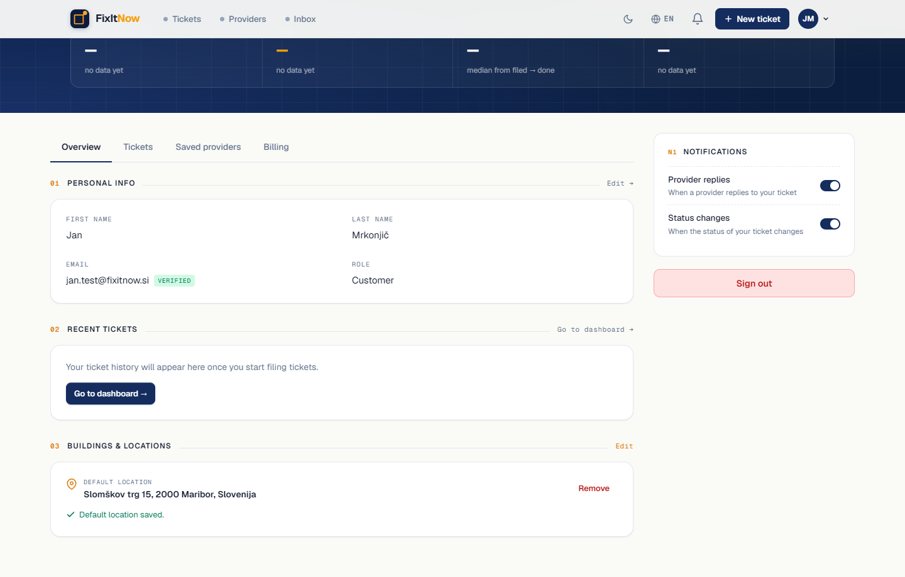 | 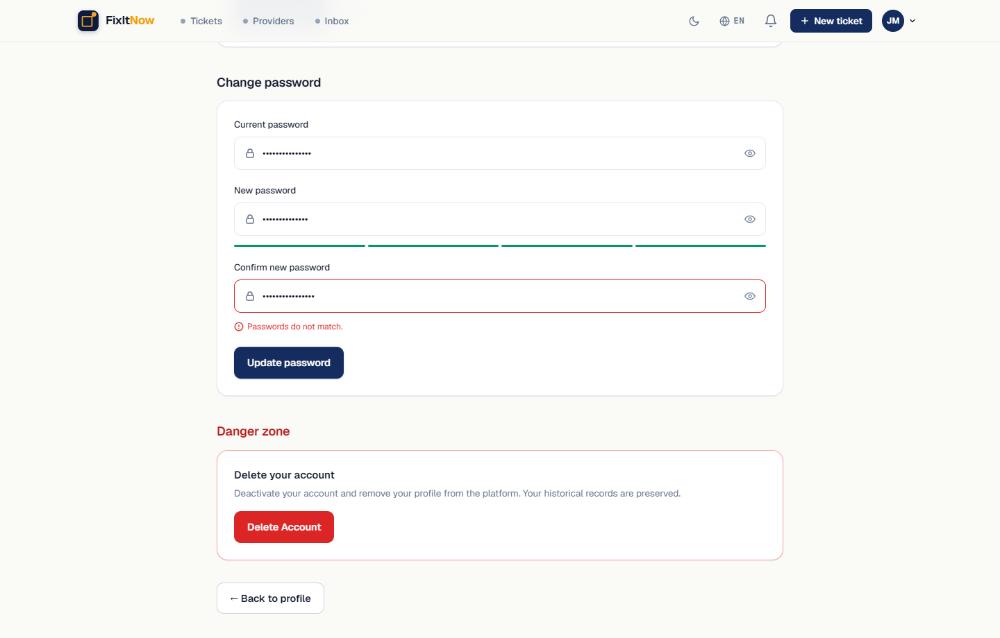 |
| **Korak 6: Zavrnitev mehkega izbrisa računa ob aktivnem zahtevku (`Danger zone`)** | |
| 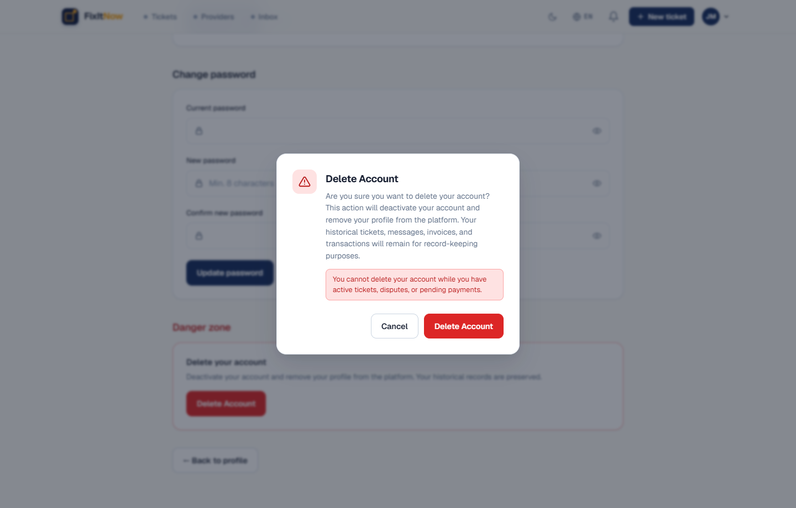 | |

---

## 4. Poročilo testiranja

### 4.1 Podatki o izvedbi in testnem okolju

- **Datum izvedbe:** 21. 10. 2026 (`TS-01`–`TS-03`) in 22. 10. 2026 (`TS-04`–`TS-06`)
- **Izvajalca testiranja:**
  - **Luka Grobelnik** (`TS-01`, `TS-02`, `TS-03`)
  - **Jan Mrkonjič** (`TS-04`, `TS-05`, `TS-06`)
- **Testno okolje:**
  - **Operacijski sistem:** Windows 11 / macOS
  - **Podatkovna baza in zaledje:** PostgreSQL 16 (`localhost:5433`), Java 21 / Spring Boot 3.3 REST + WebSocket API (`http://localhost:8080`).
  - **Spletni odjemalec:** React 19, TypeScript, Vite 8 (`http://localhost:5173`).
  - **Brskalnik in avtomatizacija zajema dokazov:** Microsoft Edge / Google Chrome (Chromium engine, ločljivost `1440 × 920 px`, z uporabo Playwright za deterministični zajem zaslonskih slik v `Naloga3/slike/`).

### 4.2 Povzetek rezultatov izvedenih scenarijev

#### Scenariji člana ekipe: Jan Mrkonjič (`TS-04` – `TS-06`)

| ID scenarija | Naziv testnega scenarija | Število korakov | Uspešni koraki (`PASSED`) | Neuspešni koraki (`FAILED`) | Blokirani (`BLOCKED`) | Končni status |
| :--- | :--- | :---: | :---: | :---: | :---: | :---: |
| **TS-04** | Registracija uporabnika/izvajalca, preverjanje moči gesla ter vklop in prijava z dvofaktorsko avtentikacijo (2FA TOTP) | 8 | 8 | 0 | 0 | **PASSED** ✓ |
| **TS-05** | Ustvarjanje novega zahtevka z validacijo obveznih polj, nalaganjem slik in neposredno izbiro izvajalca ter preklic zahtevka | 7 | 7 | 0 | 0 | **PASSED** ✓ |
| **TS-06** | Upravljanje uporabniškega profila stranke, dodajanje lokacij stavb, sprememba gesla in mehki izbris računa | 7 | 7 | 0 | 0 | **PASSED** ✓ |
| **Skupaj (Jan Mrkonjič)** | **3 izvedeni funkcionalni testni scenariji** | **22** | **22 (100 %)** | **0 (0 %)** | **0 (0 %)** | **USPEŠNO** |

#### Zbirni pregled vseh izvedenih scenarijev v dokumentu (`TS-01` – `TS-06`)

| ID scenarija | Odgovorna oseba | Število korakov | Uspešni (`PASSED`) | Neuspešni (`FAILED`) | Blokirani (`BLOCKED`) | Končni status |
| :--- | :--- | :---: | :---: | :---: | :---: | :---: |
| **TS-01** | Luka Grobelnik | 8 | 8 | 0 | 0 | **PASSED** ✓ |
| **TS-02** | Luka Grobelnik | 11 | 11 | 0 | 0 | **PASSED** ✓ |
| **TS-03** | Luka Grobelnik | 7 | 7 | 0 | 0 | **PASSED** ✓ |
| **TS-04** | Jan Mrkonjič | 8 | 8 | 0 | 0 | **PASSED** ✓ |
| **TS-05** | Jan Mrkonjič | 7 | 7 | 0 | 0 | **PASSED** ✓ |
| **TS-06** | Jan Mrkonjič | 7 | 7 | 0 | 0 | **PASSED** ✓ |
| **Skupaj** | **6 izvedenih scenarijev** | **48** | **48 (100 %)** | **0 (0 %)** | **0 (0 %)** | **USPEŠNO** |

### 4.3 Ugotovitve in zaključek testiranja

1. **Skladnost delovanja s funkcionalnimi zahtevami:**
   - Vsi trije funkcionalni testni scenariji Jana Mrkonjiča (`TS-04`, `TS-05`, `TS-06` – skupaj 22 testnih korakov) ter vsi trije scenariji Luke Grobelnika (`TS-01`, `TS-02`, `TS-03` – skupaj 26 testnih korakov) so se izvedli uspešno (`PASSED` v 100 % korakov).
2. **Preverjanje vhodnih validacij in varnostnih mehanizmov (`TS-04`, `TS-05`, `TS-06`):**
   - **Registracija in 2FA (`TS-04`):** Potrjena je pravilna validacija dolžine in moči gesla (`pw-meter`), obveznega strinjanja s pogoji uporabe ter večdelnega obrazca za prijavo izvajalca (`PENDING_APPROVAL`). Dvofaktorska avtentikacija (TOTP) pravilno zahteva 6-mestno kodo in zavrne nepopolne vnose na strani `/two-factor`.
   - **Oddaja in preklic zahtevka (`TS-05`):** Obrazec `/tickets/new` dosledno prepreči oddajo brez obveznih podatkov, ohranja vpisano stanje ob prehodu na imenik izvajalcev (`/providers`) in pri izbiri konkretnega izvajalca (*Specific provider*) zahteva izbiro termina iz izvajalčevega urnika razpoložljivosti (`ProviderAvailabilityPicker`). Preklic zahtevka v stanju `PENDING_APPROVAL` pravilno prestavi zahtevek v končno stanje `CANCELLED`.
   - **Upravljanje profila in varovalka pri mehkem izbrisu računa (`TS-06`):** Shranjevanje privzete lokacije (`LocationModal`), posodabljanje osebnih podatkov in preverjanje ujemanja novega gesla delujejo pravilno. Potrjena je tudi kritična poslovna varovalka v `AccountDeletionService`, ki prepreči mehki izbris računa (`400 Bad Request`), dokler ima uporabnik aktivne zahtevke ali neporavnane obveznosti.
3. **Opažanje za nadaljnje izboljšave uporabniške izkušnje (UX):**
   - Med pregledom kode in izvedbo `TS-04` smo opazili, da komponente za nastavitev in vklop 2FA (`TwoFactorSetupCard.tsx`, `TwoFactorEnableCard.tsx` in `TwoFactorDisableCard.tsx`) že obstajajo v `frontend/src/components/two-factor/`, vendar trenutno niso neposredno vključene v stran z nastavitvami profila (`/profile/edit`), zato se začetni vklop 2FA izvede prek REST končnih točk `/api/v1/user/2fa/setup` in `/api/v1/user/2fa/enable`, medtem ko je stran za preverjanje kode ob prijavi (`/two-factor`) v celoti integrirana. Priporočamo vključitev kartice za vklop/izklop 2FA neposredno na stran `/profile/edit`.

---

## 5. Uporaba orodij umetne inteligence

Pri pripravi in izvedbi naloge smo v skladu z navodili transparentno zabeležili uporabo generativnih orodij umetne inteligence:

- **Uporabljeni model:** Gemini 4 Argon (Medium) (v okolju Antigravity IDE).
- **Namen uporabe:**
  1. Pregled obstoječe dokumentacije (`README.md`, `CLAUDE.md`, `Naloga1`, `Naloga2`) in izvorne kode za obnovo kataloga ključnih funkcionalnosti (`F-01`–`F-08`).
  2. Strukturiranje testnih scenarijev `TS-04`, `TS-05` in `TS-06` v skladu s standardom **ISO/IEC/IEEE 29119-3:2021**.
  3. Priprava avtomatizirane skripte Playwright za zagon scenarijev `TS-04`, `TS-05` in `TS-06` v spletnem odjemalcu ter zajem zaslonskih posnetkov v mapo `Naloga3/slike/`.
- **Način preverjanja:** Vsi testni koraki, vhodni podatki, pričakovani odzivi in zajeti zaslonski posnetki v `Naloga3/slike/` so bili preverjeni z dejanskim zagonom spletnega odjemalca (`http://localhost:5173`) in primerjavo z implementacijo v `frontend/src/` ter `backend/src/`.
