# Poročilo – Naloga 5: Avtomatizirano funkcionalno testiranje

---

## 1. Izbira in utemeljitev orodja za avtomatizirano funkcionalno testiranje

Spletni odjemalec platforme **FixItNow** je zgrajen z ogrodjem **React 19**, **TypeScript 6** in graditeljem **Vite 8** (`frontend/`), komunikacija z zaledjem (Spring Boot 4) pa poteka prek REST API-ja ter dvosmerne komunikacije **WebSocket/STOMP prek SockJS**.

Za avtomatizacijo funkcionalnih testnih primerov (*End-to-End* / E2E) iz Naloge 3 smo izbrali orodje **Playwright** (`@playwright/test` v1.64.1).

### Utemeljitev izbire orodja Playwright:
1. **Naravna podpora za več brskalniških kontekstov (`BrowserContext`):** Ključni testni scenariji v FixItNow (`TS-02` in `TS-03`) zahtevajo hkratno sodelovanje dveh različnih uporabniških vlog (*Customer* in *Provider*) v ločenih sejah brez medsebojnega vpliva piškotkov in `localStorage`. Playwright omogoča ustvarjanje popolnoma izoliranih brskalniških kontekstov znotraj istega testa.
2. **Podpora za TypeScript in sodobne spletne aplikacije (SPA):** Playwright ima vgrajeno samodejno čakanje (*auto-waiting*) na vidnost in interaktivnost elementov ter nativno podporo za prenose datotek (`waitForEvent('download')` pri prenosu PDF računa) in prestrezanje oz. testiranje povezav WebSocket (`routeWebSocket`).
3. **Primerjava z alternativami (Cypress, Selenium):**
   - *Cypress* teče znotraj istega brskalniškega okna in ima omejitve pri hkratnem upravljanju dveh ločenih prijavljenih sej (Customer + Provider) v istem testu.
   - *Selenium* zahteva ročno upravljanje gonilnikov (`chromedriver`), pogostejše eksplicitno čakanje ter nima vgrajene podpore za prestrezanje omrežnega prometa in WebSocketov na ravni protokola.

---

## 2. Predviden način vključitve v cevovod CI/CD

### 2.1 Izvajanje brez grafičnega vmesnika (*Headless*)
Playwright se v okolju CI/CD privzeto izvaja v **brezglavem načinu** (`headless: true` v `frontend/playwright.config.ts`), zato ne potrebuje grafičnega namiznega okolja (X11/Wayland) ali monitorja.

### 2.2 Zahteve v okolju cevovoda
Za zagon testov v cevovodu (npr. GitHub Actions na `ubuntu-latest`) okolje potrebuje:
- **Node.js (v20+)** in nameščene odvisnosti projekta (`npm ci`).
- **Brskalniške binarne datoteke in sistemske knjižnice:** Namestitev Chromiuma z ukazom `npx playwright install --with-deps chromium` (namesti brskalnik in potrebne OS knjižnice v Linux vsebniku). Ločen Selenium/WebDriver strežnik ni potreben.
- **Zagnana aplikacija in zaledje / testni podatki:**
  - Playwright prek konfiguracije `webServer` samodejno zažene razvojni strežnik Vite (`npm run dev` na `http://localhost:5173`) in počaka, da je pripravljen.
  - Za deterministično izvajanje E2E testov brez odvisnosti od zunanje baze PostgreSQL ali Dockerja v `frontend`-only cevovodu skrbi razred `MockBackend` (`frontend/e2e/fixtures/mockBackend.ts`), ki na ravni omrežja in WebSocketov simulira REST API ter STOMP/SockJS strežnik. Po potrebi (npr. v integracijskem cevovodu z `docker compose` in testno bazo PostgreSQL) pa se lahko isti testi povežejo na živo zaledje z nastavitvijo `USE_LIVE_BACKEND=true`.

### 2.3 Oblika rezultatov
Konfiguracija `frontend/playwright.config.ts` je nastavljena za sočasno generiranje štirih oblik poročil:
- **`list`** – sprotni konzolni izpis uspešnih in neuspešnih testov v dnevniku cevovoda.
- **`junit` (`frontend/test-results/junit.xml`)** – standardizirana XML oblika za samodejno objavo rezultatov v orodjih CI/CD (GitHub Actions, GitLab CI, Jenkins).
- **`json` (`frontend/test-results/results.json`)** – strojno berljiv zapis podrobnosti vsakega testa.
- **`html` (`frontend/playwright-report/index.html`)** – interaktivno spletno poročilo, ki vključuje sledi izvajanja (*trace*), posnetke zaslona in videoposnetke ob morebitnem padcu testa (primerno za shranjevanje kot CI *artifact*).

### 2.4 Vključitev v `.github/workflows/frontend.yml`
Avtomatizirani testi Playwright so vključeni v delovni tok GitHub Actions (`.github/workflows/frontend.yml`) pred gradnjo in objavo aplikacije:
```yaml
      - name: Install Playwright Chromium
        working-directory: frontend
        run: npx playwright install --with-deps chromium

      - name: Run E2E tests (Playwright)
        working-directory: frontend
        run: npm run test:e2e

      - name: Upload Playwright report
        if: always()
        uses: actions/upload-artifact@v4
        with:
          name: playwright-report
          path: |
            frontend/playwright-report/
            frontend/test-results/junit.xml
            frontend/test-results/results.json
```

---

## 3. Namestitev in struktura avtomatiziranih testov

Orodje je bilo nameščeno v mapo `frontend/`:
- `npm install -D @playwright/test` (`@playwright/test` v1.64.1)
- Dodani skripti v `frontend/package.json`: `"test:e2e": "playwright test"`, `"test:e2e:headed": "playwright test --headed"`, `"test:e2e:report": "playwright show-report"`.

Ustvarjene datoteke (izvorne datoteke v `frontend/`, kopije za oddajo ter izvoz rezultatov pa tudi neposredno v `Naloga5/`):
- `frontend/playwright.config.ts` (kopija: `Naloga5/playwright.config.ts`) – konfiguracija Playwrighta, poročevalcev in `webServer` zagona.
- `frontend/e2e/fixtures/mockBackend.ts` (kopija: `Naloga5/e2e/fixtures/mockBackend.ts`) – priprava prijavljenih sej (JWT v `localStorage`), prestrezanje REST klicev ter simulacija dvosmernega STOMP/SockJS strežnika za klepet in obvestila v realnem času.
- `frontend/e2e/ts01-browse-saved-providers.spec.ts` (kopija: `Naloga5/e2e/ts01-browse-saved-providers.spec.ts`) – avtomatizacija scenarija **`TS-01`**.
- `frontend/e2e/ts02-ticket-lifecycle-reviews.spec.ts` (kopija: `Naloga5/e2e/ts02-ticket-lifecycle-reviews.spec.ts`) – avtomatizacija scenarija **`TS-02`**.
- `frontend/e2e/ts03-realtime-chat-notifications.spec.ts` (kopija: `Naloga5/e2e/ts03-realtime-chat-notifications.spec.ts`) – avtomatizacija scenarija **`TS-03`**.
- `Naloga5/results/` – izvožena poročila zadnjega uspešnega zagona (`junit.xml`, `results.json`, `playwright-report.html`).

---

## 4. Pregled avtomatiziranih testnih scenarijev in rezultati izvajanja

Avtomatizirani so bili vsi trije testni scenariji iz Naloge 3 (`Naloga3/porocilo.md`):

| Oznaka | Datoteka | Opis avtomatiziranega toka | Čas izvajanja | Status |
| :--- | :--- | :--- | :---: | :---: |
| **`TS-01`** | `ts01-browse-saved-providers.spec.ts` | Večkriterijsko filtriranje mojstrov (`Plumbing`, `Max € = 50`, `5+ yr`), razvrščanje (*Lowest price*), prikaz zemljevida Leaflet (`Show on map`), prazen rezultat + `Reset`, shranjevanje mojstra (`☆ Save` $\rightarrow$ `★ Saved`), preverjanje obstojnosti po osvežitvi strani na `/profile` (*Saved providers*) ter odstranitev (`00 SAVED`). | 11.4 s | **PASSED** |
| **`TS-02`** | `ts02-ticket-lifecycle-reviews.spec.ts` | Dva brskalniška konteksta (*Customer* in *Provider*). Preverjanje zaklenjenosti ocen pred zaključkom, potrditev zahtevka `FIX-0042` (`PENDING_APPROVAL` $\rightarrow$ `APPROVED`), prehod v `IN_TRANSIT` (*Live tracking*), zaključek dela (`PENDING_PROVIDER_INVOICE`), validacija minimalnega zneska računa (`0.50 €` $\rightarrow$ `"The minimum amount is €1.00."`), izdaja računa (`65.00 €`), prenos PDF računa (`Invoice-FIX-0042.pdf`), potrditev plačila (`COMPLETED`) ter oddaja (`5 ★`), urejanje (`4 ★`) in brisanje ocene mojstra. | 4.8 s | **PASSED** |
| **`TS-03`** | `ts03-realtime-chat-notifications.spec.ts` | Dva brskalniška konteksta (*Customer* na `/chat?room=room-fix-0042`, *Provider* na `/dashboard/provider`) povezana prek WebSocket/STOMP. Pošiljanje sporočila v živo, prejem obvestila v `NotificationBell` z značko `1` in preusmeritev v klepet, odgovor mojstra v realnem času, urejanje sporočila (oznaka `edited` v obeh oknih), brisanje sporočila (`"This message was deleted"` v obeh oknih) ter `Mark all read` in `Clear all` (`"You're all caught up."`). | 2.9 s | **PASSED** |

Skupni rezultat končnega zagona (`npm run test:e2e`): **3 passed (24.0s)**, generirana poročila: `frontend/test-results/junit.xml`, `frontend/test-results/results.json` in `frontend/playwright-report/index.html` (kopije v `Naloga5/results/`).

### 4.1 Posnetki zaslona uspešnih testov

- **`TS-01` – Filtrirani in razvrščeni mojstri s prikazom zemljevida:**

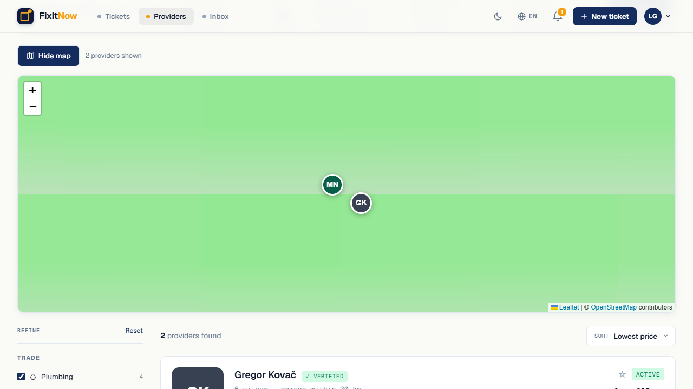

- **`TS-01` – Shranjeni mojstri na zavihku *Saved providers* (`/profile`):**

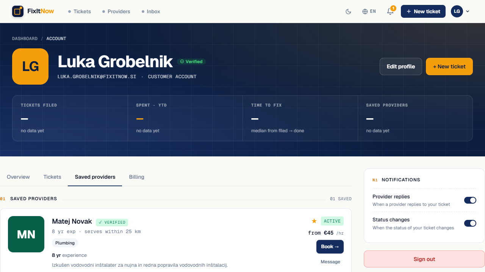

- **`TS-02` – Izdan račun (€65.00) in gumb za prenos PDF na `/tickets/42`:**

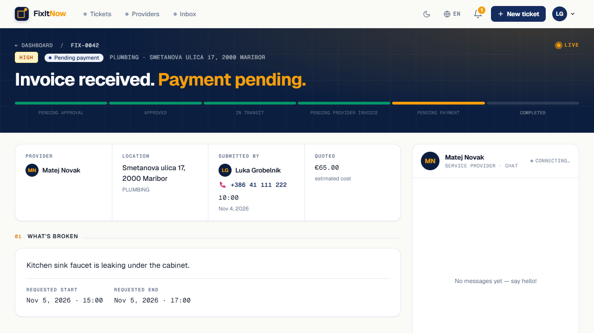

- **`TS-02` – Oddana ocena 5 ★ na profilu mojstra:**

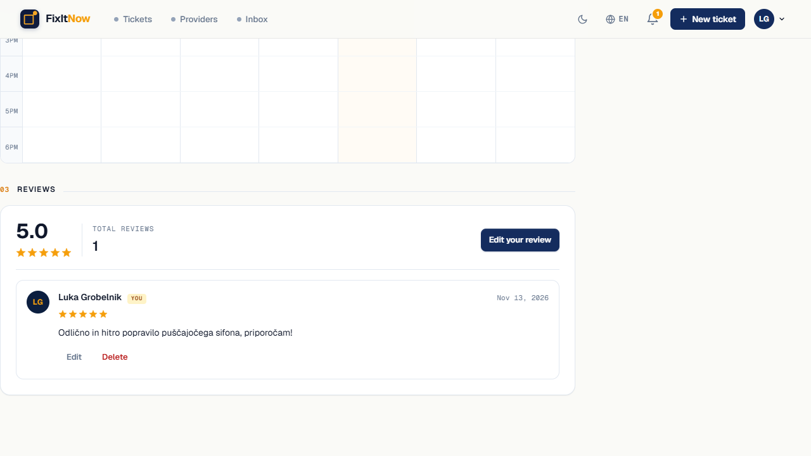

- **`TS-03` – Dvosmerni klepet v realnem času (`LIVE`), urejeno (`edited`) in izbrisano sporočilo:**

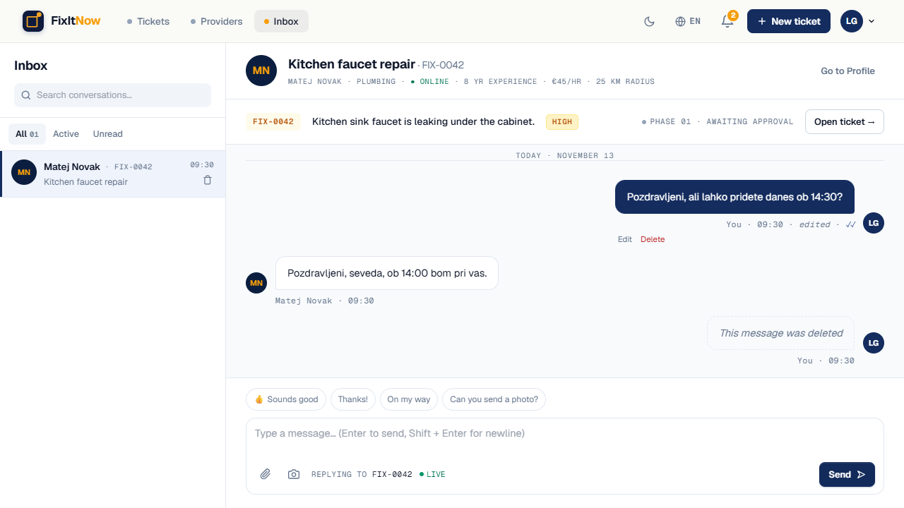

---

## 5. Preizkus zaznave namerno vnesene napake (*Fault Injection*)

Za preverjanje zanesljivosti avtomatiziranih testov smo v rešitev namerno vnesli napako v logiko razvrščanja po ceni (`price_asc`) v datoteki `frontend/src/pages/BrowseProvidersPage.tsx` (vrstica 128), kjer smo primerjalni izraz obrnili iz naraščajočega v padajočega:

```ts
// Prvotna (pravilna) koda:
if (effectiveSortBy === "price_asc") return arr.sort((a, b) => a.pricePerHour - b.pricePerHour);

// Namerno vnesena napaka:
if (effectiveSortBy === "price_asc") return arr.sort((a, b) => b.pricePerHour - a.pricePerHour);
```

Ob ponovnem zagonu testa `TS-01` (`npx playwright test e2e/ts01-browse-saved-providers.spec.ts`) je skripta napako takoj zaznala in test je padel na trditvi, ki preverja vrstni red kartic mojstrov (`Gregor Kovač` 35 €/h pred `Matej Novak` 45 €/h):

```text
  1) [chromium] › e2e\ts01-browse-saved-providers.spec.ts:9:3 › TS-01: Večkriterijsko iskanje mojstrov...
    Error: expect(locator).toContainText(expected) failed

    Locator: locator('h3').first()
    Expected substring: "Gregor Kovač"
    Received string:    "Matej Novak"
    Timeout: 10000ms
```

Posnetek zaslona ob zaznani napaki (na prvem mestu se prikaže dražji mojster *Matej Novak*, €45/hr, namesto *Gregor Kovač*, €35/hr):

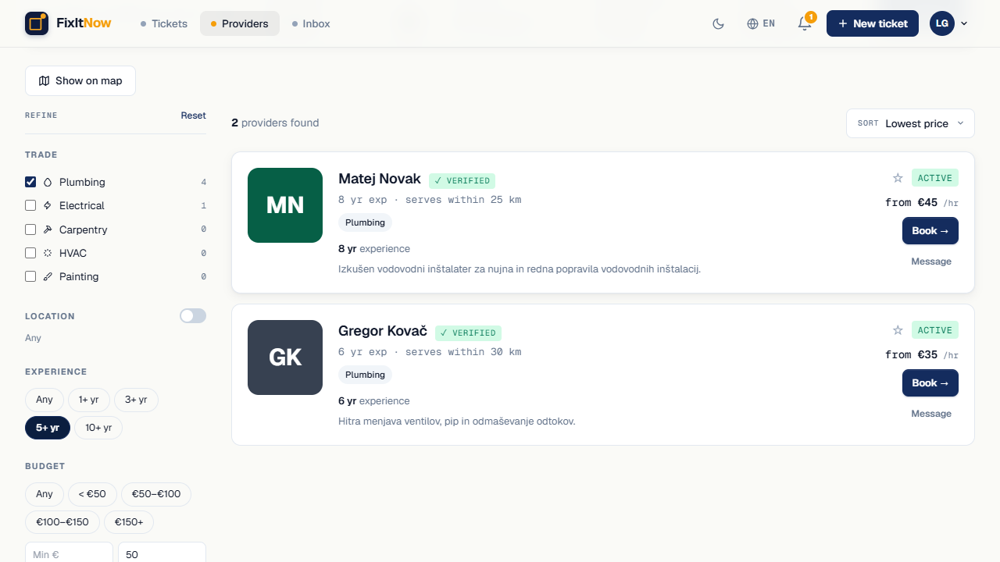

Po potrditvi zaznave smo namerno napako odstranili (povrnili `a.pricePerHour - b.pricePerHour`) in znova pognali celoten testni nabor (`npm run test:e2e`), kjer so znova uspešno prestali vsi trije testi (`3 passed`).

---

## 6. Zaključek

Avtomatizirano funkcionalno testiranje z orodjem **Playwright** je v projektu **FixItNow** uspešno vzpostavljeno. Testi pokrivajo ključne večkoračne uporabniške tokove, vključno z večbrskalniškimi scenariji v realnem času (WebSocket/STOMP, prenosi PDF, dinamični zemljevidi), se izvajajo v brezglavem načinu brez grafičnega vmesnika, generirajo standardizirana poročila (JUnit XML, JSON, HTML) za CI/CD ter zanesljivo zaznajo regresijske napake v aplikaciji.


---

# Del 2: Avtomatizirano funkcionalno testiranje — Cypress (Alan Labaš)

## 1. Izbira in utemeljitev orodja

Za avtomatizacijo testnih primerov `TS-07`, `TS-08` in `TS-09` na čelnem delu aplikacije (**React + TypeScript + Vite**) je bilo izbrano orodje **Cypress (`16.3.0`)**.

Razlogi za izbiro:
- **Naravna podpora za JavaScript/TypeScript in SPA ogrodja:** testi so napisani v TypeScriptu in tečejo neposredno v brskalniku ob aplikaciji.
- **Samodejno čakanje (auto-retry):** Cypress samodejno počaka na pojavitev elementov in dokončanje omrežnih zahtev brez ročnih časovnih zakasnitev (`sleep`).
- **Vgrajeno prestrezanje omrežja (`cy.intercept`):** omogoča deterministično simulacijo API klicev (`/api/v1/...`) in shranjevanje stanja v pomnilniku med testom, zato testi ne potrebujejo zunanje baze ali zalednega strežnika.

## 2. Način vključitve v CI/CD cevovod

Testi so vključeni v GitHub Actions delovni tok `.github/workflows/frontend.yml`:

- **Izvajanje brez grafičnega vmesnika:** ukaz `npm run test:cypress:ci` (`start-server-and-test dev http://localhost:5173 test:cypress`) zažene `cypress run` v brezglavem (*headless*) načinu z vgrajenim brskalnikom **Electron**.
- **Zahteve okolja v cevovodu:** `Node.js` (`v20`), `npm ci` (namestitev odvisnosti in binarnega paketa Cypress brez zunanjih brskalniških gonilnikov) ter zagnan razvojni strežnik Vite na `http://localhost:5173`. Zunanja testna baza ali zaledna storitev v CI ni potrebna, saj `frontend/cypress/support/mockApi.ts` prestreže API klice ter nastavi avtenticirano sejo v `localStorage`.
- **Oblika rezultatov:** izpis v konzoli, strojno berljiva **JUnit XML** poročila v `frontend/cypress-results/junit-*.xml` ter posnetki zaslona ob napakah, ki se v cevovodu shranijo kot artefakt `cypress-report`.

## 3. Avtomatizirani testni primeri

| Testni primer | Datoteka | Opis preverjanega toka | Rezultat | Čas |
| :--- | :--- | :--- | :---: | :---: |
| **TS-07** | `cypress/e2e/ts07-provider-calendar.cy.ts` | Ustvarjanje enkratnega in ponavljajočega časovnega bloka (`+ Create`), urejanje, brisanje ter preverjanje kolizije ob dvojni rezervaciji termina. | Uspešen | 5 s |
| **TS-08** | `cypress/e2e/ts08-banking-iban-payouts.cy.ts` | Zavrnitev neveljavnega IBAN-a po MOD-97 (`Invalid IBAN`), shranjevanje veljavnega IBAN-a, Stripe onboarding in pregled praznih ter nepraznih izplačil. | Uspešen | 4 s |
| **TS-09** | `cypress/e2e/ts09-admin-moderation.cy.ts` | Sprememba vloge uporabnika, suspenz in reaktivacija uporabnika ter posodobitev in brisanje skrbniškega zahtevka. | Uspešen | 3 s |

**Skupni rezultat (`npm run test:cypress:ci`):** `All specs passed! 3/3 (14s)`.

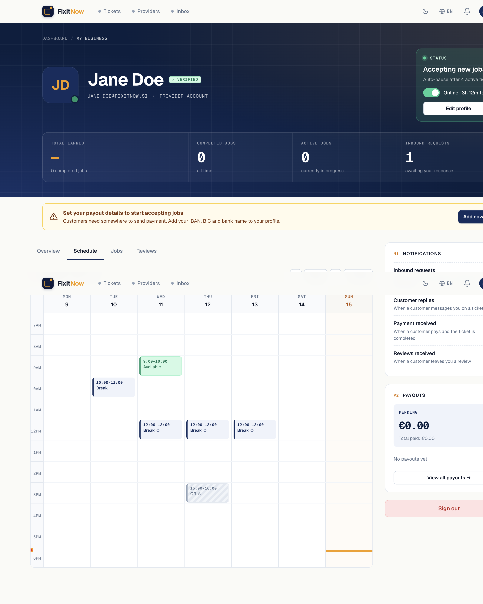

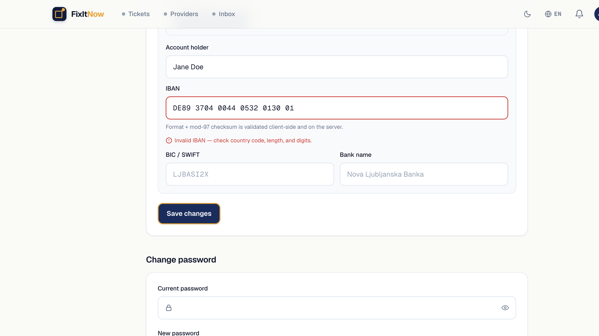

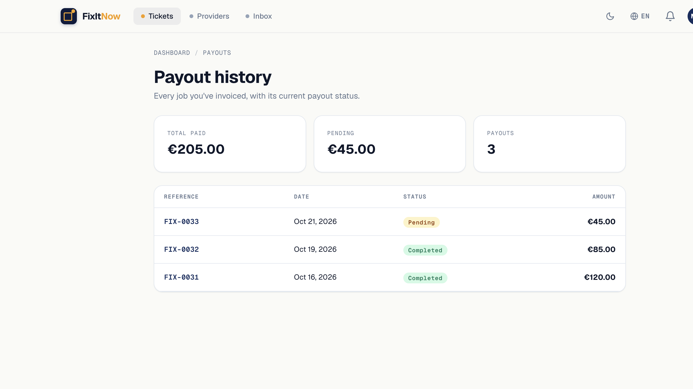

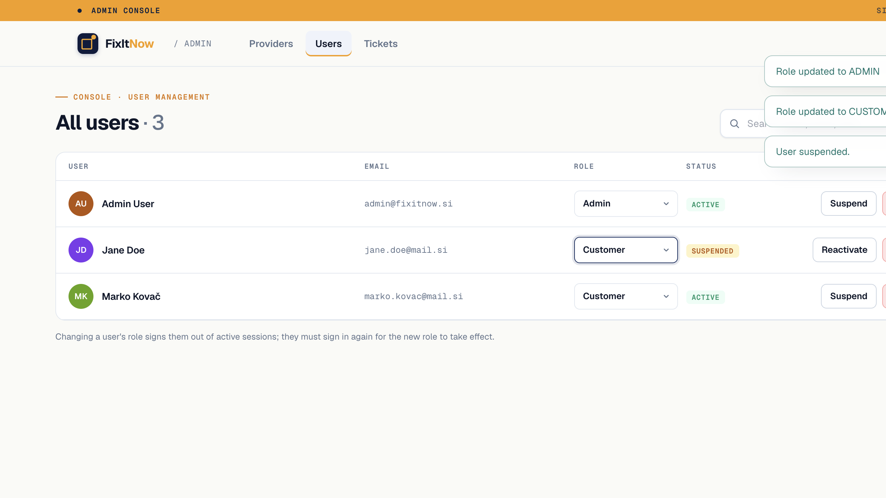

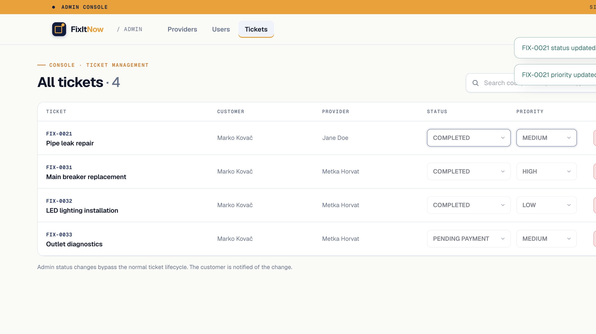

## 4. Preverjanje zaznave namerne napake (Fault Injection)

V datoteki `frontend/src/lib/iban.ts` (funkcija `isValidIban`) je bila namerno obrnjena kontrolna vsota MOD-97:

```ts
// Pravilna koda:
return BigInt(numeric) % 97n === 1n;

// Namerno vnesena napaka:
return BigInt(numeric) % 97n !== 1n;
```

Ob ponovnem zagonu testa `TS-08` (`npx cypress run --spec cypress/e2e/ts08-banking-iban-payouts.cy.ts`) je Cypress napako takoj zaznal, saj obrazec neveljavnega IBAN-a ni več zavrnil:

```text
AssertionError: Timed out retrying after 10000ms: Expected to find content: 'Invalid IBAN' but never did.
    at Context.eval (webpack://frontend/./cypress/e2e/ts08-banking-iban-payouts.cy.ts:23:32)
```

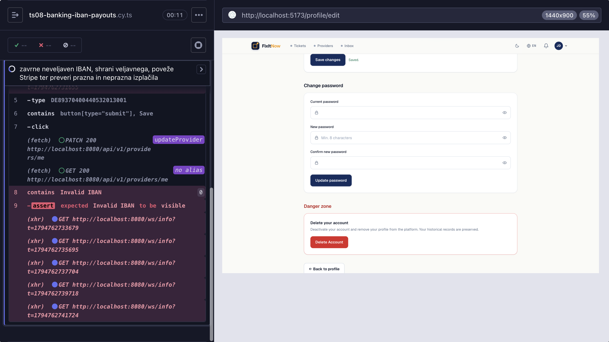

Po potrditvi zaznave je bila napaka odstranjena (`=== 1n`), ponovni zagon `npm run test:cypress:ci` pa je potrdil, da vsi 3 testi spet uspešno pretečejo (`3/3`, `00:14`).

---

# Del 3: Avtomatizirano funkcionalno testiranje — Playwright (Jan Mrkonjič)

## 1. Izbira in utemeljitev orodja

Za avtomatizacijo funkcionalnih testnih scenarijev **`TS-04`**, **`TS-05`** in **`TS-06`** iz Naloge 3 na spletnem odjemalcu **FixItNow** (**React 19 + TypeScript 6 + Vite 8**) je bilo izbrano orodje **Playwright (`@playwright/test` v1.64.1)**.

### Utemeljitev izbire orodja Playwright za scenarije `TS-04`–`TS-06`:
1. **Programsko nalaganje datotek iz pomnilnika (`locator.setInputFiles`):** Scenarij `TS-05` zahteva nalaganje fotografije okvare (PNG/JPEG/WebP) v komponento `dropzone` (`input[type="file"]`) ter preverjanje izrisa predogleda (`URL.createObjectURL`) in števca `1 selected` v kartici *Live summary*. Playwright omogoča neposredno podajanje binarnih datotek (`Buffer`) iz pomnilnika brez zunanjih vtičnikov.
2. **Nativno obvladovanje večstopenjskih avtentikacijskih preusmeritev in stanja usmerjevalnika (`react-router-dom`):**
   - V `TS-04` prijava z vklopljeno dvofaktorsko avtentikacijo (`POST /api/v1/auth/login` $\rightarrow$ `requiresTwoFactor: true`) shrani začasni žeton `tempToken` v avtentikacijski kontekst in preusmeri uporabnika na `/two-factor`, po potrditvi 6-mestne TOTP kode pa vzpostavi polno JWT sejo in preusmeri na `/profile`.
   - V `TS-05` izbira izvajalca prek `/tickets/new` $\rightarrow$ `/providers` $\rightarrow$ `/tickets/new` prenaša stanje obrazca prek `routerLocation.state`. Playwright s samodejnim čakanjem (*auto-waiting*) zanesljivo sledi vsem navigacijam v SPA aplikaciji.
3. **Deterministično prestrezanje omrežnega prometa (`context.route`):** Z razširitvijo razreda `MockBackend` (`frontend/e2e/fixtures/mockBackend.ts`) Playwright na ravni brskalniškega konteksta prestreže klice za registracijo, 2FA TOTP preverjanje, geokodiranje naslovov (`AddressAutocomplete`), nalaganje slik ter poslovno blokado mehkega izbrisa računa (`400 Bad Request` ob aktivnih zahtevkih v `TS-06`).

---

## 2. Predviden način vključitve v cevovod CI/CD

Testi `TS-04`, `TS-05` in `TS-06` se izvajajo v sklopu obstoječega koraka **Playwright E2E** v delovnem toku GitHub Actions (`.github/workflows/frontend.yml`):

- **Izvajanje brez grafičnega vmesnika (*Headless*):** V `frontend/playwright.config.ts` je nastavljeno `headless: true`, zato se brskalnik Chromium v cevovodu izvaja v brezglavem načinu brez grafičnega strežnika (X11/Wayland).
- **Zahteve okolja v cevovodu:**
  - `Node.js v20` in nameščene odvisnosti (`npm ci` v mapi `frontend/`).
  - Brskalnik Chromium in sistemske odvisnosti (`npx playwright install --with-deps chromium`).
  - Zagnan razvojni strežnik Vite na `http://localhost:5173` (Playwright ga samodejno zažene in nadzira prek nastavitve `webServer` v `playwright.config.ts`).
  - Ločena baza PostgreSQL ali zaledni strežnik v CI/CD nista potrebna, ker `MockBackend` v celoti simulira zaledne REST končne točke in stanja zahtevkov.
- **Oblika vrnjenih rezultatov:**
  - **`list`** – sprotni izpis v konzoli CI/CD cevovoda.
  - **`junit` (`frontend/test-results/junit.xml` / kopija v `Naloga5/results/junit.xml`)** – standardizirano XML poročilo o izvedenih testih (`TS-04`–`TS-06`).
  - **`json` (`frontend/test-results/results.json` / kopija v `Naloga5/results/results.json`)** – strukturirano JSON poročilo z metrikami in trajanjem vsakega koraka.
  - **`html` (`frontend/playwright-report/index.html` / kopija v `Naloga5/results/playwright-report.html`)** – interaktivno HTML poročilo, ki se v GitHub Actions shrani kot artefakt `playwright-report`.

---

## 3. Avtomatizirani testni primeri (`TS-04`–`TS-06`)

V mapi `frontend/e2e/` (in kopije v `Naloga5/e2e/`) so bili implementirani naslednji trije avtomatizirani testni skripti:

| Testni primer | Datoteka | Opis avtomatiziranega toka | Čas izvajanja | Status |
| :--- | :--- | :--- | :---: | :---: |
| **`TS-04`** | `e2e/ts04-auth-register-2fa.spec.ts` | Izbira vloge na `/register` (*01 I need things fixed*), preverjanje indikatorja moči gesla (`pw-meter s1` $\rightarrow$ `s4`) in validacije prekratkega gesla (`"Password must be at least 8 characters."`), preverjanje obveznega sprejetja pogojev uporabe, uspešna registracija stranke (`You're in!`), validacija prazne vloge izvajalca na `/register/provider`, oddaja popolne vloge izvajalca v 6 sekcijah (`Application submitted!`) ter prijava z 2FA TOTP (`/login` $\rightarrow$ `/two-factor`, zavrnitev 4-mestne kode `"1234"` in potrditev 6-mestne kode `"482910"` s preusmeritvijo na `/profile`). | 8.0 s | **PASSED** ✅ |
| **`TS-05`** | `e2e/ts05-create-cancel-ticket.spec.ts` | Preverjanje validacije praznega obrazca na `/tickets/new` (5 obveznih polj), vnos naziva, kategorije `Electrical`, opisa in nalaganje PNG slike okvare s preverjanjem predogleda in števca `1 selected` v *Live summary*, izbira naslova iz `AddressAutocomplete` (`"Koroška cesta 46, 2000 Maribor, Slovenija"`, `"✓ Address pinned"`) in nujnosti `03 · High`, neposredna izbira izvajalca *Luka Kovač* prek `/providers` (`✓ Selected`), izbira prostega termina v `ProviderAvailabilityPicker`, oddaja zahtevka `FIX-0088` (`/tickets/88`) ter preklic zahtevka (`Cancel ticket` $\rightarrow$ `CANCELLED`, `2 events`). | 6.5 s | **PASSED** ✅ |
| **`TS-06`** | `e2e/ts06-profile-locations-delete-account.spec.ts` | Pregled osebnega profila stranke na `/profile` (`Overview`, značka `VERIFIED`), dodajanje privzete lokacije v `LocationModal` (`"Slomškov trg 15, 2000 Maribor, Slovenija"` $\rightarrow$ `"Default location saved."`), posodobitev priimka in telefona na `/profile/edit` (`"Saved."`), validacija neujemajočih se gesel (`"Passwords do not match."`) in uspešna sprememba gesla (`"Password updated."`), preverjanje blokade mehkega izbrisa računa ob aktivnem zahtevku (`400 Bad Request` v *Danger zone*) ter uspešen mehki izbris računa z odjavo po zaključku aktivnih zahtevkov. | 4.5 s | **PASSED** ✅ |

**Skupni rezultat končnega zagona (`TS-04` do `TS-06`):** `3 passed (19.0s)`.

### 3.1 Posnetki zaslona uspešnih testov (`TS-04`–`TS-06`)

- **`TS-04` – Validacija prekratkega gesla (`pw-meter s1`) ob registraciji stranke (`/register/user`):**

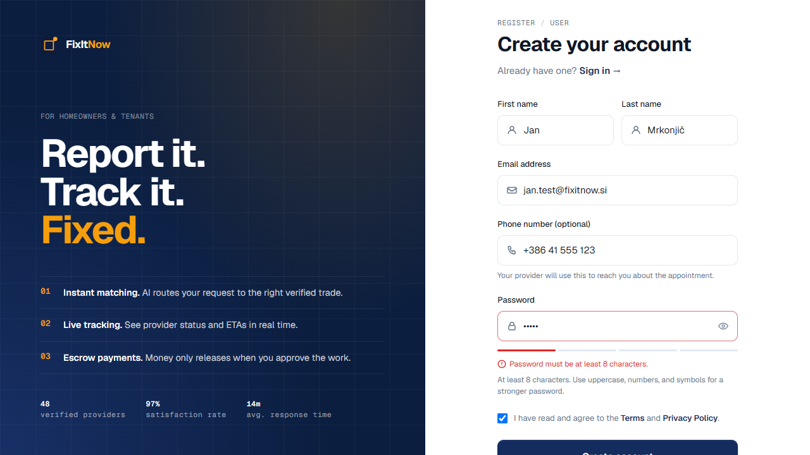

- **`TS-04` – Uspešno oddana vloga izvajalca v čakanju na odobritev administratorja (`/register/provider`):**

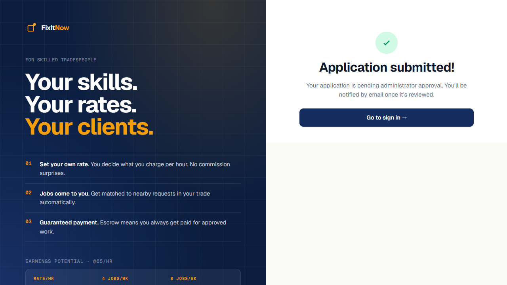

- **`TS-04` – Preverjanje 2FA TOTP kode in validacija dolžine kode na `/two-factor`:**

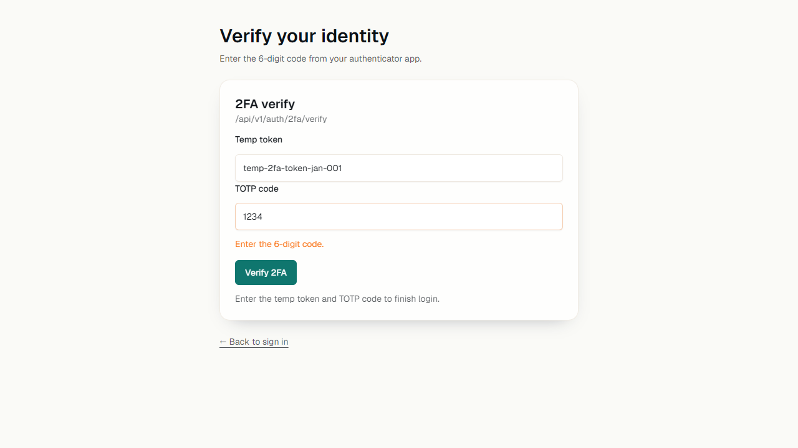

- **`TS-05` – Validacija obveznih polj praznega zahtevka na `/tickets/new`:**

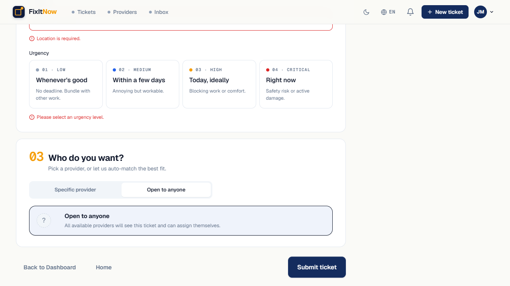

- **`TS-05` – Izpolnjen zahtevek s fotografijo, pripeto lokacijo, izbranim izvajalcem *Luka Kovač* in terminom:**

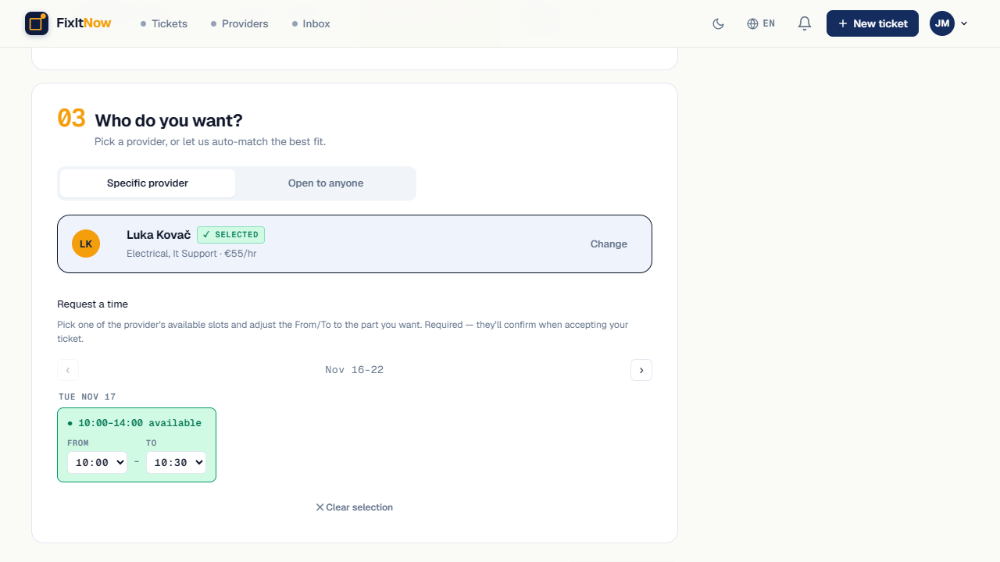

- **`TS-05` – Ustvarjen zahtevek `FIX-0088` v stanju `PENDING_APPROVAL` (`/tickets/88`):**

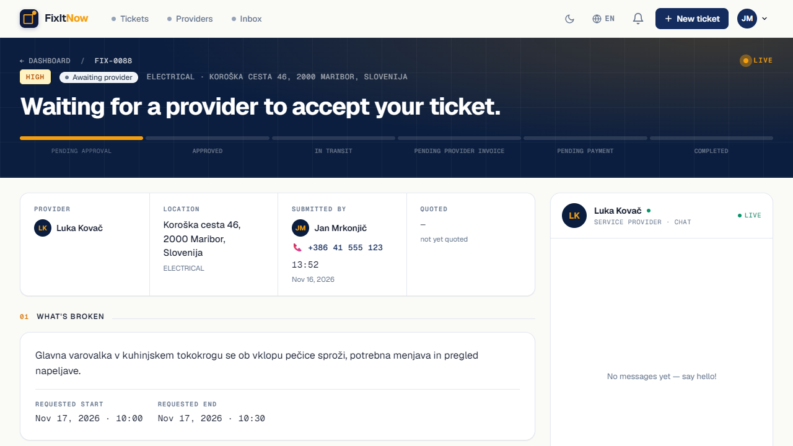

- **`TS-05` – Zahtevek `FIX-0088` po preklicu s strani stranke (`CANCELLED`):**

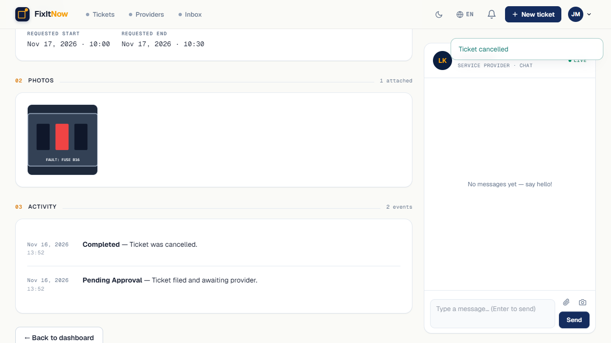

- **`TS-06` – Shranjena privzeta lokacija stavbe v razdelku *03 Buildings & locations* (`/profile`):**

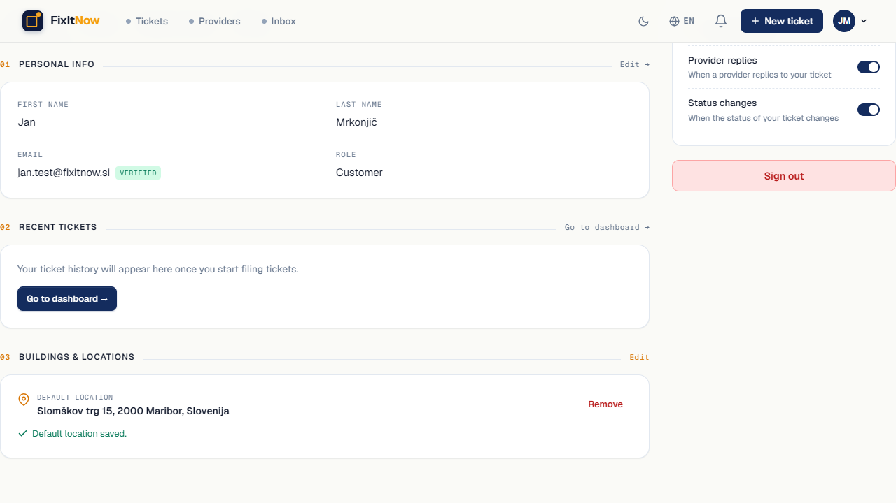

- **`TS-06` – Urejen profil (`Saved.`) in validacija neujemajočih se gesel (`Passwords do not match.`) na `/profile/edit`:**

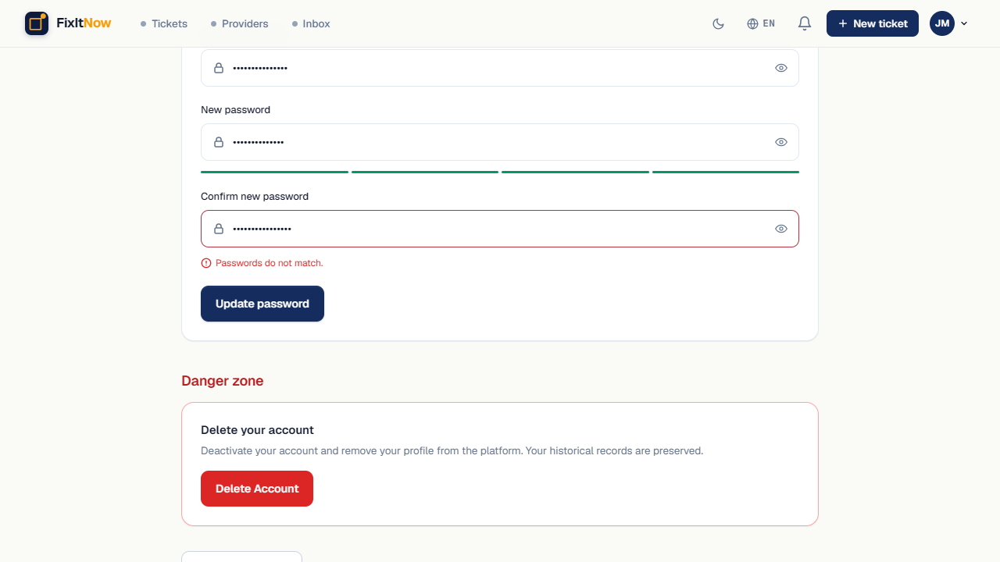

- **`TS-06` – Blokada mehkega izbrisa računa ob aktivnem zahtevku (*Danger zone – Delete Account*):**

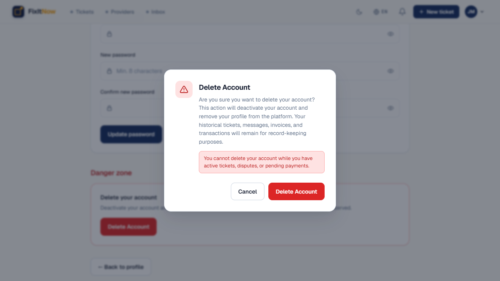

---

## 4. Preizkus zaznave namerno vnesene napake (*Fault Injection*)

Za preverjanje zanesljivosti avtomatiziranih testov smo v datoteki `frontend/src/pages/RegisterUserPage.tsx` (vrstica 71) v validacijski shemi Zod namerno znižali zahtevano minimalno dolžino gesla z `8` na `3` znake:

```ts
// Prvotna (pravilna) koda:
password: z.string().min(8, t("registerUser.passwordMinLength")),

// Namerno vnesena napaka:
password: z.string().min(3, t("registerUser.passwordMinLength")),
```

Ob ponovnem zagonu testa `TS-04` (`npx playwright test e2e/ts04-auth-register-2fa.spec.ts`) je skripta napako takoj zaznala. V 2. koraku je obrazec namesto zavrnitve prekratkega 5-mestnega gesla (`"abc12"`) dovolil oddajo registracije in prešel na zaslon `"You're in!"`, zaradi česar je test padel na trditvi, ki pričakuje izpis validacijske napake `"Password must be at least 8 characters."`:

```text
  1) [chromium] › e2e\ts04-auth-register-2fa.spec.ts:8:3 › TS-04: Registracija uporabnika/izvajalca, preverjanje moči gesla ter prijava z 2FA TOTP
    Error: expect(locator).toBeVisible() failed

    Locator: getByText('Password must be at least 8 characters.')
    Expected: visible
    Timeout: 10000ms
    Error: element(s) not found
```

Posnetek zaslona ob zaznani napaki (obrazec je zaradi okvarjene validacije sprejel prekratko geslo `"abc12"` in prikazal potrditveni zaslon *You're in!*):

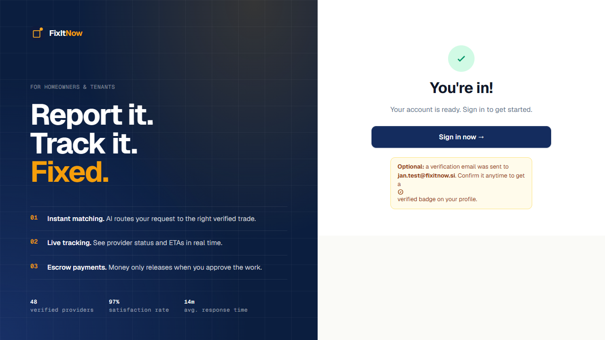

Po potrditvi zaznave smo namerno napako odstranili (povrnili `.min(8, ...)`) in ponovno pognali naše tri testne scenarije (`TS-04`–`TS-06`), pri čemer so vsi 3 testi ponovno uspešno prestali preizkus (`3 passed`, `19.0s`).

