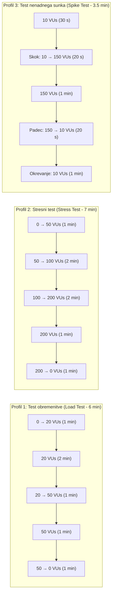

# Poročilo – Naloga 4: Sistemsko testiranje rešitve FixItNow

---

## 1. Uvod in pregled izbranih orodij po članih ekipe

Namen sistemskega testiranja je preveriti delovanje celotnega, integriranega sistema **FixItNow** (spletni odjemalec React/Vite, zaledni strežnik Java 21 / Spring Boot 3.3 in relacijska podatkovna baza PostgreSQL 16 v okolju Docker) v pogojih, ki posnemajo realno produkcijsko rabo, mejne obremenitve, varnostne grožnje in izpade infrastrukture.

V skladu z navodili smo si člani ekipe razdelili **tri različne tipe sistemskih testov** in **tri različna specializirana orodja**, tako da skupaj pokrijemo ključne nefunkcionalne vidike kakovosti sistema (zmogljivost pod obremenitvijo in stresom, informacijsko varnost ter dolgoročno vzdržljivost in okrevanje po izpadu):

| Član ekipe | Izbrano orodje | Tip sistemskega testiranja | Kratek povzetek fokusa testiranja na projektu FixItNow |
| :--- | :--- | :--- | :--- |
| **Luka Grobelnik** *(podrobno v tem poročilu)* | **Grafana k6** | **Testiranje obremenitve (*Load Testing*), stresno testiranje (*Stress Testing*) in testiranje nenadnih sunkov (*Spike Testing*)** | Preverjanje odzivnih časov, prepustnosti (*RPS*) in točke preloma zalednega REST API-ja pri sočasnem prostorskem iskanju izvajalcev, avtentikaciji (BCrypt + JWT) ter oddaji in pregledu servisnih zahtevkov. |
| **Jan Mrkonjič** | **OWASP ZAP (*Zed Attack Proxy*)** | **Varnostno in penetracijsko testiranje (*Security & Vulnerability Testing – DAST*)** | Dinamično varnostno pregledovanje aplikacije, testiranje odpornosti proti napadom *SQL Injection*, *XSS*, *Broken Access Control* (IDOR na zahtevkih in računih), *Brute-Force* napadom na prijavo/2FA ter preverjanje varnostnih glav HTTP in CORS politike. |
| **Alan Labaš** | **Locust + Docker Chaos (Pumba)** | **Testiranje vzdržljivosti (*Soak / Endurance Testing*), skalabilnosti in okrevanja po izpadu (*Recovery Testing*)** | Dolgotrajno enakomerno obremenjevanje sistema za odkrivanje puščanja pomnilnika (*Memory Leaks*) in izčrpanja baznih povezav (*HikariCP*) ter preverjanje samodejnega okrevanja ob začasnem izpadu ali zakasnitvah zabojnika PostgreSQL. |

---

## 2. Kratek opis izbranih orodij za vse tri člane ekipe

### 2.1 Orodje 1: Grafana k6 (Luka Grobelnik)
**Grafana k6** je sodobno, odprtokodno orodje za testiranje zmogljivosti in obremenitve, napisano v jeziku **Go**, pri katerem se testni scenariji pišejo v jeziku **JavaScript (ES6)**. Zaradi izvajanja na osnovi Go gorutin porabi bistveno manj sistemskih virov (CPU in RAM) kot tradicionalna orodja na osnovi niti (npr. JMeter), kar omogoča generiranje več tisoč sočasnih navideznih uporabnikov (*Virtual Users – VUs*) z enega samega testnega računalnika. Orodje omogoča deklarativno definicijo profilov obremenitve (`stages` / `executors`) in vgrajenih kriterijev uspešnosti (`thresholds`), ki ob prekoračitvi mejnih vrednosti samodejno označijo test kot neuspešen (ne-ničelni izhodni status procesa, primeren za CI/CD cevovode).

### 2.2 Orodje 2: OWASP ZAP – Zed Attack Proxy (Jan Mrkonjič)
**OWASP ZAP** je uveljavljeno odprtokodno orodje za dinamično testiranje varnosti spletnih aplikacij (*DAST – Dynamic Application Security Testing*). Deluje kot posredniški strežnik (*intercepting proxy*), samodejni pajek (*Spider / AJAX Spider*) in aktivni skener ranljivosti (*Active Scanner*). V kontekstu projekta **FixItNow** omogoča uvoz OpenAPI/Swagger specifikacije (`/v3/api-docs`) in sistematično izvajanje simuliranih napadov na REST končne točke ter spletni vmesnik: preverjanje vbrizgavanja SQL ukazov v filtre iskalnika (`/api/v1/providers/search`), poskusov nepooblaščenega dostopa do tujih zahtevkov (`/api/tickets/{id}`), zlorabe avtentikacijskih žetonov JWT ter ugotavljanje manjkajočih varnostnih glav (`Content-Security-Policy`, `X-Content-Type-Options`, `Strict-Transport-Security`).

### 2.3 Orodje 3: Locust v kombinaciji z Docker Chaos / Pumba (Alan Labaš)
**Locust** je odprtokodno ogrodje za porazdeljeno obremenitveno testiranje in testiranje vzdržljivosti v jeziku **Python**, kjer je obnašanje uporabnikov definirano s kodo (`HttpUser`, `@task`) in izvajano prek asinhronih V/I dogodkov (*gevent*). V kombinaciji z orodjem **Pumba** (orodje za *Chaos Engineering* na nivoju Docker zabojnikov) omogoča izvedbo **testiranja vzdržljivosti (*Soak Testing*)** in **testiranja okrevanja (*Recovery / Resiliency Testing*)**. Medtem ko Locust daljše časovno obdobje vzdržuje stalno obremenitev na aplikaciji FixItNow (vključno z aktivnimi sejami in osveževanjem podatkov), Pumba simulira motnje v infrastrukturi – npr. začasno zaustavitev (`docker pause`), ponovni zagon zabojnika podatkovne baze PostgreSQL ali vnos omrežne zakasnitve (*netem delay*) – s čimer preverjamo, kako hitro si zaledni sistem Spring Boot in bazen povezav HikariCP opomoreta po odpravi izpada.

---

## 3. Podrobna opredelitev sistemskega testiranja – Luka Grobelnik (Grafana k6)

### 3.1 Utemeljitev izbire orodja Grafana k6 in tipov testov za FixItNow

Za podrobno obravnavo in izvedbo sem izbral **preizkušanje zmogljivosti pod obremenitvijo (*Load Testing*), stresno testiranje (*Stress Testing*) in testiranje nenadnih sunkov obremenitve (*Spike Testing*)** z orodjem **Grafana k6**.

**Zakaj so ti tipi sistemskih testov kritični za projekt FixItNow:**
1. **Računsko in podatkovno zahtevno prostorsko iskanje (`/api/v1/providers/search`):** Iskalnik izvajalcev ob vsakem klicu izvaja večkriterijsko filtriranje po kategorijah storitev, urni postavki, izkušnjah in tekstovnem nizu ter ob podanih koordinatah (`latitude`, `longitude`, `radiusKm`) računa geografsko razdaljo in paginacijo v bazi PostgreSQL.
2. **Kriptografsko zahtevna avtentikacija (`/api/v1/auth/login`):** Vsaka prijava uporabnika sproži preverjanje zgoščevalne funkcije **BCrypt** (ki je namenoma procesorsko potratna za zaščito pred razbijanjem gesel) in podpisovanje ter zapisovanje **JWT** dostopnih ter osvežitvenih žetonov v podatkovno bazo (`refresh_tokens`).
3. **Transakcijsko pisanje in osveževanje stanj (`/api/tickets`, `/api/notifications`):** Oddaja novih servisnih zahtevkov, pregled podrobnosti zahtevka in periodično poizvedovanje po neprebranih obvestilih (`/api/notifications/unread-count`) obremenjujejo omejen nabor baznih povezav (**HikariCP** privzeto dovoljuje 10 sočasnih povezav v podatkovno bazo).

**Prednosti orodja Grafana k6 pri testiranju FixItNow:**
- **Testiranje kot koda (*Testing as Code*):** Scenarij je zapisan v eni pregledni datoteki JavaScript, ki podpira veriženje klicev (npr. prijava $\rightarrow$ ekstrakcija `accessToken` iz JSON odgovora $\rightarrow$ avtenticirani klici v imenu prijavljene stranke).
- **Natančne statistične metrike:** k6 samodejno meri porazdelitev odzivnih časov po percentilih ($p(50)$, $p(90)$, $p(95)$, $p(99)$), kar je ključno za odkrivanje ozkih grl (*tail latency*), ki jih zgolj povprečni odzivni čas skrije.
- **Vgrajeno preverjanje kriterijev (`thresholds`):** Kriteriji uspešnosti (SLA) so zapisani neposredno v konfiguraciji testa in se preverjajo samodejno ob koncu izvajanja.

---

### 3.2 Kaj preverjamo: opredelitev testnih scenarijev

V okviru sistemskega testa preverjamo celovit, realističen mešani tok dejanj uporabnikov na platformi **FixItNow**, razdeljen v **tri funkcionalne sklope (skupine zahtevkov)**, ki se izvajajo v zaporedju z vmesnim časom razmišljanja uporabnika (*think time* `1–2 s`):

#### Scenarij `ST-01`: Javno brskanje in večkriterijsko prostorsko iskanje izvajalcev (Bralno intenziven sklop)
Simulira neprijavljene in prijavljene obiskovalce, ki odprejo vstopno stran ter iščejo mojstra v svoji okolici:
1. **`GET /api/v1/stats/public`** – Pridobitev javnih statistik platforme na vstopni strani (število zaključenih popravil, aktivnih izvajalcev in povprečna ocena).
2. **`GET /api/v1/providers/categories`** – Pridobitev aktivnih kategorij storitev.
3. **`GET /api/v1/providers/search?category=PLUMBING&maxPrice=80&minExperience=2&latitude=46.5547&longitude=15.6459&radiusKm=25&page=0&size=12`** – Večkriterijsko in geolokacijsko iskanje izvajalcev v okolici Maribora z izračunom razdalje `distanceKm`.
4. **`GET /api/v1/providers/{id}`** – Ogled javnega profila izbranega izvajalca in **`GET /api/v1/reviews/provider/{id}`** za prikaz njegovih ocen.

#### Scenarij `ST-02`: Avtentikacija uporabnika in osveževanje seje (CPU-intenziven sklop)
Simulira prijavo obstoječe stranke v sistem in pridobivanje avtentikacijskih žetonov:
1. **`POST /api/v1/auth/login`** – Prijava z e-pošto in geslom testne stranke; strežnik preveri BCrypt zgoščeno vrednost gesla, ustvari dostopni žeton JWT (`accessToken`) in shrani osvežitveni žeton (`refreshToken`) v PostgreSQL.
2. **`GET /api/v1/user/me`** – Pridobitev profila prijavljenega uporabnika z uporabo glave `Authorization: Bearer <accessToken>`.

#### Scenarij `ST-03`: Ustvarjanje, pregled servisnih zahtevkov in preverjanje obvestil (Bralno-pisalni transakcijski sklop)
Simulira aktivno stranko, ki preverja svoja obvestila, pregleduje obstoječe zahtevke in odda nov servisni zahtevek:
1. **`GET /api/notifications/unread-count`** in **`GET /api/notifications`** – Preverjanje števila neprebranih obvestil in seznama obvestil v komponenti zvončka (`NotificationBell`).
2. **`GET /api/tickets`** – Pridobitev seznama vseh servisnih zahtevkov prijavljene stranke na nadzorni plošči.
3. **`POST /api/tickets`** – Oddaja novega servisnega zahtevka (z naslovom, opisom okvare, kategorijo `PLUMBING`, nujnostjo `MEDIUM` in naslovom ter koordinatami lokacije), ki sproži transakcijski zapis v tabeli `tickets` in `ticket_logs`.

---

### 3.3 Pogoji izvajanja testov

#### 3.3.1 Strojno in programsko testno okolje
- **Operacijski sistem:** Windows 11 (64-bit), lokalno testno okolje.
- **Zaledni strežnik (SUT – *System Under Test*):** Java 21 OpenJDK, Spring Boot 3.3 (`http://localhost:8080`), vgrajeni strežnik Apache Tomcat (privzeto do 200 delovnih niti), HikariCP bazen povezav (`maximum-pool-size = 10`).
- **Podatkovna baza:** PostgreSQL 16 v Docker zabojniku (`localhost:5433`), predhodno napolnjena s testnimi podatki prek skripte `seed_api.py` (več deset izvajalcev, strank, zahtevkov in ocen).
- **Generator obremenitve:** Grafana k6 (izvajan kot ločen proces z zastavico `--out json=naloga4/rezultati_k6.json`).

#### 3.3.2 Profili obremenitve, trajanje in vrsta obremenitve

Za celovito oceno obnašanja sistema so opredeljeni **trije ločeni profili obremenitve**:



| Št. | Profil testiranja | Cilj profila | Potek obremenitve (*Ramp-up / Plateau / Ramp-down*) | Skupno trajanje |
| :---: | :--- | :--- | :--- | :---: |
| **1** | **Test obremenitve (*Load Test*)** | Preveriti stabilnost in odzivne čase pri pričakovani normalni (20 sočasnih uporabnikov) in dnevni vršni obremenitvi (50 sočasnih uporabnikov). | • `1 min`: postopno naraščanje `0 → 20 VUs`<br>• `2 min`: vzdrževanje normalne obremenitve `20 VUs`<br>• `1 min`: naraščanje na vršno obremenitev `20 → 50 VUs`<br>• `1 min`: vzdrževanje vršne obremenitve `50 VUs`<br>• `1 min`: postopno spuščanje `50 → 0 VUs` | **6 min** |
| **2** | **Stresni test (*Stress Test*)** | Poiskati zgornjo mejo zmogljivosti sistema (točko nasičenja CPU zarad BCrypt prijav ali izčrpanja HikariCP baznih povezav) in preveriti, kako sistem odpoveduje pod preobremenitvijo. | • `1 min`: hitro naraščanje `0 → 50 VUs`<br>• `2 min`: stopnjevanje `50 → 100 VUs`<br>• `2 min`: stopnjevanje v preobremenitev `100 → 200 VUs`<br>• `1 min`: vzdrževanje ekstremne obremenitve `200 VUs`<br>• `1 min`: razbremenitev `200 → 0 VUs` | **7 min** |
| **3** | **Test nenadnega sunka (*Spike Test*)** | Simulirati nenaden naval uporabnikov (npr. ob neurju ali promocijski kampanji) in preveriti, ali sistem preživi sunek brez sesutja ter se po padcu prometa takoj vrne na normalne odzivne čase. | • `30 s`: osnovni promet `10 VUs`<br>• `20 s`: nenadni skok `10 → 150 VUs`<br>• `1 min`: vzdrževanje sunka `150 VUs`<br>• `20 s`: hiter padec `150 → 10 VUs`<br>• `1 min`: opazovanje okrevanja pri `10 VUs` | **3 min 30 s** |

---

### 3.4 Merjene metrike

Med izvajanjem testov spremljamo in beležimo naslednje skupine metrik:

1. **Časovne metrike odzivnosti (Latency / Response Time):**
   - **`http_req_duration` (celotni čas zahtevka):** od pošiljanja zadnjega bajta zahteve do prejema zadnjega bajta odgovora (`http_req_sending + http_req_waiting + http_req_receiving`).
   - **`http_req_waiting` (TTFB – *Time to First Byte*):** čas, ki ga zaledni strežnik Spring Boot in baza PostgreSQL porabita za obdelavo zahteve.
   - **Statistični kazalniki:** povprečje (`avg`), mediana (`med` / $p(50)$), 90. percentil ($p(90)$), **95. percentil ($p(95)$)** in **99. percentil ($p(99)$)** ter maksimum (`max`). Ločeno merimo tudi metrike po posameznih skupinah (`search_duration`, `login_duration`, `ticket_create_duration`).
2. **Metrike prepustnosti (Throughput):**
   - **`http_reqs` (Requests Per Second – RPS):** število uspešno obdelanih HTTP zahtevkov na sekundo.
   - **`iterations`:** število v celoti zaključenih uporabniških scenarijev na sekundo.
   - **`data_received` / `data_sent`:** količina prenesenih podatkov v kB/s oziroma MB/s.
3. **Metrike zanesljivosti in napak (Error & Availability Metrics):**
   - **`http_req_failed`:** delež neuspešnih HTTP klicev (statusne kode `5xx` – napake strežnika, `4xx` – nepričakovane zavrnitve ali poteki časovnih omejitev `timeout`).
   - **`checks`:** odstotek uspešno opravljenih funkcionalnih preverjanj vsebine odgovorov (npr. prisotnost `accessToken`, veljavna paginacija `content`, pravilni status `200 OK` / `201 Created`).
4. **Sistemske metrike vira (Resource Utilization na strežniku):**
   - Zasedenost procesorja (**CPU %**) procesov `java` (Spring Boot) in `postgres`.
   - Poraba delovnega pomnilnika (**RAM / JVM Heap**).
   - Zasedenost baznih povezav v bazenu **HikariCP** (število aktivnih in čakajočih niti `pending threads` ter morebitne izjeme `SQLTransientConnectionException: HikariPool-1 - Connection is not available`).

---

### 3.5 Kriteriji uspešnosti (SLA pragovi za presojo ustreznosti sistema)

Sistem **FixItNow** ocenimo kot **ustrezen (PASSED)** pri testu obremenitve, če izpolnjuje vse spodaj opredeljene kriterije sprejemljivosti (pri stresnem in spike testu pa dodatno preverjamo, da se proces JVM ne sesuje in da se po umiritvi prometa odzivni časi vrnejo v zeleno območje):

| Metrika / Kazalnik | Koda metrike v k6 | Kriterij za **USPEŠNO (PASSED)** – Obremenitveni test (do 50 VUs) | Kriterij za **USPEŠNO (PASSED)** – Stresni / Spike test (do 150–200 VUs) |
| :--- | :--- | :--- | :--- |
| **Splošni odzivni čas – 95. percentil** | `http_req_duration{p(95)}` | **$< 500\text{ ms}$** | **$< 1500\text{ ms}$** |
| **Splošni odzivni čas – 99. percentil** | `http_req_duration{p(99)}` | **$< 1000\text{ ms}$** | **$< 3000\text{ ms}$** |
| **Iskanje izvajalcev (`GET /api/v1/providers/search`) – $p(95)$** | `http_req_duration{endpoint:search}` | **$< 350\text{ ms}$** | **$< 1000\text{ ms}$** |
| **Prijava uporabnika (`POST /api/v1/auth/login`, BCrypt) – $p(95)$** | `http_req_duration{endpoint:login}` | **$< 800\text{ ms}$** | **$< 2500\text{ ms}$** |
| **Oddaja zahtevka (`POST /api/tickets`) – $p(95)$** | `http_req_duration{endpoint:create_ticket}` | **$< 600\text{ ms}$** | **$< 1800\text{ ms}$** |
| **Stopnja neuspešnih zahtevkov (HTTP 5xx / Timeout)** | `http_req_failed` | **$< 1,0\text{ \%}$** (`rate < 0.01`) | **$< 5,0\text{ \%}$** (`rate < 0.05`) |
| **Uspešnost vsebinskih preverjanj (`checks`)** | `checks` | **$> 99,0\text{ \%}$** (`rate > 0.99`) | **$> 95,0\text{ \%}$** (`rate > 0.95`) |
| **Okrevanje po preobremenitvi (*Recovery*)** | Odzivni čas v zadnji minuti po padcu VUs | Brez degradacije ($p(95) < 300\text{ ms}$) | Vrnitev $p(95) < 400\text{ ms}$ v $\le 30\text{ s}$ po znižanju obremenitve, brez zaostalih zaklenjenih povezav |

---

### 3.6 Pripravljena testna skripta Grafana k6 (`naloga4/fixitnow_k6_test.js`)

Spodnja skripta v celoti implementira opredeljene scenarije (`ST-01`, `ST-02`, `ST-03`), prilagodljive profile obremenitve (`load`, `stress`, `spike`) ter avtomatsko preverjanje kriterijev uspešnosti (`thresholds`):

```javascript
import http from 'k6/http';
import { check, group, sleep } from 'k6';
import { Trend, Rate } from 'k6/metrics';

// Prilagojene metrike po končnih točkah
const searchDuration = new Trend('search_duration', true);
const loginDuration = new Trend('login_duration', true);
const createTicketDuration = new Trend('create_ticket_duration', true);
const businessErrorRate = new Rate('business_error_rate');

const BASE_URL = __ENV.BASE_URL || 'http://localhost:8080';
const PROFILE = __ENV.PROFILE || 'load'; // 'load' | 'stress' | 'spike'

const profiles = {
  load: [
    { duration: '1m', target: 20 }, // Postopno naraščanje na normalno obremenitev
    { duration: '2m', target: 20 }, // Vzdrževanje normalne obremenitve
    { duration: '1m', target: 50 }, // Povečanje na vršno obremenitev
    { duration: '1m', target: 50 }, // Vzdrževanje vršne obremenitve
    { duration: '1m', target: 0 },  // Postopno zmanjševanje (ramp-down)
  ],
  stress: [
    { duration: '1m', target: 50 },
    { duration: '2m', target: 100 },
    { duration: '2m', target: 200 },
    { duration: '1m', target: 200 },
    { duration: '1m', target: 0 },
  ],
  spike: [
    { duration: '30s', target: 10 },
    { duration: '20s', target: 150 },
    { duration: '1m', target: 150 },
    { duration: '20s', target: 10 },
    { duration: '1m', target: 10 },
  ],
};

export const options = {
  stages: profiles[PROFILE] || profiles.load,
  thresholds: {
    http_req_failed: ['rate<0.01'],                       // Manj kot 1 % napak HTTP
    http_req_duration: ['p(95)<500', 'p(99)<1000'],       // Splošni SLA odzivnega časa
    search_duration: ['p(95)<350'],                       // SLA za iskanje izvajalcev
    login_duration: ['p(95)<800'],                        // SLA za BCrypt prijavo
    create_ticket_duration: ['p(95)<600'],                // SLA za ustvarjanje zahtevka
    checks: ['rate>0.99'],                                // Nad 99 % uspešnih preverjanj
  },
};

export default function () {
  let accessToken = null;

  // 1. SKLOP (ST-01): Javno brskanje in prostorsko iskanje izvajalcev
  group('ST-01: Javno brskanje in iskanje izvajalcev', () => {
    const statsRes = http.get(`${BASE_URL}/api/v1/stats/public`, {
      tags: { endpoint: 'public_stats' },
    });
    check(statsRes, {
      'javna statistika vrne 200 OK': (r) => r.status === 200,
    });

    const categoriesRes = http.get(`${BASE_URL}/api/v1/providers/categories`, {
      tags: { endpoint: 'categories' },
    });
    check(categoriesRes, {
      'kategorije vrnejo 200 OK': (r) => r.status === 200,
    });

    const searchUrl =
      `${BASE_URL}/api/v1/providers/search?category=PLUMBING&maxPrice=80` +
      `&minExperience=2&latitude=46.5547&longitude=15.6459&radiusKm=25&page=0&size=12`;
    const searchRes = http.get(searchUrl, {
      tags: { endpoint: 'search' },
    });
    searchDuration.add(searchRes.timings.duration);

    const searchOk = check(searchRes, {
      'iskanje izvajalcev vrne 200 OK': (r) => r.status === 200,
      'odgovor vsebuje paginirano polje content': (r) => {
        try {
          return Array.isArray(JSON.parse(r.body).content);
        } catch (_) {
          return false;
        }
      },
    });
    businessErrorRate.add(!searchOk);
  });

  sleep(1);

  // 2. SKLOP (ST-02): Avtentikacija uporabnika (BCrypt + JWT)
  group('ST-02: Prijava uporabnika in pridobitev profila', () => {
    const loginPayload = JSON.stringify({
      email: __ENV.TEST_EMAIL || 'ana.kovac@example.com',
      password: __ENV.TEST_PASSWORD || 'Password123!',
    });

    const loginRes = http.post(`${BASE_URL}/api/v1/auth/login`, loginPayload, {
      headers: { 'Content-Type': 'application/json' },
      tags: { endpoint: 'login' },
    });
    loginDuration.add(loginRes.timings.duration);

    const loginOk = check(loginRes, {
      'prijava vrne 200 OK': (r) => r.status === 200,
      'odgovor vsebuje accessToken': (r) => {
        try {
          const body = JSON.parse(r.body);
          accessToken = body.accessToken;
          return Boolean(accessToken);
        } catch (_) {
          return false;
        }
      },
    });
    businessErrorRate.add(!loginOk);
  });

  sleep(1);

  // 3. SKLOP (ST-03): Avtenticirani klici - obvestila in servisni zahtevki
  if (accessToken) {
    const authHeaders = {
      headers: {
        'Content-Type': 'application/json',
        Authorization: `Bearer ${accessToken}`,
      },
    };

    group('ST-03: Obvestila in upravljanje zahtevkov', () => {
      const unreadRes = http.get(
        `${BASE_URL}/api/notifications/unread-count`,
        authHeaders
      );
      check(unreadRes, {
        'neprebrana obvestila vrnejo 200 OK': (r) => r.status === 200,
      });

      const ticketsRes = http.get(`${BASE_URL}/api/tickets`, authHeaders);
      check(ticketsRes, {
        'seznam zahtevkov vrne 200 OK': (r) => r.status === 200,
      });

      // Z verjetnostjo 25 % uporabnik v iteraciji odda tudi nov zahtevek (realistično razmerje branje:pisanje)
      if (Math.random() < 0.25) {
        const ticketPayload = JSON.stringify({
          title: 'Puščanje sifona pod kuhinjskim koritom (k6 test)',
          description: 'Voda kaplja pri tesnilu pod pomivalnim koritom.',
          serviceCategory: 'PLUMBING',
          urgency: 'MEDIUM',
          address: 'Smetanova ulica 17, 2000 Maribor',
          latitude: 46.559,
          longitude: 15.638,
        });

        const createRes = http.post(
          `${BASE_URL}/api/tickets`,
          ticketPayload,
          Object.assign({}, authHeaders, { tags: { endpoint: 'create_ticket' } })
        );
        createTicketDuration.add(createRes.timings.duration);

        check(createRes, {
          'ustvarjanje zahtevka vrne 201 Created': (r) => r.status === 201,
        });
      }
    });
  }

  sleep(1);
}
```
