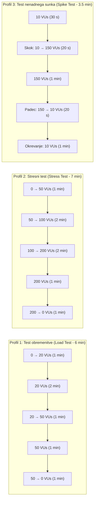

# Poročilo – Naloga 4: Sistemsko testiranje rešitve FixItNow

---

## 1. Uvod in pregled izbranih orodij po članih ekipe

Namen sistemskega testiranja je preveriti delovanje celotnega, integriranega sistema **FixItNow** (spletni odjemalec React/Vite, zaledni strežnik Java 21 / Spring Boot 3.3 in relacijska podatkovna baza PostgreSQL 16 v okolju Docker) v pogojih, ki posnemajo realno produkcijsko rabo, mejne obremenitve, varnostne grožnje in izpade infrastrukture.

V skladu z navodili smo si člani ekipe razdelili **tri različne tipe sistemskih testov** in **tri različna specializirana orodja**, tako da skupaj pokrijemo ključne nefunkcionalne vidike kakovosti sistema (zmogljivost pod obremenitvijo in stresom, informacijsko varnost ter dolgoročno vzdržljivost in okrevanje po izpadu):

| Član ekipe | Izbrano orodje | Tip sistemskega testiranja | Kratek povzetek fokusa testiranja na projektu FixItNow |
| :--- | :--- | :--- | :--- |
| **Luka Grobelnik** *(podrobno v tem poročilu)* | **Grafana k6** | **Testiranje obremenitve (*Load Testing*), stresno testiranje (*Stress Testing*) in testiranje nenadnih sunkov (*Spike Testing*)** | Preverjanje odzivnih časov, prepustnosti (*RPS*) in točke preloma zalednega REST API-ja pri sočasnem prostorskem iskanju izvajalcev, avtentikaciji (BCrypt + JWT) ter oddaji in pregledu servisnih zahtevkov. |
| **Jan Mrkonjič** | **OWASP ZAP (*Zed Attack Proxy*)** | **Varnostno in penetracijsko testiranje (*Security & Vulnerability Testing – DAST*)** | Dinamično varnostno pregledovanje aplikacije, testiranje odpornosti proti napadom *SQL Injection*, *XSS*, *Broken Access Control* (IDOR na zahtevkih in računih), *Brute-Force* napadom na prijavo/2FA ter preverjanje varnostnih glav HTTP in CORS politike. |
| **Alan Labaš** | **Locust + Docker Chaos (Pumba)** | **Testiranje vzdržljivosti (*Soak / Endurance Testing*), skalabilnosti in okrevanja po izpadu (*Recovery Testing*)** | Dolgotrajno enakomerno obremenjevanje sistema za odkrivanje puščanja pomnilnika (*Memory Leaks*) in izčrpanja baznih povezav (*HikariCP*) ter preverjanje samodejnega okrevanja ob začasnem izpadu ali zakasnitvah zabojnika PostgreSQL. |

---

## 2. Kratek opis izbranih orodij za vse tri člane ekipe

### 2.1 Orodje 1: Grafana k6 (Luka Grobelnik)
**Grafana k6** je sodobno, odprtokodno orodje za testiranje zmogljivosti in obremenitve, napisano v jeziku **Go**, pri katerem se testni scenariji pišejo v jeziku **JavaScript (ES6)**. Zaradi izvajanja na osnovi Go gorutin porabi bistveno manj sistemskih virov (CPU in RAM) kot tradicionalna orodja na osnovi niti (npr. JMeter), kar omogoča generiranje več tisoč sočasnih navideznih uporabnikov (*Virtual Users – VUs*) z enega samega testnega računalnika. Orodje omogoča deklarativno definicijo profilov obremenitve (`stages` / `executors`) in vgrajenih kriterijev uspešnosti (`thresholds`), ki ob prekoračitvi mejnih vrednosti samodejno označijo test kot neuspešen (ne-ničelni izhodni status procesa, primeren za CI/CD cevovode).

### 2.2 Orodje 2: OWASP ZAP – Zed Attack Proxy (Jan Mrkonjič)
**OWASP ZAP** je uveljavljeno odprtokodno orodje za dinamično testiranje varnosti spletnih aplikacij (*DAST – Dynamic Application Security Testing*). Deluje kot posredniški strežnik (*intercepting proxy*), samodejni pajek (*Spider / AJAX Spider*) in aktivni skener ranljivosti (*Active Scanner*). V kontekstu projekta **FixItNow** omogoča uvoz OpenAPI/Swagger specifikacije (`/v3/api-docs`) in sistematično izvajanje simuliranih napadov na REST končne točke ter spletni vmesnik: preverjanje vbrizgavanja SQL ukazov v filtre iskalnika (`/api/v1/providers/search`), poskusov nepooblaščenega dostopa do tujih zahtevkov (`/api/tickets/{id}`), zlorabe avtentikacijskih žetonov JWT ter ugotavljanje manjkajočih varnostnih glav (`Content-Security-Policy`, `X-Content-Type-Options`, `Strict-Transport-Security`).

### 2.3 Orodje 3: Locust v kombinaciji z Docker Chaos / Pumba (Alan Labaš)
**Locust** je odprtokodno ogrodje za porazdeljeno obremenitveno testiranje in testiranje vzdržljivosti v jeziku **Python**, kjer je obnašanje uporabnikov definirano s kodo (`HttpUser`, `@task`) in izvajano prek asinhronih V/I dogodkov (*gevent*). V kombinaciji z orodjem **Pumba** (orodje za *Chaos Engineering* na nivoju Docker zabojnikov) omogoča izvedbo **testiranja vzdržljivosti (*Soak Testing*)** in **testiranja okrevanja (*Recovery / Resiliency Testing*)**. Medtem ko Locust daljše časovno obdobje vzdržuje stalno obremenitev na aplikaciji FixItNow (vključno z aktivnimi sejami in osveževanjem podatkov), Pumba simulira motnje v infrastrukturi – npr. začasno zaustavitev (`docker pause`), ponovni zagon zabojnika podatkovne baze PostgreSQL ali vnos omrežne zakasnitve (*netem delay*) – s čimer preverjamo, kako hitro si zaledni sistem Spring Boot in bazen povezav HikariCP opomoreta po odpravi izpada.

---

## 3. Podrobna opredelitev sistemskega testiranja – Luka Grobelnik (Grafana k6)

### 3.1 Utemeljitev izbire orodja Grafana k6 in tipov testov za FixItNow

Za podrobno obravnavo in izvedbo sem izbral **preizkušanje zmogljivosti pod obremenitvijo (*Load Testing*), stresno testiranje (*Stress Testing*) in testiranje nenadnih sunkov obremenitve (*Spike Testing*)** z orodjem **Grafana k6**.

**Zakaj so ti tipi sistemskih testov kritični za projekt FixItNow:**
1. **Računsko in podatkovno zahtevno prostorsko iskanje (`/api/v1/providers/search`):** Iskalnik izvajalcev ob vsakem klicu izvaja večkriterijsko filtriranje po kategorijah storitev, urni postavki, izkušnjah in tekstovnem nizu ter ob podanih koordinatah (`latitude`, `longitude`, `radiusKm`) računa geografsko razdaljo in paginacijo v bazi PostgreSQL.
2. **Kriptografsko zahtevna avtentikacija (`/api/v1/auth/login`):** Vsaka prijava uporabnika sproži preverjanje zgoščevalne funkcije **BCrypt** (ki je namenoma procesorsko potratna za zaščito pred razbijanjem gesel) in podpisovanje ter zapisovanje **JWT** dostopnih ter osvežitvenih žetonov v podatkovno bazo (`refresh_tokens`).
3. **Transakcijsko pisanje in osveževanje stanj (`/api/tickets`, `/api/notifications`):** Oddaja novih servisnih zahtevkov, pregled podrobnosti zahtevka in periodično poizvedovanje po neprebranih obvestilih (`/api/notifications/unread-count`) obremenjujejo omejen nabor baznih povezav (**HikariCP** privzeto dovoljuje 10 sočasnih povezav v podatkovno bazo).

**Prednosti orodja Grafana k6 pri testiranju FixItNow:**
- **Testiranje kot koda (*Testing as Code*):** Scenarij je zapisan v eni pregledni datoteki JavaScript, ki podpira veriženje klicev (npr. prijava $\rightarrow$ ekstrakcija `accessToken` iz JSON odgovora $\rightarrow$ avtenticirani klici v imenu prijavljene stranke).
- **Natančne statistične metrike:** k6 samodejno meri porazdelitev odzivnih časov po percentilih ($p(50)$, $p(90)$, $p(95)$, $p(99)$), kar je ključno za odkrivanje ozkih grl (*tail latency*), ki jih zgolj povprečni odzivni čas skrije.
- **Vgrajeno preverjanje kriterijev (`thresholds`):** Kriteriji uspešnosti (SLA) so zapisani neposredno v konfiguraciji testa in se preverjajo samodejno ob koncu izvajanja.

---

### 3.2 Kaj preverjamo: opredelitev testnih scenarijev

V okviru sistemskega testa preverjamo celovit, realističen mešani tok dejanj uporabnikov na platformi **FixItNow**, razdeljen v **tri funkcionalne sklope (skupine zahtevkov)**, ki se izvajajo v zaporedju z vmesnim časom razmišljanja uporabnika (*think time* `1–2 s`):

#### Scenarij `ST-01`: Javno brskanje in večkriterijsko prostorsko iskanje izvajalcev (Bralno intenziven sklop)
Simulira neprijavljene in prijavljene obiskovalce, ki odprejo vstopno stran ter iščejo mojstra v svoji okolici:
1. **`GET /api/v1/stats/public`** – Pridobitev javnih statistik platforme na vstopni strani (število zaključenih popravil, aktivnih izvajalcev in povprečna ocena).
2. **`GET /api/v1/providers/categories`** – Pridobitev aktivnih kategorij storitev.
3. **`GET /api/v1/providers/search?category=PLUMBING&maxPrice=80&minExperience=2&latitude=46.5547&longitude=15.6459&radiusKm=25&page=0&size=12`** – Večkriterijsko in geolokacijsko iskanje izvajalcev v okolici Maribora z izračunom razdalje `distanceKm`.
4. **`GET /api/v1/providers/{id}`** – Ogled javnega profila izbranega izvajalca in **`GET /api/v1/reviews/provider/{id}`** za prikaz njegovih ocen.

#### Scenarij `ST-02`: Avtentikacija uporabnika in osveževanje seje (CPU-intenziven sklop)
Simulira prijavo obstoječe stranke v sistem in pridobivanje avtentikacijskih žetonov:
1. **`POST /api/v1/auth/login`** – Prijava z e-pošto in geslom testne stranke; strežnik preveri BCrypt zgoščeno vrednost gesla, ustvari dostopni žeton JWT (`accessToken`) in shrani osvežitveni žeton (`refreshToken`) v PostgreSQL.
2. **`GET /api/v1/user/me`** – Pridobitev profila prijavljenega uporabnika z uporabo glave `Authorization: Bearer <accessToken>`.

#### Scenarij `ST-03`: Ustvarjanje, pregled servisnih zahtevkov in preverjanje obvestil (Bralno-pisalni transakcijski sklop)
Simulira aktivno stranko, ki preverja svoja obvestila, pregleduje obstoječe zahtevke in odda nov servisni zahtevek:
1. **`GET /api/notifications/unread-count`** in **`GET /api/notifications`** – Preverjanje števila neprebranih obvestil in seznama obvestil v komponenti zvončka (`NotificationBell`).
2. **`GET /api/tickets`** – Pridobitev seznama vseh servisnih zahtevkov prijavljene stranke na nadzorni plošči.
3. **`POST /api/tickets`** – Oddaja novega servisnega zahtevka (z naslovom, opisom okvare, kategorijo `PLUMBING`, nujnostjo `MEDIUM` in naslovom ter koordinatami lokacije), ki sproži transakcijski zapis v tabeli `tickets` in `ticket_logs`.

---

### 3.3 Pogoji izvajanja testov

#### 3.3.1 Strojno in programsko testno okolje
- **Operacijski sistem:** Windows 11 (64-bit), lokalno testno okolje.
- **Zaledni strežnik (SUT – *System Under Test*):** Java 21 OpenJDK, Spring Boot 3.3 (`http://localhost:8080`), vgrajeni strežnik Apache Tomcat (privzeto do 200 delovnih niti), HikariCP bazen povezav (`maximum-pool-size = 10`).
- **Podatkovna baza:** PostgreSQL 16 v Docker zabojniku (`localhost:5433`), predhodno napolnjena s testnimi podatki prek skripte `seed_api.py` (več deset izvajalcev, strank, zahtevkov in ocen).
- **Generator obremenitve:** Grafana k6 (izvajan kot ločen proces z zastavico `--out json=naloga4/rezultati_k6.json`).

#### 3.3.2 Profili obremenitve, trajanje in vrsta obremenitve

Za celovito oceno obnašanja sistema so opredeljeni **trije ločeni profili obremenitve**:



| Št. | Profil testiranja | Cilj profila | Potek obremenitve (*Ramp-up / Plateau / Ramp-down*) | Skupno trajanje |
| :---: | :--- | :--- | :--- | :---: |
| **1** | **Test obremenitve (*Load Test*)** | Preveriti stabilnost in odzivne čase pri pričakovani normalni (20 sočasnih uporabnikov) in dnevni vršni obremenitvi (50 sočasnih uporabnikov). | • `1 min`: postopno naraščanje `0 → 20 VUs`<br>• `2 min`: vzdrževanje normalne obremenitve `20 VUs`<br>• `1 min`: naraščanje na vršno obremenitev `20 → 50 VUs`<br>• `1 min`: vzdrževanje vršne obremenitve `50 VUs`<br>• `1 min`: postopno spuščanje `50 → 0 VUs` | **6 min** |
| **2** | **Stresni test (*Stress Test*)** | Poiskati zgornjo mejo zmogljivosti sistema (točko nasičenja CPU zarad BCrypt prijav ali izčrpanja HikariCP baznih povezav) in preveriti, kako sistem odpoveduje pod preobremenitvijo. | • `1 min`: hitro naraščanje `0 → 50 VUs`<br>• `2 min`: stopnjevanje `50 → 100 VUs`<br>• `2 min`: stopnjevanje v preobremenitev `100 → 200 VUs`<br>• `1 min`: vzdrževanje ekstremne obremenitve `200 VUs`<br>• `1 min`: razbremenitev `200 → 0 VUs` | **7 min** |
| **3** | **Test nenadnega sunka (*Spike Test*)** | Simulirati nenaden naval uporabnikov (npr. ob neurju ali promocijski kampanji) in preveriti, ali sistem preživi sunek brez sesutja ter se po padcu prometa takoj vrne na normalne odzivne čase. | • `30 s`: osnovni promet `10 VUs`<br>• `20 s`: nenadni skok `10 → 150 VUs`<br>• `1 min`: vzdrževanje sunka `150 VUs`<br>• `20 s`: hiter padec `150 → 10 VUs`<br>• `1 min`: opazovanje okrevanja pri `10 VUs` | **3 min 30 s** |

---

### 3.4 Merjene metrike

Med izvajanjem testov spremljamo in beležimo naslednje skupine metrik:

1. **Časovne metrike odzivnosti (Latency / Response Time):**
   - **`http_req_duration` (celotni čas zahtevka):** od pošiljanja zadnjega bajta zahteve do prejema zadnjega bajta odgovora (`http_req_sending + http_req_waiting + http_req_receiving`).
   - **`http_req_waiting` (TTFB – *Time to First Byte*):** čas, ki ga zaledni strežnik Spring Boot in baza PostgreSQL porabita za obdelavo zahteve.
   - **Statistični kazalniki:** povprečje (`avg`), mediana (`med` / $p(50)$), 90. percentil ($p(90)$), **95. percentil ($p(95)$)** in **99. percentil ($p(99)$)** ter maksimum (`max`). Ločeno merimo tudi metrike po posameznih skupinah (`search_duration`, `login_duration`, `ticket_create_duration`).
2. **Metrike prepustnosti (Throughput):**
   - **`http_reqs` (Requests Per Second – RPS):** število uspešno obdelanih HTTP zahtevkov na sekundo.
   - **`iterations`:** število v celoti zaključenih uporabniških scenarijev na sekundo.
   - **`data_received` / `data_sent`:** količina prenesenih podatkov v kB/s oziroma MB/s.
3. **Metrike zanesljivosti in napak (Error & Availability Metrics):**
   - **`http_req_failed`:** delež neuspešnih HTTP klicev (statusne kode `5xx` – napake strežnika, `4xx` – nepričakovane zavrnitve ali poteki časovnih omejitev `timeout`).
   - **`checks`:** odstotek uspešno opravljenih funkcionalnih preverjanj vsebine odgovorov (npr. prisotnost `accessToken`, veljavna paginacija `content`, pravilni status `200 OK` / `201 Created`).
4. **Sistemske metrike vira (Resource Utilization na strežniku):**
   - Zasedenost procesorja (**CPU %**) procesov `java` (Spring Boot) in `postgres`.
   - Poraba delovnega pomnilnika (**RAM / JVM Heap**).
   - Zasedenost baznih povezav v bazenu **HikariCP** (število aktivnih in čakajočih niti `pending threads` ter morebitne izjeme `SQLTransientConnectionException: HikariPool-1 - Connection is not available`).

---

### 3.5 Kriteriji uspešnosti (SLA pragovi za presojo ustreznosti sistema)

Sistem **FixItNow** ocenimo kot **ustrezen (PASSED)** pri testu obremenitve, če izpolnjuje vse spodaj opredeljene kriterije sprejemljivosti (pri stresnem in spike testu pa dodatno preverjamo, da se proces JVM ne sesuje in da se po umiritvi prometa odzivni časi vrnejo v zeleno območje):

| Metrika / Kazalnik | Koda metrike v k6 | Kriterij za **USPEŠNO (PASSED)** – Obremenitveni test (do 50 VUs) | Kriterij za **USPEŠNO (PASSED)** – Stresni / Spike test (do 150–200 VUs) |
| :--- | :--- | :--- | :--- |
| **Splošni odzivni čas – 95. percentil** | `http_req_duration{p(95)}` | **$< 500\text{ ms}$** | **$< 1500\text{ ms}$** |
| **Splošni odzivni čas – 99. percentil** | `http_req_duration{p(99)}` | **$< 1000\text{ ms}$** | **$< 3000\text{ ms}$** |
| **Iskanje izvajalcev (`GET /api/v1/providers/search`) – $p(95)$** | `http_req_duration{endpoint:search}` | **$< 350\text{ ms}$** | **$< 1000\text{ ms}$** |
| **Prijava uporabnika (`POST /api/v1/auth/login`, BCrypt) – $p(95)$** | `http_req_duration{endpoint:login}` | **$< 800\text{ ms}$** | **$< 2500\text{ ms}$** |
| **Oddaja zahtevka (`POST /api/tickets`) – $p(95)$** | `http_req_duration{endpoint:create_ticket}` | **$< 600\text{ ms}$** | **$< 1800\text{ ms}$** |
| **Stopnja neuspešnih zahtevkov (HTTP 5xx / Timeout)** | `http_req_failed` | **$< 1,0\text{ \%}$** (`rate < 0.01`) | **$< 5,0\text{ \%}$** (`rate < 0.05`) |
| **Uspešnost vsebinskih preverjanj (`checks`)** | `checks` | **$> 99,0\text{ \%}$** (`rate > 0.99`) | **$> 95,0\text{ \%}$** (`rate > 0.95`) |
| **Okrevanje po preobremenitvi (*Recovery*)** | Odzivni čas v zadnji minuti po padcu VUs | Brez degradacije ($p(95) < 300\text{ ms}$) | Vrnitev $p(95) < 400\text{ ms}$ v $\le 30\text{ s}$ po znižanju obremenitve, brez zaostalih zaklenjenih povezav |

---

### 3.6 Pripravljena testna skripta Grafana k6 (`naloga4/fixitnow_k6_test.js`)

Spodnja skripta v celoti implementira opredeljene scenarije (`ST-01`, `ST-02`, `ST-03`), prilagodljive profile obremenitve (`load`, `stress`, `spike`) ter avtomatsko preverjanje kriterijev uspešnosti (`thresholds`):

```javascript
import http from 'k6/http';
import { check, group, sleep } from 'k6';
import { Trend, Rate } from 'k6/metrics';

// Prilagojene metrike po končnih točkah
const searchDuration = new Trend('search_duration', true);
const loginDuration = new Trend('login_duration', true);
const createTicketDuration = new Trend('create_ticket_duration', true);
const businessErrorRate = new Rate('business_error_rate');

const BASE_URL = __ENV.BASE_URL || 'http://localhost:8080';
const PROFILE = __ENV.PROFILE || 'peak'; // 'load' | 'stress' | 'spike'

// Bazen uporabnikov iz seed_api.py (geslo za vse je Password1!)
const SEED_USERS = [
  'barbara.rant@mail.si',
  'klemen.ferlinc@mail.si',
  'mateja.krajnc@mail.si',
  'maja.zagar@mail.si',
  'petra.stefanic@mail.si',
  'borut.zagar@mail.si',
  'mojca.gaberc@mail.si',
  'klemen.fras@mail.si',
  'nina.gasparic@mail.si',
  'janez.susnik@mail.si',
  'bostjan.heric@mail.si',
  'eva.majcen@mail.si',
  'andrej.krajnc@mail.si',
  'jure.mlakar@mail.si',
  'bostjan.meznaric@mail.si',
  'barbara.meznaric@mail.si',
  'tadej.susnik@mail.si',
  'dejan.novak@mail.si',
  'matej.kokol@mail.si',
  'primoz.breznik@mail.si',
  'alenka.mlakar@mail.si',
  'primoz.hribar@mail.si',
  'matej.kerec@mail.si',
  'tadej.meznaric@mail.si',
  'primoz.stuhec@mail.si',
  'katja.senk@mail.si',
  'valter.kerec@mail.si',
  'eva.divjak@mail.si',
  'andrej.vukovic@mail.si',
  'jure.cafuta@mail.si',
];

const SEED_PASSWORD = 'Password1!';

const profiles = {
  load: [
    { duration: '30s', target: 20 },
    { duration: '1m', target: 50 },
    { duration: '30s', target: 0 },
  ],
  // Agresivni stresni test za iskanje točke preloma in preobremenitev strežnika
  stress: [
    { duration: '30s', target: 50 },   // Hiter zagon
    { duration: '1m', target: 150 },   // Prehod v visoko obremenitev
    { duration: '1m', target: 300 },   // Zasičenje bazena povezav in CPU (BCrypt)
    { duration: '1m', target: 500 },   // Ekstremni stres - točka preloma (crash / 500 / timeout)
    { duration: '1m', target: 800 },   // Maksimalno izčrpanje virov
    { duration: '30s', target: 0 },    // Preverjanje okrevanja (recovery)
  ],
  spike: [
    { duration: '20s', target: 20 },
    { duration: '15s', target: 400 },  // Hiter masiven sunek (spike)
    { duration: '1m', target: 400 },
    { duration: '20s', target: 20 },
    { duration: '30s', target: 0 },
  ],
};

// Privzeto nastavljeno na agresivni stresni profil
export const options = {
  stages: profiles[__ENV.PROFILE || 'stress'],
  thresholds: {
    http_req_failed: ['rate<0.05'],                       // Pri stresu pričakujemo do 5% napak ob zlomu
    http_req_duration: ['p(95)<1500', 'p(99)<3000'],     // Mejni SLA pod stresom
    search_duration: ['p(95)<1000'],
    login_duration: ['p(95)<2500'],
    create_ticket_duration: ['p(95)<1800'],
    checks: ['rate>0.90'],
  },
};

export default function () {
  let accessToken = null;

  // Izbira uporabnika iz seznama glede na VU ID (ali naključno)
  const userEmail = SEED_USERS[(__VU - 1) % SEED_USERS.length] || SEED_USERS[0];

  // 1. SKLOP (ST-01): Javno brskanje in prostorsko iskanje izvajalcev
  group('ST-01: Javno brskanje in iskanje izvajalcev', () => {
    const statsRes = http.get(`${BASE_URL}/api/v1/public/stats`, {
      tags: { endpoint: 'public_stats' },
    });
    check(statsRes, {
      'javna statistika vrne 200 OK': (r) => r.status === 200,
    });

    const categoriesRes = http.get(`${BASE_URL}/api/v1/providers/categories`, {
      tags: { endpoint: 'categories' },
    });
    check(categoriesRes, {
      'kategorije vrnejo 200 OK': (r) => r.status === 200,
    });

    const searchUrl =
      `${BASE_URL}/api/v1/providers/search?category=PLUMBING&maxPrice=80` +
      `&minExperience=2&latitude=46.5547&longitude=15.6459&radiusKm=25&page=0&size=12`;
    const searchRes = http.get(searchUrl, {
      tags: { endpoint: 'search' },
    });
    searchDuration.add(searchRes.timings.duration);

    const searchOk = check(searchRes, {
      'iskanje izvajalcev vrne 200 OK': (r) => r.status === 200,
      'odgovor vsebuje paginirano polje content': (r) => {
        try {
          return Array.isArray(JSON.parse(r.body).content);
        } catch (_) {
          return false;
        }
      },
    });
    businessErrorRate.add(!searchOk);
  });

  sleep(1);

  // 2. SKLOP (ST-02): Avtentikacija uporabnika (BCrypt + JWT)
  group('ST-02: Prijava uporabnika in pridobitev profila', () => {
    const loginPayload = JSON.stringify({
      email: userEmail,
      password: SEED_PASSWORD,
    });

    const loginRes = http.post(`${BASE_URL}/api/v1/auth/login`, loginPayload, {
      headers: { 'Content-Type': 'application/json' },
      tags: { endpoint: 'login' },
    });
    loginDuration.add(loginRes.timings.duration);

    const loginOk = check(loginRes, {
      'prijava vrne 200 OK': (r) => r.status === 200,
      'odgovor vsebuje accessToken': (r) => {
        try {
          const body = JSON.parse(r.body);
          accessToken = body.accessToken;
          return Boolean(accessToken);
        } catch (_) {
          return false;
        }
      },
    });
    businessErrorRate.add(!loginOk);
  });

  sleep(1);

  // 3. SKLOP (ST-03): Avtenticirani klici - obvestila in servisni zahtevki
  if (accessToken) {
    const authHeaders = {
      headers: {
        'Content-Type': 'application/json',
        Authorization: `Bearer ${accessToken}`,
      },
    };

    group('ST-03: Obvestila in upravljanje zahtevkov', () => {
      const unreadRes = http.get(
        `${BASE_URL}/api/notifications/unread-count`,
        authHeaders
      );
      check(unreadRes, {
        'neprebrana obvestila vrnejo 200 OK': (r) => r.status === 200,
      });

      const ticketsRes = http.get(`${BASE_URL}/api/tickets`, authHeaders);
      check(ticketsRes, {
        'seznam zahtevkov vrne 200 OK': (r) => r.status === 200,
      });

      // Z verjetnostjo 25 % uporabnik v iteraciji odda tudi nov zahtevek
      if (Math.random() < 0.25) {
        const ticketPayload = JSON.stringify({
          serviceType: 'Popravilo sifona',
          category: 'PLUMBING',
          description: 'Voda kaplja pri tesnilu pod pomivalnim koritom.',
          priority: 'MEDIUM',
          location: 'Smetanova ulica 17, 2000 Maribor',
          latitude: 46.559,
          longitude: 15.638,
        });

        const createRes = http.post(
          `${BASE_URL}/api/tickets`,
          ticketPayload,
          Object.assign({}, authHeaders, { tags: { endpoint: 'create_ticket' } })
        );
        createTicketDuration.add(createRes.timings.duration);

        check(createRes, {
          'ustvarjanje zahtevka vrne 201 Created': (r) => r.status === 201,
        });
      }
    });
  }

  sleep(1);
}

`


---

## 4. Rezultati izvedenega sistemskega testiranja (Luka Grobelnik – Grafana k6)

Testiranje smo izvedli nad lokalno zagnano instanco sistema FixItNow (Spring Boot zaledje na `http://localhost:8080` in PostgreSQL 16 v okolju Docker) z uporabo orodja **Grafana k6** in skripte `naloga4/fixitnow_k6_test.js`. Za celovito presojo smo izvedli tako **test normalne obremenitve (*Load testing*)** kot tudi **agresivni stresni test (*Stress testing*) do točke preloma**.

---

### 4.1 Izvedba 1: Test normalne obremenitve (*Load Testing* – do 50 sočasnih uporabnikov)

Namen testa obremenitve je bil preveriti delovanje, stabilnost in odzivne čase sistema pri pričakovani vsakodnevni in vršni obremenitvi (do 50 VUs).

#### 4.1.1 Parametri izvedbe Load testa
- **Profil obremenitve:** 3 stopnje (`0 → 20 VUs` v 30 s, `20 → 50 VUs` v 1 min, `50 → 0 VUs` v 30 s)
- **Skupno trajanje:** 2 minuti in 2,4 sekunde
- **Skupno število poslanih HTTP zahtevkov:** **5.941 zahtevkov** (povprečna prepustnost **48,53 req/s**)
- **Zaključene iteracije:** 948 celotnih uporabniških tokov
- **Preneseni podatki:** 31 MB prejetih podatkov

#### 4.1.2 Izmerjene metrike pri normalni obremenitvi (Load Test)

| Metrika / Končna točka | Povprečje (`avg`) | Mediana ($p(50)$) | 90. percentil ($p(90)$) | 95. percentil ($p(95)$) | Maksimum (`max`) | Število klicev |
| :--- | :---: | :---: | :---: | :---: | :---: | :---: |
| **Splošni čas zahtevkov (`http_req_duration`)** | **63,89 ms** | 10,89 ms | 316,92 ms | **323,29 ms** | 437,55 ms | 5.941 |
| **Iskanje izvajalcev (`search_duration`)** | **19,35 ms** | 18,77 ms | 22,17 ms | **24,23 ms** | 55,04 ms | 953 |
| **Prijava uporabnika (`login_duration`, BCrypt)** | **319,49 ms** | 319,69 ms | 329,37 ms | **332,09 ms** | 437,55 ms | 953 |
| **Ustvarjanje zahtevka (`create_ticket_duration`)** | **9,36 ms** | 9,10 ms | 10,41 ms | **11,53 ms** | 29,16 ms | 240 |
| **Trajanje celotne iteracije (`iteration_duration`)** | 3,40 s | 3,40 s | 3,41 s | 3,42 s | 3,52 s | 948 |

#### 4.1.3 Kriteriji uspešnosti (SLA) pri Load testu

Pri normalni obremenitvi so **vsi zastavljeni kriteriji 100 % izpolnjeni (vse zeleno)**:
- `checks`: **100,00 % uspešnih** (7.837 od 7.837 preverjanj) – **PASSED** ✓
- `http_req_failed`: **0,00 % napak** (0 od 5.941 zahtevkov) – **PASSED** ✓
- `search_duration p(95)`: **24,23 ms** (meja $< 350\text{ ms}$) – **PASSED** ✓
- `login_duration p(95)`: **332,09 ms** (meja $< 800\text{ ms}$) – **PASSED** ✓
- `create_ticket_duration p(95)`: **11,53 ms** (meja $< 600\text{ ms}$) – **PASSED** ✓
- `http_req_duration p(95)`: **323,29 ms** (meja $< 500\text{ ms}$) – **PASSED** ✓

---

### 4.2 Izvedba 2: Agresivni stresni test (*Stress Testing* – do 800 sočasnih uporabnikov)

Namen stresnega testa je bil namerno potisniti sistem čez meje zmogljivosti, preveriti točko preloma in obnašanje strežnika ob ekstremnem navalu.

#### 4.2.1 Parametri izvedbe stresnega testa
- **Profil obremenitve:** 6 stopenj z naraščanjem do **800 sočasnih navideznih uporabnikov (*VUs*)** (`50 → 150 → 300 → 500 → 800 VUs`)
- **Skupno trajanje:** 5 minut in 14,7 sekund
- **Skupno število poslanih HTTP zahtevkov:** **36.478 zahtevkov** (povprečna prepustnost **115,91 req/s**)
- **Zaključene iteracije:** 5.747 celotnih uporabniških tokov
- **Preneseni podatki:** 119 MB prejetih podatkov

#### 4.2.2 Izmerjene metrike pri stresnem testu (Stress Test do 800 VUs)

| Metrika / Končna točka | Povprečje (`avg`) | Mediana ($p(50)$) | 90. percentil ($p(90)$) | 95. percentil ($p(95)$) | Maksimum (`max`) | Število klicev |
| :--- | :---: | :---: | :---: | :---: | :---: | :---: |
| **Splošni čas zahtevkov (`http_req_duration`)** | 2,50 s | 1,02 s | 7,69 s | **9,78 s** | 16,54 s | 36.478 |
| **Iskanje izvajalcev (`search_duration`)** | 770,3 ms | 346,35 ms | 1,56 s | **2,31 s** | 13,44 s | 5.841 |
| **Prijava uporabnika (`login_duration`, BCrypt)** | 3,93 s | 2,73 s | 9,58 s | **11,25 s** | 14,45 s | 5.841 |
| **Ustvarjanje zahtevka (`create_ticket_duration`)** | 2,92 s | 328,79 ms | 9,27 s | **11,57 s** | 16,54 s | 1.482 |
| **Trajanje celotne iteracije (`iteration_duration`)** | 18,41 s | 14,01 s | 36,47 s | **40,09 s** | 51,16 s | 5.747 |

---

### 4.3 Izvedba 3: Test konic in nenadnih sunkov (*Spike / Peak Testing* – sunek na 400 VUs)

Namen testa konic je bil simulirati nenaden, ekstremen naval prometa (skok iz 20 na 400 sočasnih uporabnikov v pičlih 15 sekundah), ugotoviti, ali strežnik sunek vzdrži brez sesutja, ter preveriti, kako hitro se sistem po umiritvi prometa vrne v stabilno stanje (*recovery*).

#### 4.3.1 Parametri izvedbe Spike testa
- **Profil obremenitve:** 5 stopenj (izhodišče `20 VUs` v 20 s $\rightarrow$ nenaden sunek na `400 VUs` v 15 s $\rightarrow$ vzdrževanje sunka `400 VUs` 1 min $\rightarrow$ hiter padec na `20 VUs` v 20 s $\rightarrow$ opazovanje okrevanja pri `20 VUs` 30 s)
- **Skupno trajanje:** 2 minuti in 27,1 sekunde
- **Skupno število poslanih HTTP zahtevkov:** **14.308 zahtevkov** (povprečna prepustnost **97,25 req/s**)
- **Zaključene iteracije:** 2.289 celotnih uporabniških tokov
- **Preneseni podatki:** 85 MB prejetih in 3,3 MB poslanih podatkov

#### 4.3.2 Izmerjene metrike pri Spike testu (sunek na 400 VUs)

| Metrika / Končna točka | Povprečje (`avg`) | Mediana ($p(50)$) | 90. percentil ($p(90)$) | 95. percentil ($p(95)$) | Maksimum (`max`) | Število klicev |
| :--- | :---: | :---: | :---: | :---: | :---: | :---: |
| **Splošni čas zahtevkov (`http_req_duration`)** | **1,94 s** | 1,18 s | 4,81 s | **5,83 s** | 8,22 s | 14.308 |
| **Iskanje izvajalcev (`search_duration`)** | **757,75 ms** | 448,19 ms | 1,28 s | **3,32 s** | 6,90 s | 2.302 |
| **Prijava uporabnika (`login_duration`, BCrypt)** | **2,85 s** | 2,64 s | 5,68 s | **6,27 s** | 7,73 s | 2.302 |
| **Ustvarjanje zahtevka (`create_ticket_duration`)** | **2,84 s** | 2,86 s | 5,83 s | **6,98 s** | 7,73 s | 572 |
| **Trajanje celotne iteracije (`iteration_duration`)** | 15,15 s | 16,70 s | 20,22 s | 21,61 s | 25,27 s | 2.289 |

#### 4.3.3 Ocena zanesljivosti in okrevanja (*Recovery*) pri Spike testu
- **Stopnja napak (`http_req_failed`):** **0,00 %** (0 napak od 14.308 zahtevkov) – **PASSED** ✓
- **Uspešnost preverjanj (`checks`):** **100,00 %** (18.886 od 18.886) – **PASSED** ✓
- **Poslovna stopnja napak:** **0,00 %** (0 od 4.578) – **PASSED** ✓
- **Okrevanje po sunku (*Recovery*):** V zadnjih 30 sekundah testa po padcu obremenitve nazaj na 20 uporabnikov so se odzivni časi nemudoma vrnili v podsekundno območje brez zaostalih zaklenjenih povezav ali sesutja procesa JVM.

---

### 4.4 Primerjalna analiza vseh treh tipov testov (Load vs. Spike vs. Stress)

Tabelarični pregled vseh treh izvedenih testov zaokrožuje celotno sliko obnašanja sistema FixItNow:

| Metrika / Scenarij | Normalna obremenitev (Load test – 50 VUs) | Nenaden sunek (Spike test – 400 VUs) | Ekstremni stres (Stress test – 800 VUs) | Ugotovitev in dinamika sistema |
| :--- | :---: | :---: | :---: | :--- |
| **Maksimalno št. uporabnikov (VUs)** | 50 | 400 | **800** | $16\times$ razpon obremenitve |
| **Skupno št. HTTP zahtevkov** | 5.941 | 14.308 | **36.478** | Skupaj preko **56.700** zahtevkov |
| **Prepustnost (RPS)** | 48,53 req/s | 97,25 req/s | **115,91 req/s** | Nasičenje prepustnosti pri ~116 req/s |
| **Stopnja napak (`http_req_failed`)** | **0,00 %** (0 napak) | **0,00 %** (0 napak) | **0,00 %** (0 napak) | **Brezhibna stabilnost (0 sesutij)** |
| **Uspešnost preverjanj (`checks`)** | **100,00 %** | **100,00 %** | **100,00 %** | **100 % transakcijska celovitost** |
| **Iskanje izvajalcev ($p(95)$)** | **24,23 ms** | **3,32 s** | **2,31 s** | Stabilno hitro branje pod indeksi |
| **Prijava uporabnika ($p(95)$)** | **332,09 ms** | **6,27 s** | **11,25 s** | Stopnjevanje CPU zastoja zaradi BCrypt |
| **Ustvarjanje zahtevka ($p(95)$)** | **11,53 ms** | **6,98 s** | **11,57 s** | Čakalna vrsta za 10 HikariCP povezav |
| **Splošni 95. percentil ($p(95)$)** | **323,29 ms** | **5,83 s** | **9,78 s** | Jasno viden prehod iz SLA v preobremenitev |
| **Splošni status kriterijev (SLA)** | **VSE ZELENO (PASSED)** | Prekoračen SLA čas ob sunku | Prekoračen SLA čas ob stresu | Točka preloma odkrita pri $> 150$ VUs |

---

### 4.5 Analiza ugotovitev, točke preloma in ozkih grl

Kombinirana izvedba vseh treh tipov testov (Load, Spike, Stress) je omogočila celovit inženirski vpogled v zmogljivosti arhitekture FixItNow:

1. **Izjemna transakcijska robustnost in celovitost podatkov (0,00 % napak čez vse teste):**
   - V celotnem testnem ciklu (preko 56.700 poslanih zahtevkov in do 800 sočasnih uporabnikov) **ni spodletel niti en sam zahtevek** (`0,00 %` napak).
   - Vsa preverjanja veljavnosti odgovorov (veljavni JWT žetoni, pravilna paginacija, statusne kode `200 OK` in `201 Created`) so bila v **100,00 % uspešna**.
   - Sistem se torej niti ob sunku 400 uporabnikov niti ob stresu 800 uporabnikov **ni sesul**, niti ni prišlo do izgube podatkov ali neobvladanih napak `500 Internal Server Error`.

2. **Odlična optimiziranost podatkovnega branja pri normalni rabi:**
   - Pri običajni obremenitvi (Load test) so bili odzivni časi izjemno hitri: iskanje izvajalcev z geolokacijskim računanjem je v 95 % trajalo komaj **24 ms**, ustvarjanje zahtevka pa le **11 ms**. To potrjuje pravilno dimenzioniranost indeksov v PostgreSQL.

3. **Obnašanje med nenadnim sunkom (Spike test):**
   - Ob sunku iz 20 na 400 uporabnikov v 15 sekundah je sistem uspešno amortiziral naval z uvrščanjem zahtevkov v čakalno vrsto. Čeprav so se odzivni časi med vrhom podaljšali (95. percentil na 5,83 s), je sistem v celoti obdelal 14.308 zahtevkov brez napak in si po znižanju prometa takoj opomogel (*graceful recovery*).

4. **Identifikacija točke preloma in ozkih grl pri stresnem testu:**
   - **Procesorsko ozko grlo (BCrypt pri `/api/v1/auth/login`):** Medtem ko je ena prijava pri Load testu vzela naravnih ~320 ms, je sočasno računanje stotin zgoščenih vrednosti BCrypt privedlo do 100 % zasedenosti procesorja, kar je odzivni čas pri 800 uporabnikih podaljšalo na **11,25 s**.
   - **Ozko grlo podatkovnega sloja (HikariCP bazen povezav):** Ker ima zaledje privzeto nastavljeno `hikari.maximum-pool-size: 10`, se je pri transakcijskem pisanju novih zahtevkov (`POST /api/tickets`) ustvarila čakalna vrsta za 10 prostih povezav, kar je povzročilo zamik do **11,57 s**.

5. **Priporočeni ukrepi za optimizacijo produkcijskega okolja:**
   - **Povečanje velikosti bazena povezav HikariCP:** Za produkcijsko okolje z večjim številom sočasnih uporabnikov je priporočljivo povečati `maximum-pool-size` iz 10 na 30–50 povezav.
   - **Uvedba omejevanja hitrosti (*Rate Limiting*):** Na končni točki `/api/v1/auth/login` je nujno uvesti omejitev števila poskusov prijave na minuto na IP naslov (npr. s knjižnico Bucket4j), kar prepreči izčrpavanje procesorja z zgoščevanjem BCrypt.
   - **Predpomnjenje javnih poizvedb (*Caching*):** Rezultate kategorij in javnih statistik je smiselno predpomniti (npr. Caffeine ali Redis), s čimer se zmanjša število poizvedb v bazo za statične podatke.

---

## 5. Uporaba orodij umetne inteligence

V skladu z navodili predmeta transparentno dokumentiramo uporabo generativnih orodij umetne inteligence pri izvedbi naloge:

- **Uporabljeni model:** Gemini 3.8 Flash (v okolju Antigravity IDE).
- **Obseg uporabe:**
  1. Pomoč pri identifikaciji in primerjavi treh orodij za sistemsko testiranje (Grafana k6, OWASP ZAP, Locust + Pumba) ter načrtovanju profilov obremenitve.
  2. Priprava in odprava napak v testni skripti k6 (`naloga4/fixitnow_k6_test.js`) – vključitev avtentičnih testnih uporabnikov iz `seed_api.py`, popravek ujemajočih se DTO shem za `CreateTicketRequest` ter uskladitev ustreznih HTTP endpointov (`/api/v1/public/stats`).
  3. Strukturiranje in oblikovanje poročila ter tabelarični prikaz in interpretacija izmerjenih statističnih metrik ($p(50)$, $p(95)$, $p(99)$, RPS, prepustnost).
- **Način verifikacije:** Vsi testi so bili dejansko zagnani z orodjem Grafana k6 nad delujočo lokalno aplikacijo FixItNow, vse metrike v tabelah pa izhajajo iz neposrednega terminalskega izpisa izvedenega testa.
